# 像素堆叠 · 放置农场 v5.11.0.19 · 风格 A

一个自动运行的放置农场：农夫自己干活赚钱，玩家用金币在商店解锁新内容（见玩法设计稿的分阶段路线；第 6 阶段起的后期扩展见 [docs/late-game-roadmap.md](docs/late-game-roadmap.md)）。v4.0 是第 1 阶段：存档和慢节奏；v4.1 是第 2 阶段：商店、工具升级和种子经济；v4.2 让农夫在田里没事时去清理院子；v4.3 是第 3 阶段：大地图、可购买的区域、斧头、砍树和移植果树；v4.3.1 把家门口的田改成三次各 +4 格，第二天就能扩第一次。v4.4 给劳作加上短促的像素特效，并把池塘第 6 层的闪光和水滴按 @asynkimo 的帖子补全；v4.5 是第 4 阶段：北牧场、鸡舍和牛羊棚、鸡羊牛，农夫喂食饮水、捡蛋挤奶剪毛卖给商人。v4.6 加了钓鱼：开局就有竹竿，闲下来去池塘钓；商店可升级钢竿和碳素竿；中后期解锁东南海边，买了海竿就能在码头海钓。不需要构建，所有素材都在本目录里，离线也能运行。v4.7 把动物分散到各区域：家门口第一周就能盖鸡舍养鸡，猪在林场边、羊在果园坡、牛在北牧场，各自要先买区域再盖棚子；另外加了猫猫狗狗这些陪伴型小伙伴。不需要构建，所有素材都在本目录里，离线也能运行。v4.7.1 加上游玩记录：每天的收支、忙碌和闲下来的时间会记在浏览器里，Chrome 还可以把存档和日志同步到本机一个文件夹（比如「文稿 / pixel-farm-sync」），开发时可以直接读，不必来回粘贴。 v5.0 是第 5 阶段第一部分：木材变成材料，用木材加金币把房子从小木屋扩建到庄园；集市的店主阿禾会慢慢和农夫熟起来，房子够大她就搬来一起干活，她爸爸接手店铺，再大一些家里会有孩子。v5.1 给田里加了一点随机惊喜：作物偶尔会发光、四棵相邻的南瓜（或卷心菜、西瓜）可能长成一个巨大的作物，家人会头顶着它欢欢喜喜去卖；猫咪有时会放下商店里才有的种子，鸡蛋和松露偶尔也有金蛋、双黄蛋、白松露这样的珍品。这些都不需要你去操作，看着大家干活就能碰到。v5.1.1 修了水壶槽在 16 格及以上会撑出背包格子的问题（改成固定宽度的比例条），并加了「仓库」面板（按 I）：种子、篮子里的作物和珍品、木材、干草、树苗都会列出来，还按今日行情估一个可卖的价钱。左上角还多了一个阿禾的好感心条，点一下能看到今天加了多少、下一步要做什么；好感上升时她头顶会冒出 +3♥。v5.1.2 把左上角「第 N 天」面板、左下角日志、底部背包和右上角标题放进同一套窗口格子里，笔记本常见分辨率下也不会再互相挡住。v5.2 加上按时段的 Lo-Fi 音乐和劳作音效，游戏里可以单独开关。v5.2.1 改进了钓鱼动画：钓竿对着池塘翘起来，浮标在水里轻轻沉浮，咬钩后有提竿收线、鱼跃出水面的动作；钓到锦鲤等稀有鱼时鱼会发光，渔夫头顶冒出一颗心。v5.2.2 把商店按工具、种子、地块、建筑、动物分页，价格改成和左上角一样的金币、木材图标，木材也出现在金币旁边。v5.2.3 让人物走路时绕开房子、池塘和栅栏，并尽量沿着泥土路走。v5.2.4 把井边打水的音效换成更轻柔的木头辘轳和轻倒水，不再像冲水。v5.3 让一家人分工：农夫管田和木头，阿禾管动物、鸡舍和果园，孩子们各有自己的小角落，不再肩并肩挤在同一处；阿禾换了新形象（头巾、垂到背上的红棕色长发），也修掉了她侧脸上那道像白胡子的白条；背包栏会倒数下一个孩子还有几天到来。v5.3.1 把猫猫狗狗重画成大头版：猫有尖耳朵、大眼睛和翘起的尾巴，狗是圆脸配两侧下垂的大耳朵、小黑鼻头，黑白狗改成边牧配色（黑身白脸纹、白胸白爪），坐着时狗会摇尾巴、猫偶尔甩尾眨眼，被摸时会眯眼开心，在草地上一眼就能分清。v5.3.2 让木材自动化：有了斧头和林场，仓库里的木材不够下一样建筑用时，农夫会在闲下来时自己去林场（分工里砍树归他，阿禾和孩子不去）砍长好的树（家门口和其他区域的树、果树都不会动，林场也总留几棵）；每棵树的木材从 5 份提到 8 份，林场的树 5 天长回来（原来 7 天）；斧头可以升级成钢斧和伐木大斧，林场里还能盖伐木小屋，每棵再多 2 份、树桩当晚用仓库里的树苗补种、3 天长回来；离线时也会按林场的产量折算一点木材。v5.4.0 是第 6 阶段：仓库旁多了图鉴面板（图鉴、成就、里程碑在一起），开局就会记下见过的鱼、稀有蛋和松露、发光作物和巨大作物；狗不再整天跟着农夫，自己在院子里转，偶尔衔回一束花或挖出一颗种子；商店卖鱼食和金鱼，有鱼食时家人会自己去池塘撒一把，钓到的锦鲤和买来的金鱼可以放到家门口池塘里养着看。 v5.4.1 把图鉴里的色块换成了像素图标：每种鱼、珍品都有自己的小图，没见过的显示同一形状的剪影；发光和巨大作物也用田里的作物图加上光晕或放大。v5.4.2 把背包栏、仓库和钓鱼记录里还在用的色块也换成同一套像素图，名字按稀有度用绿、蓝、橙色，和图鉴一致。v5.4.3 放慢孩子的成长：宝宝 5 天，接着在农场里玩 12 天，再上学 12 天（每天大约 8 点出门、14 点沿东边的路走出地图，回来继续玩，偶尔喂一下动物，不下田），然后帮工 14 天（干现在小孩那种轻活，上午仍可上学），再往后才是少年。还不会干活的孩子会自己去摸猫狗、看棚里的动物、蹲在池塘边看鱼，没有蝴蝶时就在院子里跑来跑去；家人面板会写出玩耍 / 上学 / 帮工 / 少年和天数。旧存档里已经会干活的孩子不会倒退。v5.4.4 给院子加上小雨和昆虫：大约每 7 到 10 天会下一场只持续两三个游戏时的小雨，那天已经种下的田不用浇，路面会变湿，池塘起涟漪，还能听到轻柔的雨声；晴天有蝴蝶和蜻蜓，夏天夜里有萤火虫，商店 150 金能买一次捕虫网，孩子捉到的昆虫记进图鉴新的「昆虫」页，看一眼就放走。v5.4.5 修好了「造完庄园后农夫就不再去林场」：以前商店里没有要木材的东西时只留 40 份，木材够了他就再也不去，现在改成把仓库装满为止，算空闲活（排在所有农活、整理院子和摸宠物之后，钓鱼和休息之前），仓库满了才停。 v5.4.6 把院子里飞着的蝴蝶和蜻蜓收成几个像素的小点，翅膀会轻轻扑；捉到的那一下才弹出图鉴里的那张图，日志里也会带上图标。 v5.4.7 给脚本加上版本号，避免刷新后页面标题已经是新的、却还在用浏览器缓存里的旧昆虫图；捉到时只在孩子头顶短暂显示一张较小的图并淡出，同时只保留一个，不会像落在地上的大蝴蝶。v5.5.0 是第 7 阶段的第一部分：地图向外扩了一圈（64×50 → 88×74 格），西边和南边多了一条河（河上有一座要花钱修的石桥），北边是一道山崖和山顶高地，有一条山道能上去；外圈分成 16 块中小地块，阿禾搬来、家里有两个人干活以后才能买，买的时候按地形选一种用途（农田、牧场、果园、花甸、林地、工坊院、动力坝、大道、乐园），以后还能花钱改建；羊圈还能升级出一块「放牧草地」，白天羊会出去吃草。v5.6.0 是第 8 阶段：田边浇水器（家人自己装、玩家可以挪）、工坊院里的磨坊 / 果酱铺 / 奶酪坊和新作物小麦、动力坝上转起来的水车和夜里会亮的路灯、花甸和果园坡的蜂箱、牧场上的第二套鸡舍猪圈羊圈牛棚，以及边牧早上把羊赶去草地、黄昏赶回来。v5.7.0 是第 9 阶段：商店新开「装饰」页，长椅、花盆、稻草人、石头水盆、路灯、石灯、串灯和派对区；砍树、钓鱼、巨大作物和集满图鉴的一页也会偶尔留下一件装饰。买来或捡到的东西先进仓库，家人自己找空草地摆上；工具栏的「摆…」「挪东西」可以指定位置，老房子以外的装饰、派对区、加工坊、蜂箱和浇水器都能挪。接上水车电的灯天黑就亮；派对区不定期在傍晚办一场聚会，有时镇上的人也来做客。v5.8.0 是第 10 阶段：地图往东长出 24 格，东大道尽头是一座真正能走进去的镇子；孩子到了上学期每天沿东边的路去上学（镇子没买时从镇门外出画，买了以后走进镇上的学校），雨天或派对日偶尔请假；上过几天学之后偶尔带同学回家玩；买下镇子后邻居按钟点出门，镇上小店收工坊货、蜂蜜和鱼多给两成，派对来客从镇上的家里走过来。v5.9.0 是第 11 阶段：孩子和同学、镇上的人慢慢熟起来（左上角心条的面板里能看到），商店「建筑」页能买新房子，家人盖在买下的花甸或农田里；少年和最要好的同学走得很近以后，挑一个晴天傍晚办婚礼，小两口搬进新房子，自己种旁边的 6 格小田、养两只鸡，收成算进家里的收入，隔一天左右回主农场帮一阵忙。

v3 把整套美术按「风格 A」重做：参考 16-bit SNES/GBA 农场游戏（Stardew Valley、Fields of Mistria 那种精神）。另外借了 D 的两点：堆叠物体少细节、按面分级着色。

## 在线试玩
https://mouzhi.github.io/pixel-farm/ （`main` 分支即线上版本）


## 运行
- 直接双击 `index.html`，用 Chrome / Edge / Safari 打开就行。
- 也可以在本目录运行 `python3 -m http.server 8000`，然后打开 http://localhost:8000 。

URL 参数：
- `?speed=4`：测试用的时间流速倍数，**只在本机服务器（localhost / 127.0.0.1 / 直接打开文件）上生效**，线上版忽略它。游戏本身只有一种速度：一天大约 5 分钟（白天约 4.7 分钟，农夫睡觉时快进，约 30 秒）。
- `?manual`：不自动跑动画，测试脚本用 `__farm.advance()` 推进。
- `?angle=0.22`：初始镜头角度，默认是 0.22，接近正面略带斜角。
- `?path=1`：在地面上画出不可走的格子（房子、池塘、栅栏等）和当前走路路线，调试寻路用。
- `?seed=123`：换一个随机农场布局。
- `?cursor=1`：显示一个假鼠标圈，录屏时用。
- `?nowind`：关掉风，调试用。
- `?nofx`：关掉劳作特效（尘土、水花、收获闪光、金币等），调试用。

## 操作
- 地图有 64×50 格（v4.6 起向南加了海边），农场只是中间一块。鼠标拖动、手指滑动或按 W A S D 平移镜头；右键拖动、Shift+拖动或 Q / E、← / → 旋转；按 R 回到农场、恢复默认角度。
- 右上角的小地图显示整张地图、未解锁的区域和价格，点哪里镜头就去哪里；按 M 或右下角「地图」开关。
- 滚轮按整数倍放大画面，像素始终保持方正（缩小看全图用小地图）。
- 按 B 或右上角「商店」打开商店，Esc 关闭。商店按「工具 / 种子 / 地块 / 建筑 / 动物」分页，会记住上次打开的分类；价格用和左上角一样的金币、木材图标。
- 左上角和金币并排显示木材数量。按 I、右上角「仓库」，或点左上角的木材、仓库种子，打开仓库：里面有仓库和随身的种子、篮子（包括发光 / 巨大作物和金蛋这类惊喜）、木材（已存 / 容量）、干草和树苗，并按今日行情估算现在拿去集市能卖多少。再按 I、点 ✕，或点面板外面、按 Esc 关闭。
- 屏幕偏移每帧取整到整像素，所以平移和静止时东西都逐像素对齐，没有抖动。

## 每天的循环（v4.2）
农夫用「任务板」决定做什么：每种活（收获、浇水、播种、取种子、买种子、存种子、卖菜、拔草、清杂物、开垦、清理院子）都有一个基础优先级，再减去走过去的距离，分最高的先做。走路时会绕开房子、池塘和栅栏，并尽量沿着泥土路走。下午 3 点后浇水优先级抬高，篮子满了必须先去卖。田里的活都做完以后，农夫会去清理院子里的杂草、石头、枯枝和小石子，不会再一到下午就坐在池塘边发呆。

1. 收获成熟的作物，放进篮子（最多 10 个，可升级）。收获时有一定概率留下这种作物的种子（胡萝卜 70%，南瓜 60%，西瓜 55%，偶尔两颗）；草莓是多年生，一棵能摘 10 次，最后一次才留种。
2. 清理石头和树枝，拔草收集胡萝卜种子，把种子放进仓库。
3. 开垦土地。开垦过的地永久保留，收获后不会变回荒地。开局只开放家门口田的 12 格，另外 12 格先荒着，以后用金币解锁。
4. 播种：农夫按当天行情挑每格每天最赚的作物（胡萝卜 1 天、卷心菜 2 天、南瓜 4 天成熟；草莓、西瓜要在商店解锁）。买高价种子最多花手头一半的钱。
5. 浇水：水壶装 4 格水（可升级到 8 / 16 / 30 / 40），空了去井边装满。最后一档花洒水壶一次浇周围 3×3 九格（每格还是用 1 格水）。每格每天浇一次就管一整天；作物只在夜里长一天，前提是当天浇过水。
6. 去集市整篮卖掉，顺便卖掉多出来的种子（随身种子超过一整片地的用量才卖），种子不够时向商人买。商人收购价每天小幅波动（HUD 的「今日行情」，↑↓ 表示高于或低于基础价）。
7. 田里没事做了，就去清理院子四周（不挡路、不压在建筑和田上）的杂草、石头、枯枝和小石子。杂草有时会掉 1 颗胡萝卜种子，石头和枯枝偶尔有 1 金，小石子没有收益。
8. 回家睡觉。夜里田里的空地还会长杂草杂物；院子里也会慢慢冒出几处，但有上限，不会越来越乱。

底部的背包栏显示水壶剩余水量、随身的各种种子（只显示已解锁的）和篮子里的作物。


## 商店（v4.1）
金币只花在这里，农夫会自动用上买到的东西。列表按分类分页（工具、种子、地块、建筑、动物），还没解锁的条目会留在对应分类里当预告（卡片上写着「先买…」）：

| 物品 | 等级和价格 |
|---|---|
| 家门口的田 | 开垦 4 格 60 → 再开 4 格 130 → 最后 4 格 250（共 24 格） |
| 水壶 | 8 格 80 → 16 格 600 → 30 格 2000 → 花洒（40 格，一次浇 3×3）4500 |
| 鞋子 | 走路 ×1.25 200 → ×1.5 800 → ×1.8 2500 |
| 锄头 | 开垦快一倍 250 → 一锄翻 3×3 3000 |
| 篮子 | 20 个 300 → 40 个 1200 |
| 草莓种子 | 800（4 天结果，之后每天摘一次，共 10 次） |
| 西瓜种子 | 2500（6 天成熟，卖 220） |

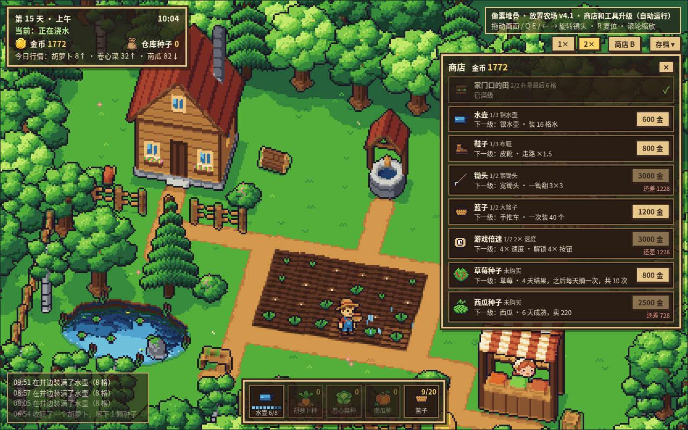

按设计稿的推荐顺序买，大约第 3 天（11 分钟）买第一把水壶，第 11 天左右 24 格全开，20 天累计收入约 4,800–5,700 金（`node tools/econ.js` 用真实游戏跑出来的数字）。

## 大地图和区域（v4.3）
农场四周是森林，四块地用篱笆围着，在商店「区域」一栏买下后篱笆门打开，农夫顺着小路过去干活。没买的区域地面偏暗，门口有一把锁和写着名字、价格的牌子（点牌子打开商店），商店里每块地都有「看看」按钮把镜头移过去。

| 区域 | 位置 | 价格 | 内容 |
|---|---|---|---|
| 林场 | 北边森林 | 800 | 可以砍的树，砍掉的树桩 3 天后长出小树、7 天后长回大树 |
| 东田 | 东边 | 1200 | 24 格新田（开垦前杂草石头多），有自己的水桶 |
| 果园坡 | 西北 | 1500 | 3 棵苹果树，空地可以移植果树 |
| 南坡梯田 | 南边 | 2500 | 24 格新田，有自己的水桶 |

斧头 500 金。砍树和种树是玩家下的指令，农夫有空就去做（指令最多 24 条）：

- **砍树**：买了斧头后，右下角出现「砍树」按钮。点它，再点家门口或已买区域里的野树，树上出现小斧头标记；再点一次取消。农夫砍倒一棵得 5 份木材（进仓库，见下面「木材和房子」）和 1 棵果树苗（苹果 60%、橘子 40%），有时还掉点小东西。果树不能砍。v5.0 起只有林场的树会长回来，别处砍掉的树桩夜里挖走、空地可以移植果树。
- **移植**：有树苗时右下角出现「种苹果 n」「种橘子 n」。点它，再点一块空草地（农场里或已买的区域，不能在田里、路上、房子边、别的树旁或院子杂物上），那里插一面小旗；农夫会去种下并浇水。树苗 5 天后结果。
- **果树**：苹果树每 3 天结 5 个（12 金一个），橘子树每 2 天结 4 个（15 金一个）。熟了农夫自己去摘，和菜一起放篮子卖。
- Esc 或「指令 n ✕」退出模式、取消全部指令。

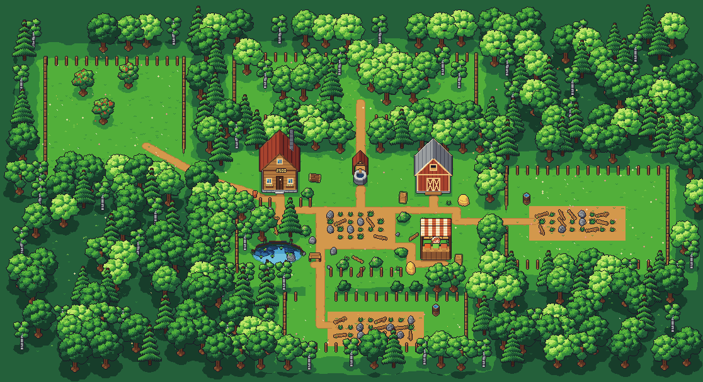
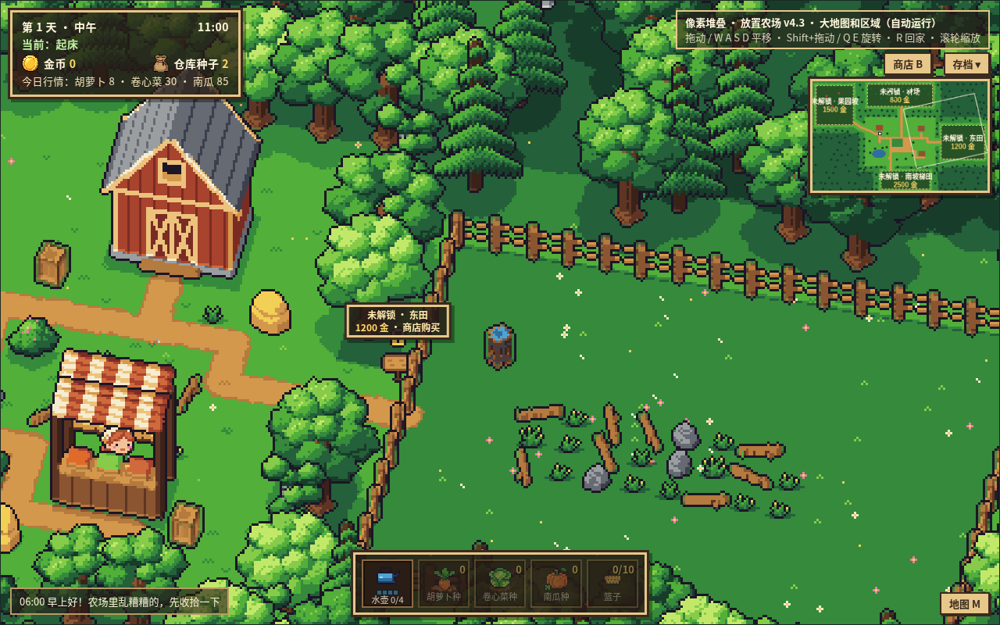


## 外圈：河、桥、山和新地块（v5.5.0）
地图向东西南北各外扩了 12 格（64×50 → 88×74 格）。**原来的坐标一个都没动**，旧存档的田、树、动物和人都在原地，外圈只是加在外面。

- **河**：从西北角沿西边流下来，绕过南边进海。家人和动物过不了河，只能走**石桥**（5500 金 + 30 木材）；桥修好前河对岸的两块地买不了。
- **山**：北边是一道石崖，崖上是山顶高地。**山道**（5000 金 + 20 木材）拆掉路障后才能上去，山顶有两块地。
- **地块**：16 块中小地块（最大的也比原来的区域小），都用篱笆围着、门口有锁和牌子。**阿禾搬来以后**（家里有农夫和阿禾两个人干活）才开放购买，之前牌子上写着「阿禾搬来后开放」。
- **选用途**：点牌子或商店「地块」页里的地块，打开它的页面，按地形选一种用途：

| 用途 | 现在有什么 | 以后（路线图） |
|---|---|---|
| 农田 | 一块新田（20–28 格），带水桶，家人会来开垦 | |
| 牧场 | 围栏草场、小棚子和水槽 | 第 8 阶段盖第二套棚舍 |
| 果园 | 可以用「种树」工具移植果树苗 | |
| 花甸 | 开满野花 | 蜂箱和装饰 |
| 林地 | 一片会长回来的树（最多 10 棵），能砍 | |
| 工坊院 | 平整的院子、木牌、木箱和木头 | 第 8 阶段盖磨坊、果酱铺、奶酪坊 |
| 动力坝 | 河边立起一架水车 | 第 8 阶段通电、转起来 |
| 大道 | 通向东边小镇的路（镇门关着） | 第 10 阶段开放小镇 |
| 乐园 | 滑梯、沙坑（有沙堡）、秋千，不上工的孩子（玩耍阶段、放学后）会自己来玩；另加 800 金 + 40 木材，屋西空地已含在地价里 | |

- **改建**：买下的地可以改成它地形允许的另一种用途，费用是地价的四分之一（取整到 50）+ 10 木材（改成乐园再加设施费）。田里的庄稼按现价卖掉，没熟的退种子钱；林地的树砍成木材（每棵 4 份）。石桥、山道、大道只有一种用途，不能改。
- **放牧草地**：商店「建筑」页，羊圈之后可以买（600 金 + 30 木材，不用买新地）。果园坡西边围出一块草地，白天 8–17 点羊会从果园西边的篱笆口出去吃草，晚上回羊圈。

| 地块 | 地形 | 价格 | 可选用途 |
|---|---|---|---|
| 屋西空地 | 平地 | 2200 + 40 木材 | 乐园（含设施）/ 花甸 |
| 林间空地 | 平地 | 2400 | 农田 / 果园 / 花甸 / 乐园 |
| 西南河湾 | 河边 | 3200 | 农田 / 花甸 / 工坊院 / 动力坝 |
| 西河湾 | 河边 | 3400 | 农田 / 工坊院 / 动力坝 |
| 南河湾 | 河边 | 3800 | 农田 / 工坊院 / 动力坝 |
| 石桥 | 特殊 | 5500 + 30 木材 | — |
| 河对岸·西 | 河对岸 | 3600（要石桥） | 农田 / 牧场 / 果园 / 花甸 / 工坊院 |
| 河对岸·东 | 河对岸 | 4000（要石桥） | 农田 / 牧场 / 花甸 / 工坊院 / 动力坝 |
| 东坡 | 缓坡 | 3500 | 牧场 / 农田 / 果园 / 花甸 |
| 东大道 | 特殊 | 6500 + 30 木材 | — |
| 东南滩 | 平地 | 3000 | 农田 / 花甸 / 工坊院 |
| 北坡·西 | 缓坡 | 2800 | 林地 / 果园 / 牧场 |
| 北坡·东 | 缓坡 | 3000 | 林地 / 果园 / 牧场 |
| 山道 | 特殊 | 5000 + 20 木材 | — |
| 山顶 | 高地 | 4000（要山道） | 果园 / 林地 |
| 高山牧场 | 高地 | 3600（要山道） | 牧场 / 花甸 / 林地 |

规则和数据在 `plots.js`（纯函数，`tools/plots-test.js` 测试），画面在 `expansion.js`，商店里的地块页和地图牌子在 `plots-ui.js`；`game.js` 里只有几处小挂钩。外圈的新模型在开局后分小段预热（每段约 6 ms，间隔至少 50 ms），不会一次性把所有角度算完卡住页面（v5.2.4 的教训）；买一块地只重画它自己那一片地面。

第一次有孩子在乐园玩滑梯、沙坑或秋千时，会点亮成就「童年 DNA 动了」。孩子成家后在新房子旁种自己的小块地、偶尔回主农场帮忙，是第 11 阶段的内容（要先有新房子、派对和镇子）；这一版只在 `plots.js` 里留了接口 `homesteadSites()`：买下后用作花甸或农田的平地，以后可以盖小两口的新房子和 6 格小田。截图可以用 `node tools/expansion-shots.js` 重新生成。

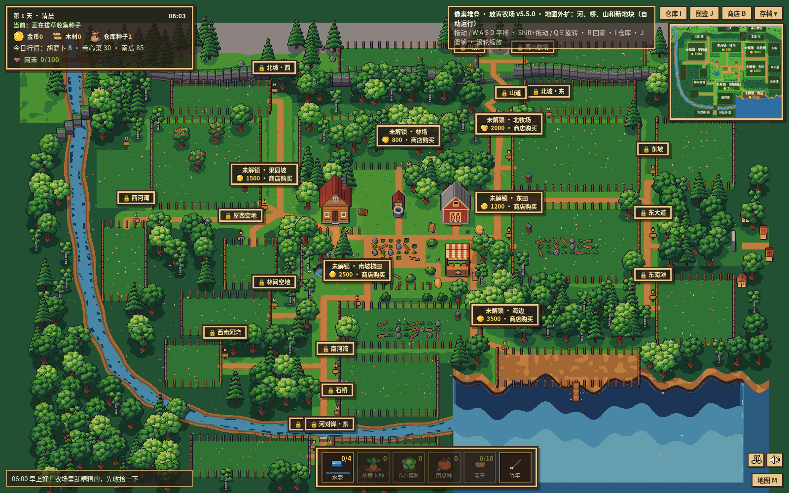
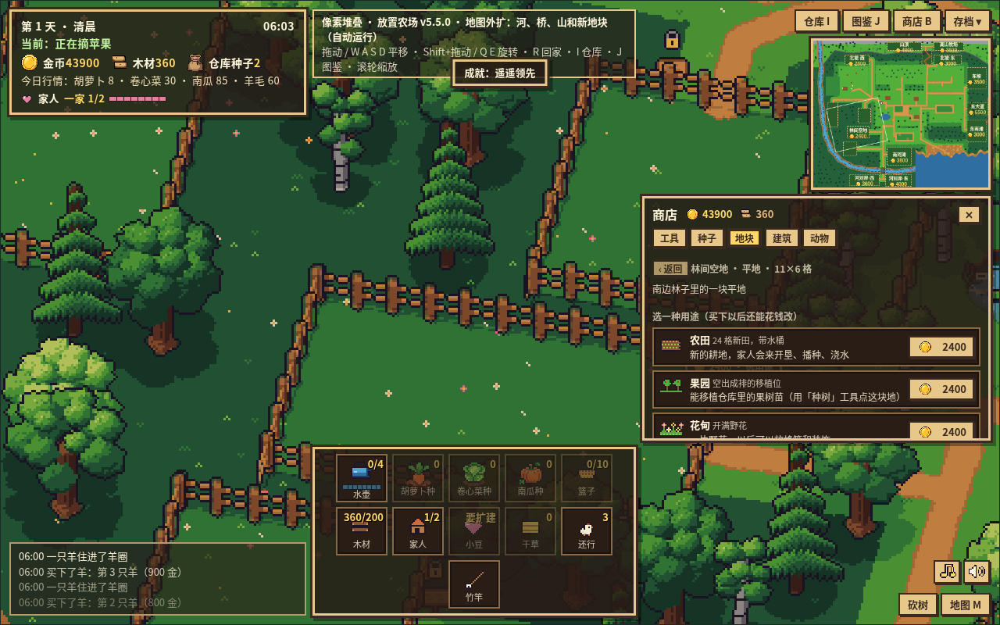
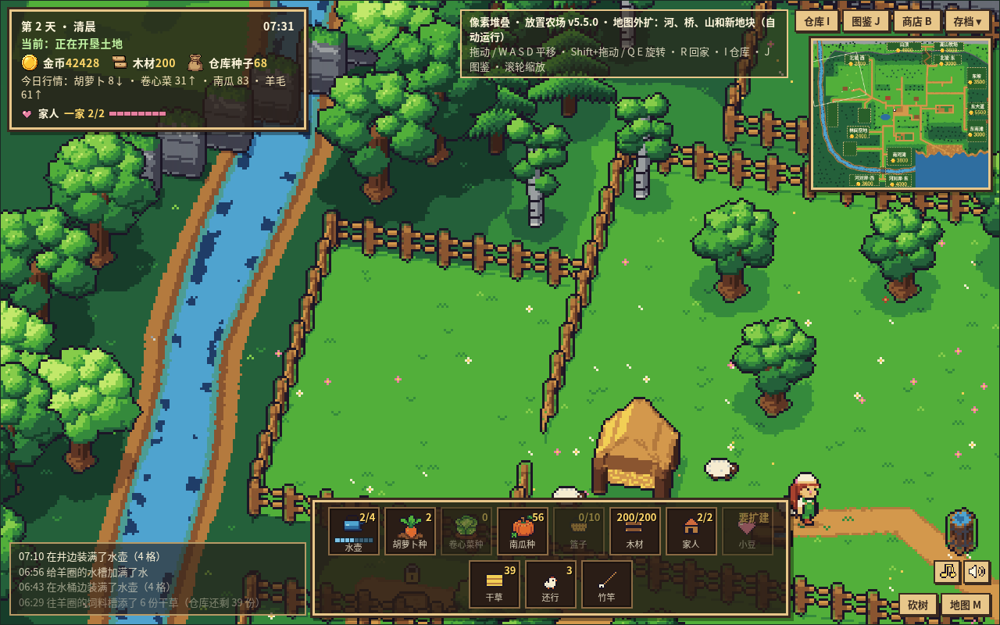
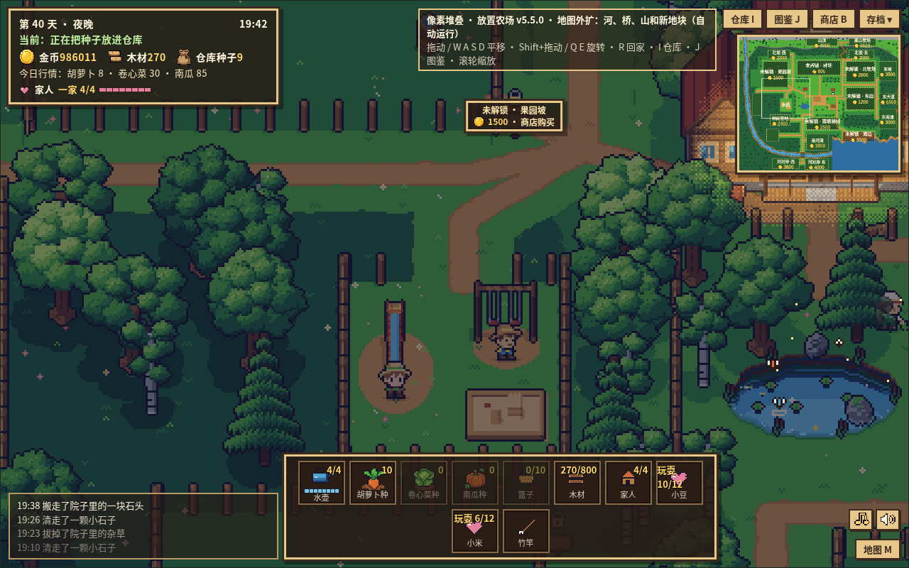


## 第 8 阶段：浇水器、加工坊、水车路灯、蜂箱、第二套棚舍（v5.6.0）
都在商店里买，买完家人自己去做，玩家不用排班。旧存档升上来什么都没有（存档 v11 → v12，只追加字段）。

- **田边浇水器**（商店「工坊」页，800 金 + 20 木材一台，最多 16 台）：买了花洒水壶，或家里有 3 个能干活的人（农夫、阿禾、帮工的孩子）才开放。家人会把它装到田边，家门口的田先装满；每台管它旁边一排 8 格（4 列 × 2 行），这些格子每天自动浇湿，早上会喷一阵水。一块田全被覆盖后，浇水就从任务板上消失。底部工具栏的「挪浇水器」：先点一台，再点田边的新位置（亮起的格子是它浇得到的；不能压在田里，也不能离田太远）。
- **加工坊**（盖在选成「工坊院」的地块里，每块院子 3 座）：磨坊 5000 金 + 120 木材、果酱铺 3500 + 80、奶酪坊 4500 + 100。家人把原料送进去，坊里自己慢慢做，做好的东西冒个小图标，再有人取出来拿去集市卖：
  - 磨坊：2 份小麦 → 1 袋面粉（60 金），每批还给仓库添 2 份饲料。买了磨坊才有**小麦**（2 天熟，种子 4 金）；家人只在磨坊缺麦子时种（地里 + 篮子里 + 坊里不到 10 份）。
  - 果酱铺：2 份草莓 / 苹果 / 橘子 → 1 罐果酱（80 金）。要先有果园并且有果树。
  - 奶酪坊：2 瓶牛奶 → 1 块奶酪（130 金）。要先养至少 1 头牛。
  - 要送去加工的东西不会被顺手卖掉；坊里装满了，多的才拿去卖。
- **水车和路灯**：第一块动力坝上的水车花 1500 金 + 60 木材修好，水车就转起来。修好后家门口、果园坡、每块地的门口和每座加工坊前会立起路灯，水车 400 步以内的天黑就亮，太远的不亮，灯上有个小小的灰色闪电。亮着的灯照到的果树夜里有时多长一天。不用拉线。
- **蜂箱**（800 金 + 20 木材一箱）：第一块「花甸」能放 6 箱；没有花甸时果园坡能放 2 箱。每 2 天攒 1 罐蜂蜜（偶尔 2 罐，一箱最多存 2 罐，不会坏），40 金一罐。白天蜂箱周围有蜜蜂飞，第一箱放下时图鉴「昆虫」页记下蜜蜂。
- **第二套棚舍**（商店「建筑」页）：第二鸡舍 600 + 40、第二猪圈 900 + 50、第二羊圈 1500 + 60、第二牛棚 2500 + 80，盖在第一块选成「牧场」的地块里，四座各占一角，容量和第一套一样。第一套住满后（6 只鸡、3 头猪 / 羊 / 牛），商店才继续卖动物，新来的住进第二套。地块上有加工坊、蜂箱或第二套棚舍时不能改建。
- **边牧赶羊**：有边境牧羊犬、羊圈也有放牧草地时，8 点它把羊赶到草地上，白天在草地边守着，16:40 起把羊赶回圈。中午在草地上的羊当晚心情 +3。没有这只狗时，羊还是按 v5.5.0 那样自己出去吃草。

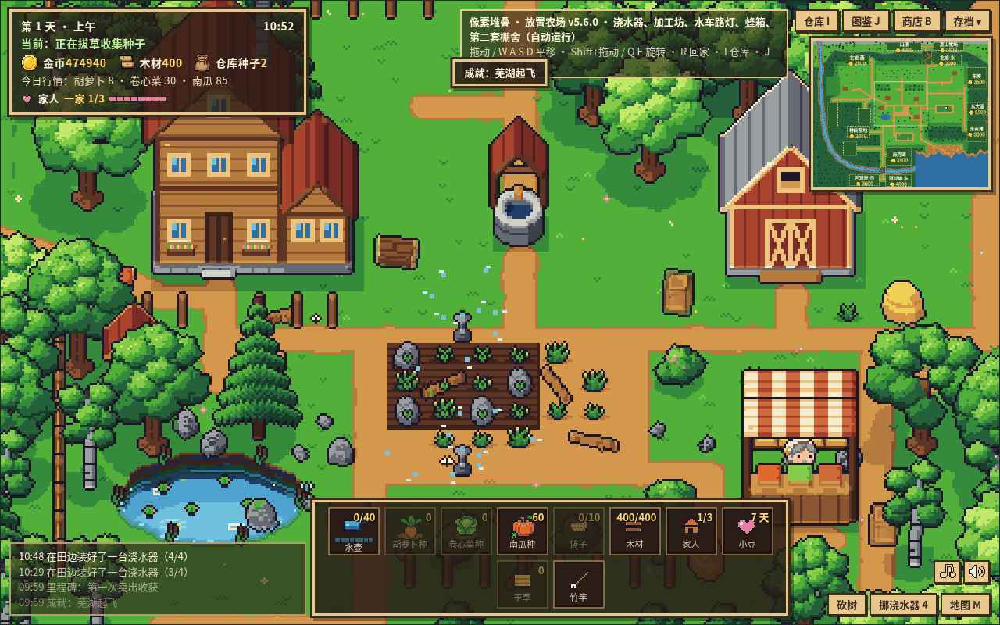
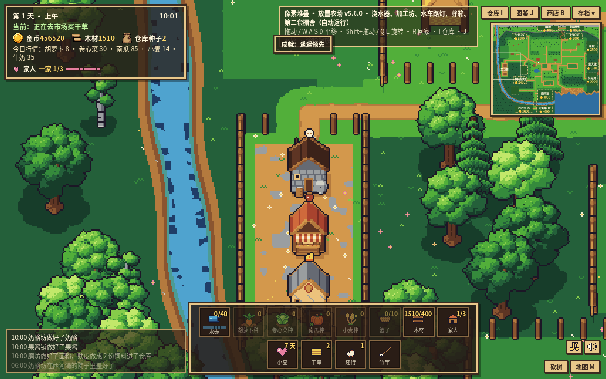
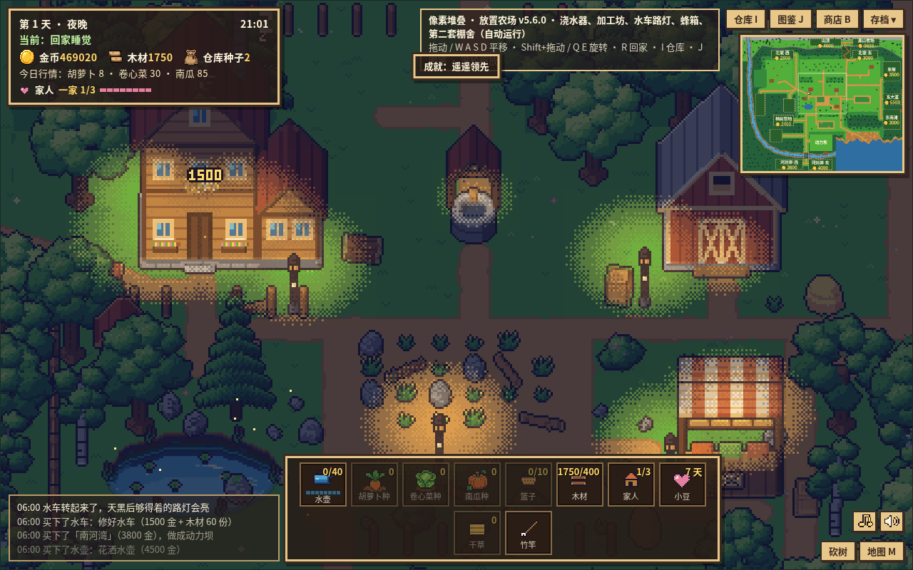
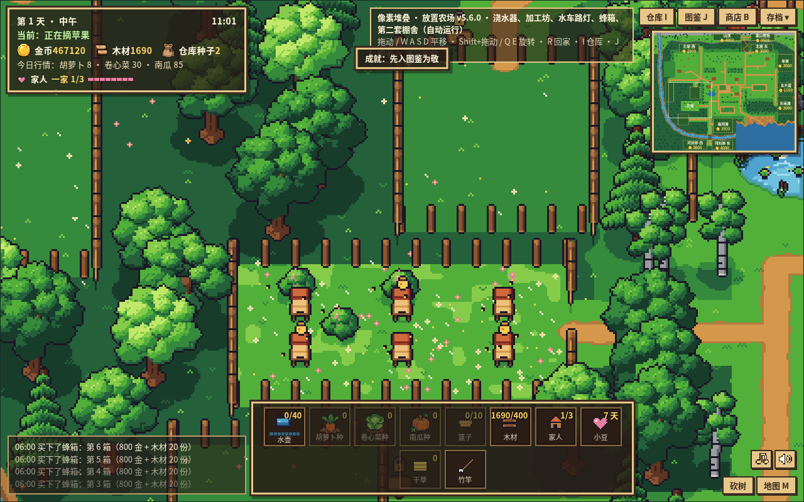
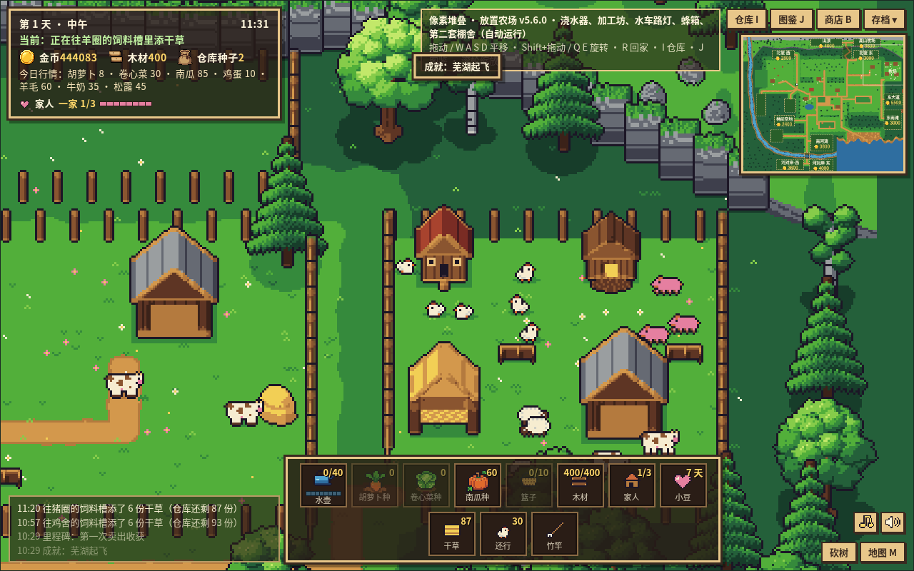
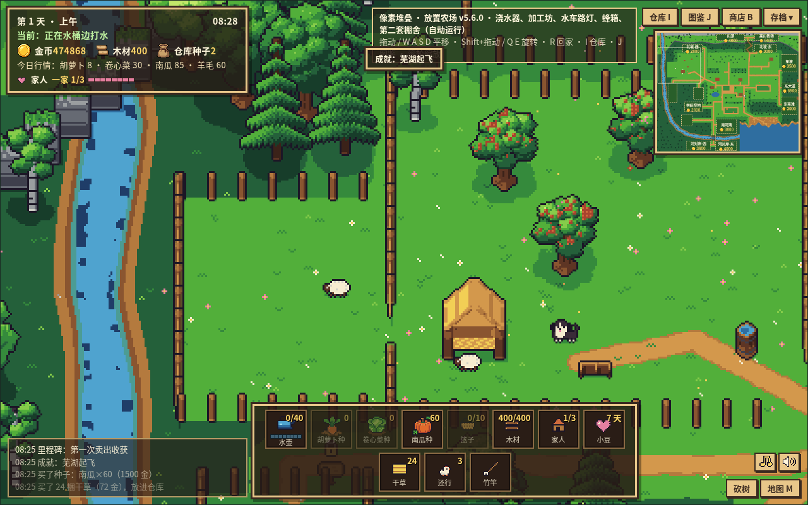

## 第 9 阶段：装饰、夜灯、派对区和挪东西（v5.7.0）
装饰只是好看，不摆也不影响进度。旧存档升上来什么装饰都没有，空地和老房子都在原处（存档 v12 → v13，只追加字段）。

- **商店「装饰」页**（价格固定，买一件进一次仓库）：长椅 300 金 + 10 木材（最多 6）、花盆 150（最多 10）、稻草人 250 + 5（最多 3）、石头水盆 450（最多 3）、路灯 600 + 5（最多 8）、石灯 800（最多 6）、串灯 700 + 10（最多 4）、派对区 2000 + 40（1 个，要等阿禾搬来）。
- **玩出来的装饰**：砍树偶尔刻出木雕小熊或石灯，海钓偶尔捞到贝壳堆或漂流瓶，池塘钓鱼偶尔钓到漂流瓶；第一次收获巨大南瓜 / 卷心菜 / 西瓜各留下一座纪念；图鉴「鱼」页集满得到锦鲤石雕，「昆虫」页集满得到风铃架。都记进图鉴新的「装饰」页。
- **家人自己摆**：仓库里有装饰时，家人白天（18 点前）会一件一件拿出来，摆在房子附近的空草地上（派对区先找乐园地块）。不放在路上、门口、田里、水边、桥上、篱笆和棚子旁边，会挡路的东西放下前先确认每个门口都还走得到。
- **「摆…」和「挪东西」**（底部工具栏）：「摆路灯 2」这样的按钮点一下，再点一块草地，亮绿色就能放，红色的放不了；家人会从仓库搬过去。「挪东西」先点要挪的东西（装饰、派对区、加工坊、蜂箱、浇水器），再点新位置：装饰、蜂箱、浇水器有人扛过去，加工坊和派对区拆了在新地方重搭。加工坊只能在它所在的工坊院里挪，蜂箱只能在它所在的花甸（或果园坡）里挪，别处的框是红的。老房子、田、棚舍、水车边的路灯和伐木小屋留在原地。搬到一半存档时，东西留在原处。
- **夜灯**：路灯、石灯、串灯白天是摆设；修好水车以后，在电网范围里的灯天黑就亮，照到的果树和第 8 阶段的路灯一样夜里有时多长一天。没有电就不亮。第一盏接电的灯亮起来时达成成就「今晚月色真美」。
- **派对**：派对区搭好后的第一个傍晚一定会办一场，之后至少隔 4 天、每天 12% 的机会（阿禾搬来或孩子出生每满 28 天的那天 45%）。17:30 一家人走过去围着长桌坐下，有时镇上的木匠阿松、面包师小桃从东边的路走来做客，20:30 散场（会晚睡一会儿）。下雨就改到下回。不用点确认，看着就好。第一次办成时达成成就「我家大门常打开」。
- 第 8 阶段写着「以后」的成就（浇水器、夜灯、边牧赶羊、派对）现在都能达成了。

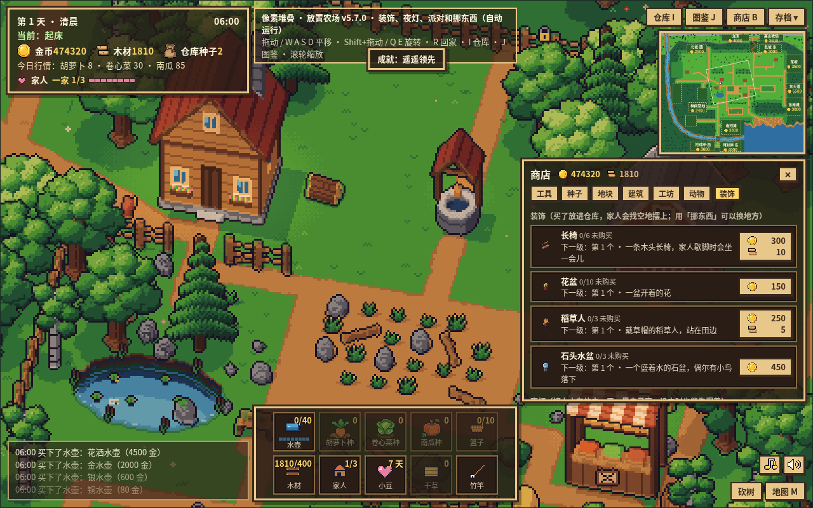
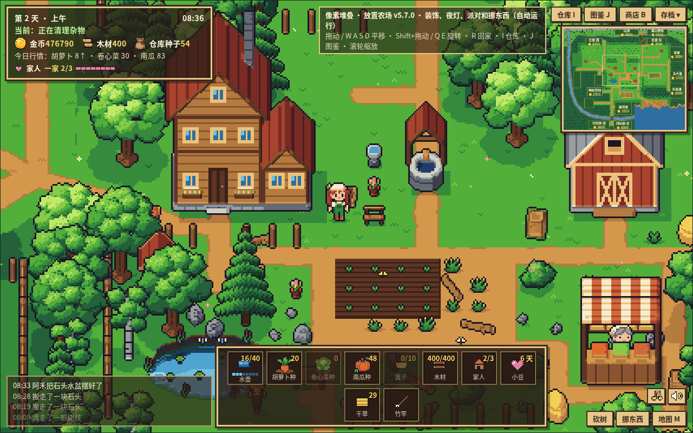
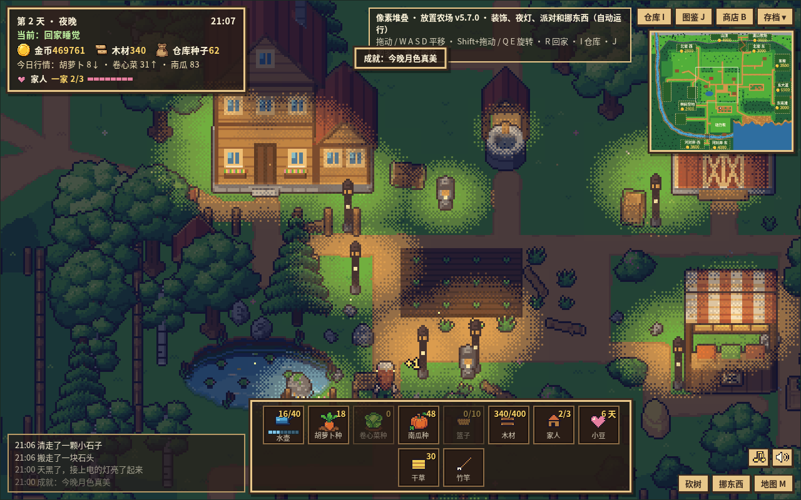
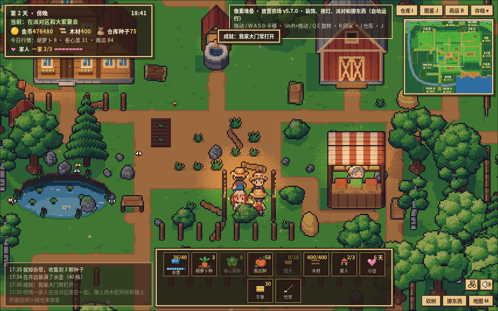
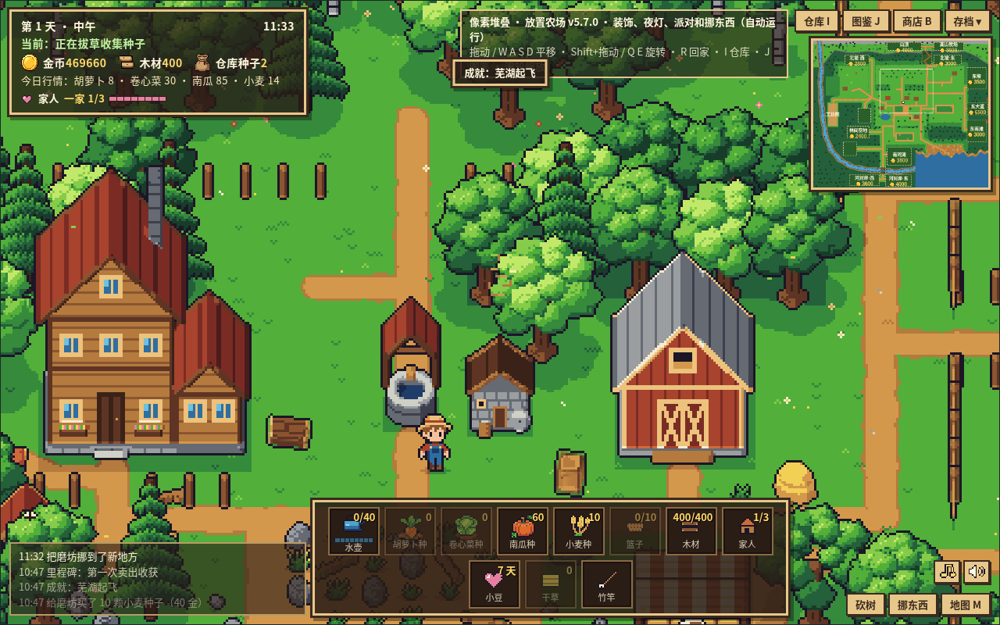

## 第 10 阶段：上学、同学和隔壁镇子（v5.8.0）
地图往东多了 24 格（x 448..640），东大道尽头的镇门后面就是镇子；旧地图上的东西一样也没挪，原来的树和地面花纹照旧（存档 v13 → v14，只追加 `town` 和商店的 `town` 一级）。

- **上学不等镇子**：孩子进入上学期（帮工期上午也去）的早上 8 点左右出门，14 点放学往回走。还没买东坡时走到东边路口出画；有东坡没买东大道时走到原来的地图东缘；东大道买成「大道」以后沿大路走到镇门；镇子买下后穿过镇门，走进学校门口。每天出门时记一个上学日，旧档从今天开始算。
- **请假**：下雨的日子大约 40%、晚上家里办派对的日子大约 30% 会请假在家玩，每天每个孩子只决定一次，写进日志，不扣任何东西。
- **同学来玩**：上满 6 个上学日之后，放学时 25% 的机会带一位同学回家（两次之间至少隔 3 天，雨天和派对日不来）。同学先去乐园（有的话），再看看动物、小狗小猫、池塘，16 点动身回家，天黑前离开农场。镇子没买时是不认识的「同学」，买了以后是阿团、朵朵、石头（和派对来客共用镇上这套人）。
- **隔壁镇子**：商店「土地」页的「隔壁镇子」，12,000 金 + 60 木材；要先把东大道买成「大道」，并且孩子上过一天学。买下后镇门打开（换成敞开的门柱和招牌），镇里有学校、镇上小店、几户人家、小广场和喷泉、路灯和长椅。东大道选成大道后，挡在大路上的林子会让开，去镇上的路一眼能看通。
- **邻居**：周婶白天守在小店门口，林老师上课时间站在校门口、下午去广场，木匠阿松和面包师小桃按自己的钟点在广场、街上和小店之间走动，下班就回家，屋里看不见。
- **镇上小店**：镇子开着时，大人（不是孩子）筐里攒到 3 件以上（v5.9.1 起 2 件）的面粉、果酱、奶酪、蜂蜜或鱼（v5.9.1 起还有鸡蛋、羊毛、牛奶、松露、苹果和橘子），就在 9–16 点专门走一趟镇上，比集市多给两成；15:30 以后没送去的照常在集市卖。
- **上学的样子**（v5.8.1）：孩子去上学和放学回来的路上摘下草帽、露出头发，背一个红书包，手里不拿篮子、大作物或要摆的装饰（东西还在筐里）；回到农场草帽戴回去。孩子在农场挎的小篮子也挪到了孩子的腰边（以前按大人的身高画，看起来像举在帽檐旁边）。上学的样子由 `tools/build_family.py` 一起生成。
- **派对来客**：镇子开着时，阿松和小桃在派对那天 16 点从自己家出门，沿大路走来，17:30 前后到；散场后走回镇上的家。那天他们不再同时出现在镇上。

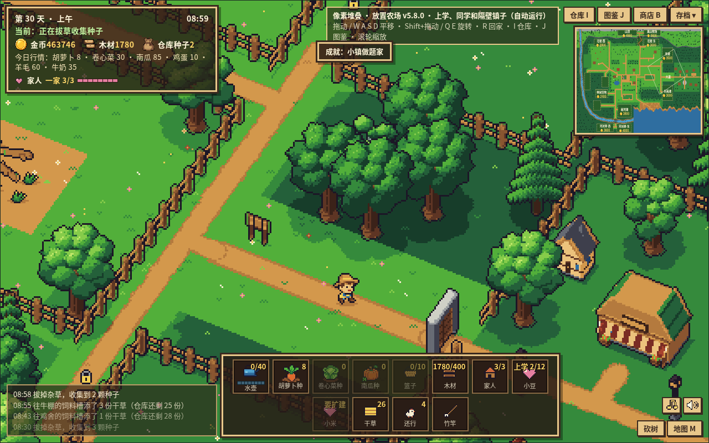
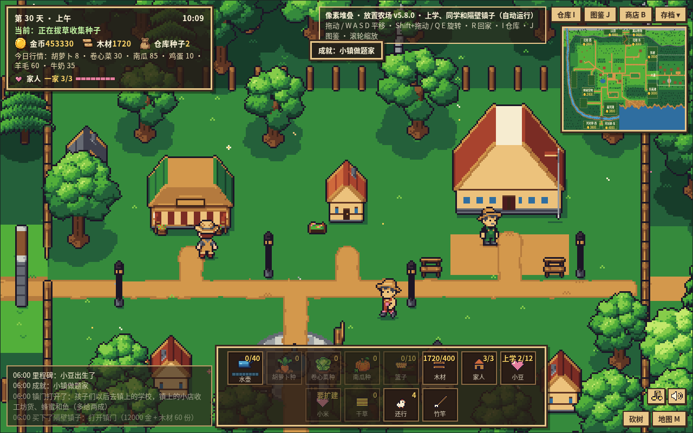
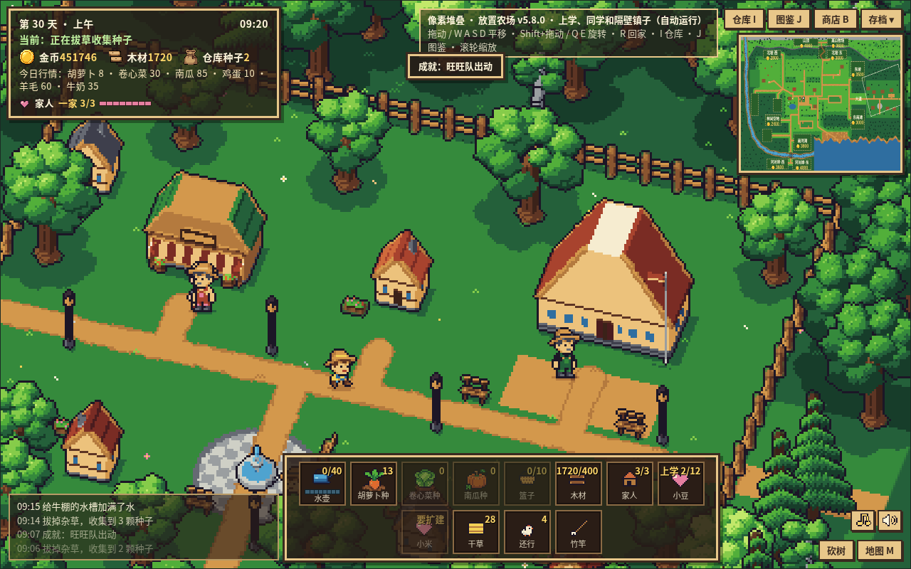
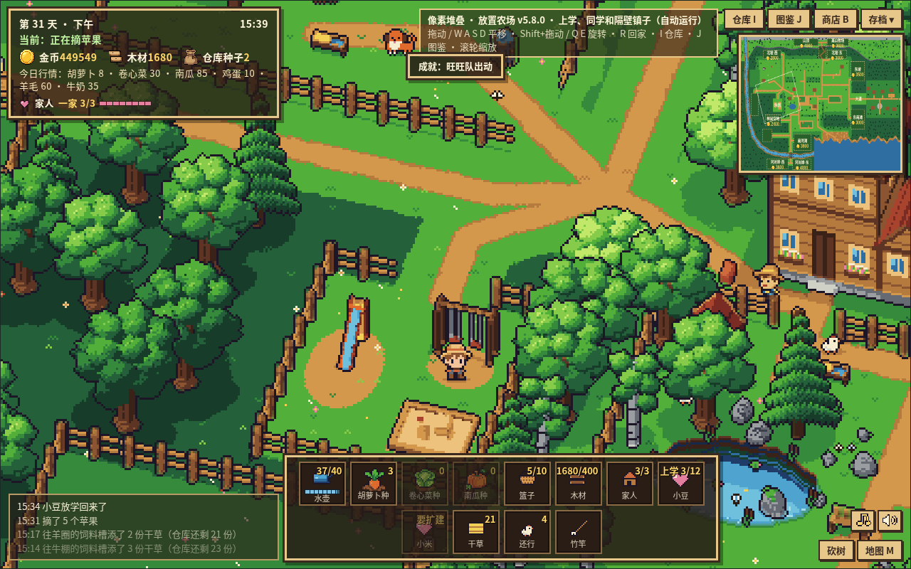
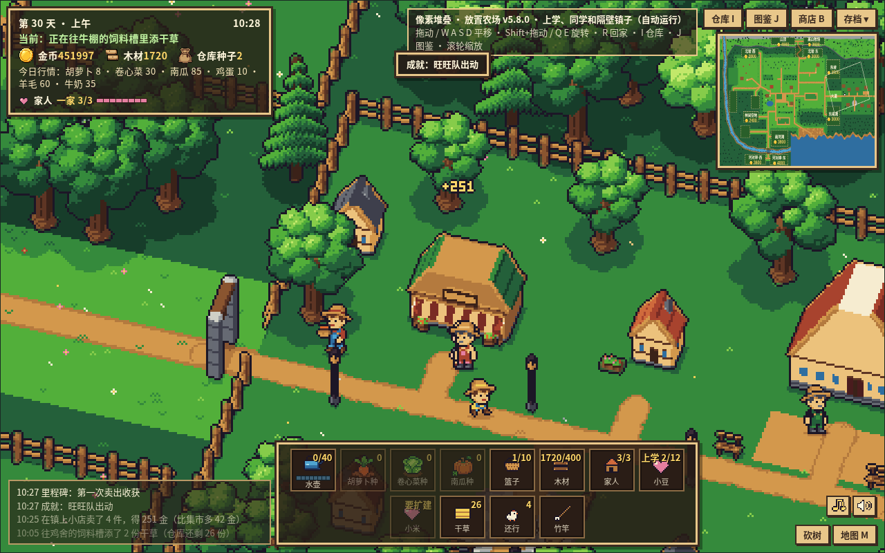
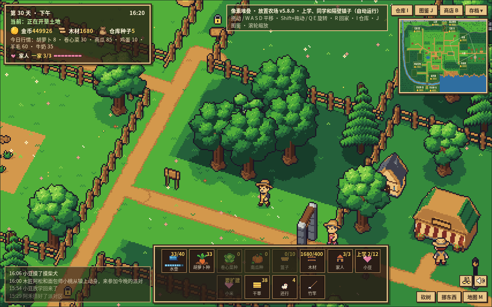

## 第 11 阶段：好感、新房子和成家（v5.9.0）
存档 v14 → v15，只追加 `home`（新房子、好感、婚事）和商店的 `cottage` 一级；旧档迁上来没有新房子、谁也没成家。

- **好感只会慢慢涨，不用管**：每个孩子对三位同学（阿团、朵朵、石头）各有 0–100。每个上学日每人 +1，当天的同桌再 +2；同学来家里玩 +5；不上学的少年每天和最要好的那位 +1，好感到 40 以后派对那天对方也会来（+4）。镇上的人对全家：林老师每个上学日 +1（镇子开着时），周婶每趟镇上小店 +2，派对来客 +3，婚礼那天大家各 +2。等级：1 认识、20 熟悉、50 要好、80 走得很近。点左上角的心条就能看到每个孩子的前三位同学和镇上的人，家人格子里也写着「小豆和朵朵要好（62）」。没有送礼，也没有要点的按钮。
- **新房子**：商店「建筑」页，第一座 5,000 金 + 200 木材，第二座 6,500 金 + 240 木材（两个孩子各一座）。要阿禾已经搬来，并且有一块买下的「花甸」或「农田」放得下（林间空地、西南 / 东南的河对岸、东坡、东岸都行；农田只有东坡和东岸够大）。家人走过去花 40 分钟搭起来（先是木架，再是木屋：石头地基、原木墙、绿门、花箱和烟囱，比老房子小一号），旁边留出 6 格小田、一个小鸡舍和一条长椅；花甸里原来的野灌木会让开，挡路的蜂箱挪到旁边。有房子的那块地不能改建。和别的东西一样，工具栏「挪东西」点新房子、再点另一块空着的花甸 / 农田，家人就会把它拆了重新搭过去（小田和田里的菜一起搬）。
- **成家**：孩子到了少年期，和还没成家的某位同学好感到 80，又有一座空着的新房子，早上就会定下来「今晚办婚礼」（不下雨、离上一场至少 3 天）。17:30 对方从镇上（镇子没买就从东边的路上）走来，有派对区就在派对区办，没有就在新房子门前，一家人都过去；20:30 小两口住进新房子。两个孩子不会娶同一个人。
- **小两口的日子**：他们自己照看那 6 格小田（卷心菜、南瓜、胡萝卜，种子自家留的，不花钱）和两只鸡，收的菜按今日行情、鸡蛋每天一次，直接算进家里的收入（傍晚日志会写今天挣了多少，大约每天几十到两三百金）；下雨不用浇。晚上回新房子睡，窗户会亮。大约每两天里有一天，孩子会在 9–16 点回主农场帮一小时（主农场的活堆起来时同一天再来一次，一天最多两次），帮完回自己家。

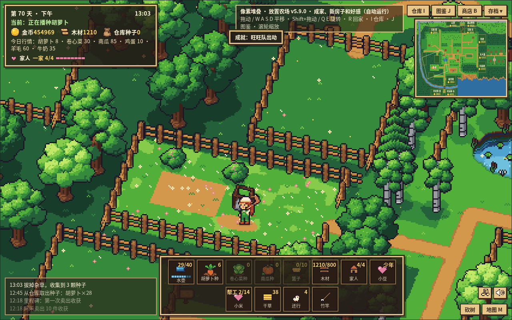
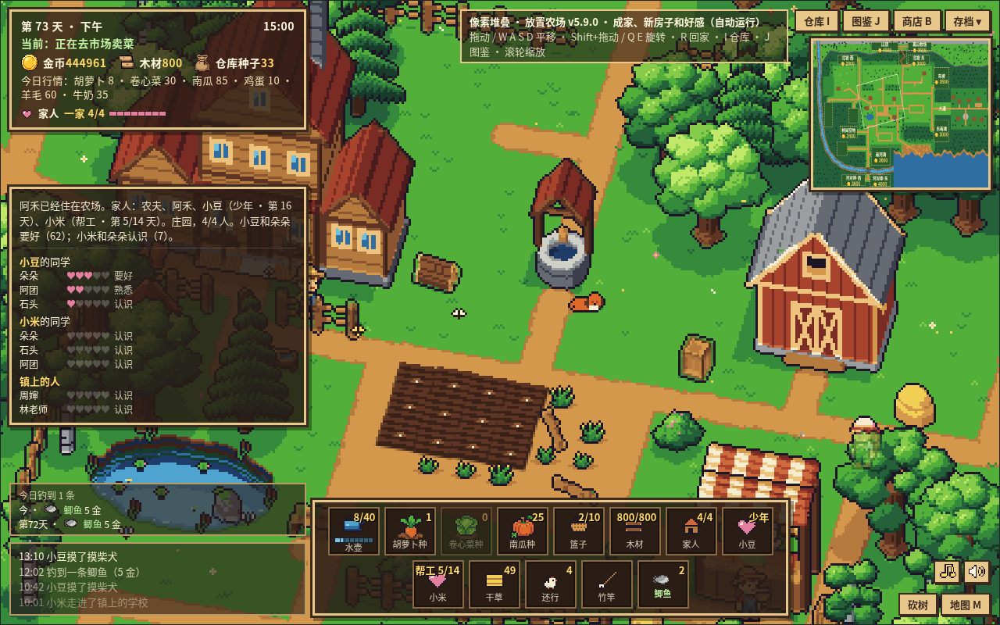
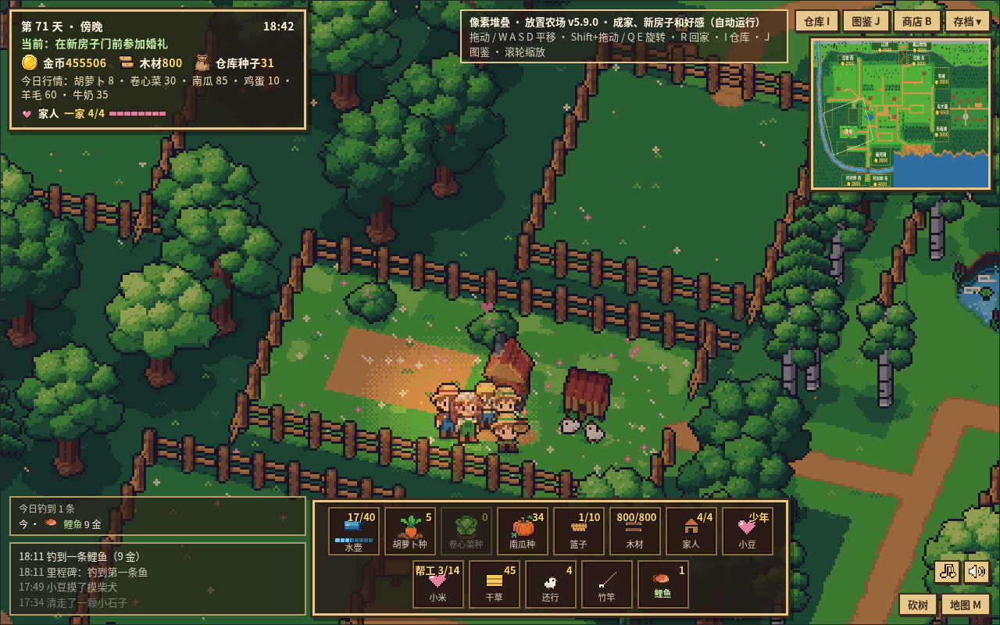
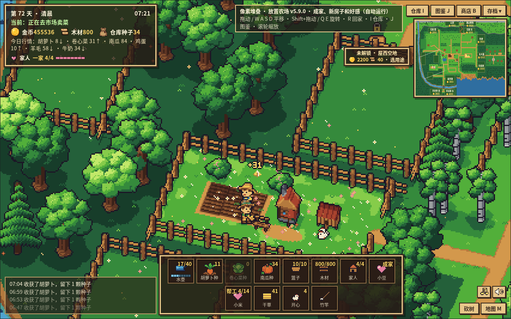
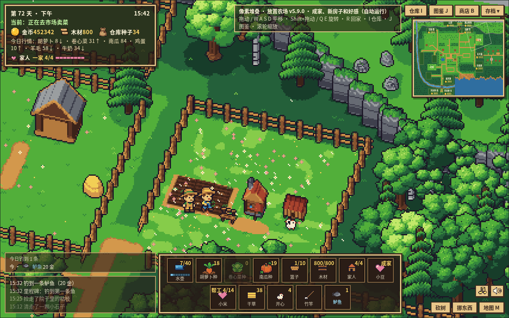
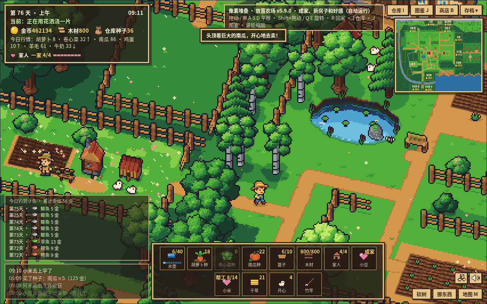
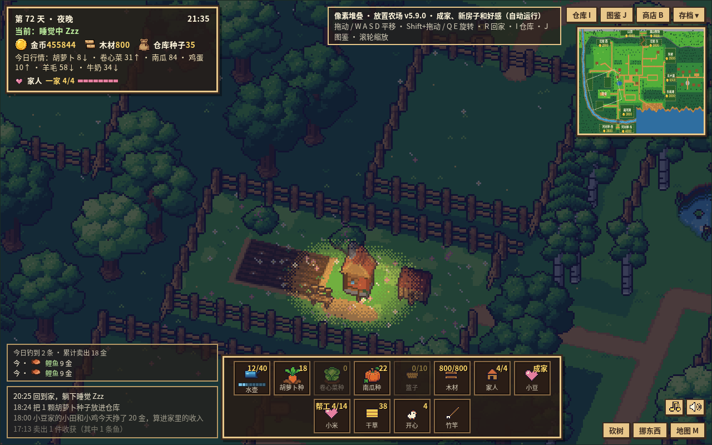

## v5.9.1 打磨（不加新内容，存档仍是 v15）
按玩家第 82 天的真实存档找出来的问题，计划见 [docs/town-enrichment-plan.md](docs/town-enrichment-plan.md) 第 1 节。

- **夜里灯多不再卡**：夜间光照层只在灯或天色变化时重算，镜头不动就直接复用；每盏灯只算自己那一块，屏幕外的灯不算。同一份 19 盏灯的存档，主屋前 21 点一帧从约 85 ms 降到约 3.5 ms（无头浏览器；平移镜头时约 5 ms）。`tools/night-bench.js` 可以复测。
- **工具栏只有一行**：贴着屏幕底边横排，东西多了可以左右滑动，不再在画面中间堆成一大块；手里没有的种子不占格子（胡萝卜种子例外，始终显示）。右下角的砍树、种树、摆放、挪东西、地图和声音按钮放在工具栏上方。
- **离开不到 10 分钟不弹「欢迎回来」**：离线收益照算，只在日志里写一行；离线收益规则不变。
- **惊喜不刷屏**：同一天同一种惊喜只占日志一行，后面的改写成「今天捡到 3 颗双黄蛋」；冒泡和提示音每种每天只有第一次。双黄蛋的概率减半（6% → 3%）。
- **树苗没地方种时说清楚**：「种苹果 / 种橘子」按钮会写「（没地方了）」，点了直接说明原因（树之间要隔开，田里、路上、房子和棚子旁边不能种；砍几棵野树或买新地块就有地方了），不会进入点选模式。
- **镇上小店收得更多**：多了鸡蛋、羊毛、牛奶、松露、苹果和橘子，筐里有 2 件就跑一趟（原来是 3 件）。
- **镇子夜里有灯**：17:30 以后镇上的路灯亮起（到第二天 6:30），住家的窗户亮到 22:30，小店亮到 19:00；周婶 18:30、林老师 18:00 起在广场坐着，20:30 回家。
- **商店里「新房子」那张卡片不再挤成一列**：还没有花甸 / 农田时，那句很长的提示把名字那一栏挤到只剩一个字宽；现在提示在价格下面换行，名字和说明照常排；新房子也挪到木篱笆后面，「房子」的小标题不再出现两次。
- **商店随进度慢慢展开**：只显示现在买得起或差钱就能买的东西，再加上往后两步能解锁的条目（锁着，写明差什么：先买哪样、阿禾搬来、买下哪种地块、孩子上学，或价钱远超现在的收入时算多一步）；更远的先藏起来，那一页底下有一行淡淡的「更多内容随进度解锁」。已经买过、或者现在就能买的东西从不隐藏；前置条件都满足、价钱在 max(1000, 最近 3 天平均日入 × 10) 以内的也一直显示，攒下的钱总有地方花。新开局商店少了 13 项（牛、新房子、加工坊、镇子……），第 59 天的存档和后期存档看起来和以前一样。`node tools/polish-shots.js` 会检查这两种情况。
- 检查脚本：`tools/polish-shots.js`（CI 会跑；本地设 `PF_REAL_SAVE=存档文件` 还会顺带读一份真实存档，存档本身不进仓库）。

## v5.10.0 镇公所和第一批二层房（存档仍是 v15，只在 `town` 里追加 `hall`）
小镇扩建的第一步，计划见 [docs/town-enrichment-plan.md](docs/town-enrichment-plan.md) 第 2–4 节。

- **镇公所和告示板**：镇子买下后，小店东边就是镇公所（石基、门前两根柱子、山墙上有钟、屋脊上插着小旗），门前立着告示板。点告示板（或镇公所的门），或者在商店里点新的「镇公所」页，就能看到告示板。镇子没买时这一页不出现。
- **繁荣度**：镇子从繁荣度 1（小镇）开始，告示板上写着还要盖几座才升级。这一版能升到 2（热闹的小镇），后面的版本（集市、面包房、木工坊和铁匠铺）会接着用它解锁。
- **第一批建设项目：三座二层房**，每座 8,000 金 + 120 木材：木构二层小楼（带阳台和晾衣绳）、砖石二层房（阁楼窗和高烟囱）、下店上住的街边铺子（一楼花店橱窗和遮阳棚）。一次盖一座：付了钱木匠阿松就搭起脚手架，白天在工地干活，第二天一早房子盖好，新邻居一家搬进来。离线好几天也照样盖好。三座都盖好，繁荣度升到 2。
- **新邻居**：镇长老顾（住原来那座空民居，白天在镇公所门口，傍晚去广场）从开镇那天就在；裁缝阿梅、邮差阿川、花匠秋姨各跟着自己的房子搬来，按钟点在广场、主街、告示板前和花店门口走动。镇上邻居从 4 人加到 8 人。
- **街景小物第一批**：镇公所门口的红邮筒、小店旁的手推车和一摞货箱、广场边的遮阳伞；南边一棵挡住新房子的树挪走了。
- **送给镇上**：仓库里或院子里多余的装饰（派对区除外），在告示板上点「送给镇上」就会摆到主街两边（最多 12 件）。从院子里送走的那件会从院子里拿掉，院子不再挤。送去的路灯、石灯、串灯不用接水车的电，天一黑就亮；新房子和镇公所的窗户傍晚也会亮。
- **镇子小报**：开镇后每 7 天，日志里会出一段小报，写这周盖好了什么、农场送了几件装饰、镇上小店多付了多少钱、现在住着几位邻居和繁荣度。
- **存档**：不升版本，只在 `town` 里追加 `hall`（盖好的房子和日期、正在盖的、送来的装饰、小报的日子），旧存档读进来是空的；所有 fixture（含第 59 天和第 72 天的存档）都测过。
- 检查脚本：`node tools/hall-test.js`（规则和存档）、`node tools/hall-shots.js`（截图 `v5100_*.png`；本地设 `PF_REAL_SAVE=存档文件` 会顺带读一份真实存档，存档本身不进仓库）。CI 两个都跑。

## v5.10.1 经济更新：离线结算上限和「家人帮忙添置」（存档仍是 v15，只追加字段）
设计和实测见 [docs/economy-rebalance.md](docs/economy-rebalance.md) 6.6、6.7 节。

- **离线收益每 24 小时最多结算 3 天**：还是按在线 50% 的速度、单次最多 3 天；新加的是「过去 24 小时（真实时间）里一共最多 3 天」。存档里追加 `offline.win`，记下最近每次结算的时间和天数（最多 12 条）。窗口没满时照旧；只剩一部分时，欢迎回来弹窗写「过去 24 小时已经结算过 X 天，这次按 Y 天算」，下面一行小字说什么时候再满；已经领满时不弹窗，只在日志里写一句。
- **电脑时钟往回调**：存档时间比现在晚一分钟以上，这次不算离线收益，日志里说一声；窗口里「未来」的记录按现在算，所以来回调钟最多也只能拿一个 24 小时的 3 天。
- **「家人帮忙添置」**：商店顶上的开关，默认关，存在 `settings.autoBuy`。打开后，农夫或阿禾（孩子不会）在小摊卖完东西后，每个游戏日最多替你买一样基础的东西，按固定顺序：田 ×3、水壶、鞋子、锄头、篮子、鸡舍、鸡 ×6、水壶 2、鞋子 2、草莓、篮子 2（一共 18 步，6,210 金，不用木材）。手里要有价格的 3 倍，买完还要留下 max(300, 最近 3 天日均 ×2)，种子钱一定够；商店还没显示出来的东西（渐进商店）会等。装饰、地块、建筑、镇公所的项目和送给镇上的东西都不会碰。第一次买会在日志里提示在哪关掉。
- **检查脚本**：`node tools/econ-test.js`（窗口、时钟回调、自动添置的规则、旧存档追加字段）、`node tools/econ-shots.js`（截图 `v5101_*.png`；本地设 `PF_REAL_SAVE=存档文件` 会顺带读一份真实存档，存档本身不进仓库）；`node tools/econ-curve.js 90 idle-auto` 跑「完全不点、只开家人帮忙添置」的玩家。

## v5.10.2 只有一种速度（存档仍是 v15，只追加字段）
- **去掉了 2× / 4× 游戏倍速**：商店里不再有「游戏倍速」，右上角也没有倍速按钮，大家都按同一个速度过日子。农夫睡觉时夜里快进（6 倍）照旧。原因见 [docs/economy-rebalance.md](docs/economy-rebalance.md) 第 9 节：一位新玩家开着 4× 一个晚上（6 小时）就玩到了第 73 天，内容全按游戏日解锁，倍速让整个游戏缩成了几个小时。
- **买过倍速的存档退钱**：第一次读档时退回买倍速花的钱（只买了 2× 退 600，买到 4× 退 3,600），日志里写「游戏倍速已取消……退回 X 金」。存档里追加 `settings.speedRefund` 记下退了多少，所以只退一次；旧的 `upgrades.speed` 读进来后清零，`settings.speed` 一律写 1。
- **短暂离开不占离线额度**：离开不到 5 分钟，或者这次离线收益不到 100 金，照常结算，但不算进「每 24 小时最多 3 天」的额度。之前新开局第一天切几次标签页（每次只值几十金）就会把 24 小时的 3 天用完。
- **按 1× 算的实时时长**（开着页面、不算离线，`node tools/econ-curve.js 90 casual`）：第 30 天约 2.7 小时，第 60 天约 5.3 小时，第 90 天约 8.0 小时（每个游戏日约 5.3 分钟）。
- 检查：`node tools/save-test.js`、`node tools/econ-test.js`（退款金额、短暂离开不进窗口）、`node tools/save-smoke.js`（买过 4× 的存档退 3,600 且只退一次、商店和界面里没有倍速）。

## v5.10.3 集市、院子小花销、装饰摆整齐（存档仍是 v15，只追加字段）
设计见 [docs/town-enrichment-plan.md](docs/town-enrichment-plan.md) 第 4 节和 [docs/economy-rebalance.md](docs/economy-rebalance.md) 6.2 节。

- **集市广场**（镇公所的新项目，30,000 金 + 200 木材，繁荣度 2，规则在 `market.js`）：盖好后广场变大，摆上 6 个摊位（自家一个，周婶、小桃、秋姨、阿梅各一个，还有一个外地货郎）。之后每 7 天一次集市日（7:00–16:00）：大人一早推车把篮子里的东西拉到广场卖，比自家小摊多卖 15%，当天的「抢手货」（作物 / 水果 / 动物产品 / 鱼 / 加工品里轮一种）多卖 30%；邻居守着自己的摊子，广场上有货郎和逛集的人。集市日镇上小店不开门。告示板上的集市卡片写着下一次是哪天、抢手货和累计多卖了多少；默认全自动，点「我来挑」以后可以按类决定带哪些货去。离线结算不按集市算（和以前一样）。存档追加 `town.hall.market`。
- **院子小花销**（商店新的「院子」页，规则在 `yard.js`，模型在 `yard-art.js`）：院子 9 样（石子小路 40/段 ×20、信箱 120、晾衣绳 150、门前花坛 200 ×4、菜园小栅栏 30 + 1 木 ×20、窗花和窗帘 180、门口灯笼 260、屋顶换色 300 / 以后 100、石板路 150 + 2 木 ×20），阿禾小摊 4 样（遮阳棚 300、新秤 200、木招牌 400 + 10 木、花瓶 120），动物照护 5 样（鸡舍稻草垫 200、猫窝 150 ×3、狗屋 250 ×3、刷子 300、盐砖 400 ×3）。买了以后家人自己走过去装，每样都有固定的位置，不占装饰的摆位。效果都很小：铺好的路上走路快 5%（石板 10%）；小摊三样各让收购价 +2%；遮阳棚和花瓶给阿禾好感 +5 / +3（一次）；围满栅栏后家门口的田夜里长杂物的机会减半；每个花坛让蜂箱多一罐蜜的机会 +2%；稻草垫让鸡每晚心情 +3，盐砖让那一棚每晚 +2，刷子每天给一只动物 +2；猫回窝睡、狗晚上回狗屋，白天常趴在狗屋门口；信箱早上偶尔有一封信；晴天屋后晾衣服；灯笼不用水车的电，天黑就亮。「家人帮忙添置」不会买这些。存档追加 `homeyard`（没装任何东西时不写）。
- **装饰摆整齐**（`slots.js`）：家人摆装饰不再随便找空地。每种装饰在家里院子、新房子、镇上各有一串固定位置：路灯沿小路和篱笆等距排开，花盆在门口、窗下和花坛边，长椅和别的装饰放在几个角落；不压田、路和动物圈。位置用完就放进仓库（仓库上限 20 → 80）。旧存档读入后会把已经摆着的装饰按新位置重新摆一次（数量不变，放不下的进仓库），存档追加 `settings.decorLayout`。送给镇上的礼物也按种类摆到街上的固定位置。
- **检查**：`node tools/market-test.js`、`node tools/slots-test.js`、`node tools/yard-test.js`、`node tools/market-shots.js`（截图 `v5103_*.png`）。
- **经济曲线**（`node tools/econ-curve.js 90 casual|growth|idle`，1×，详见 `docs/economy-rebalance.md` 第 7 节）：不买院子东西的「只买生产类」「完全不点」和 v5.10.2 一样（在脚本自己的波动范围里）。「随手买」第 1–30 天手里的钱和以前差不多（平均几十到几百金），这段时间在院子上多花约 3,000，到第 60 天花完 10,330；因为钱从生产类挪到了院子，第 60 天累计收入低约 23%，第 81–90 天日入低约 13%。


## v5.10.4 面包房 + 订单板（存档仍是 v15，只追加字段）
设计见 [docs/town-enrichment-plan.md](docs/town-enrichment-plan.md) 第 3 节和第 4 节。

- **小桃的面包房**（镇公所的新项目，25,000 金 + 150 木材，繁荣度 2，规则在 `bakery.js`）：盖在南街 L6 地块（L5 和广场之间）。盖好后小桃白天在店里忙（集市日她仍守自己的摊位）。告示板和店门口的订单板上，每天给出 2 个订单（例如「6 份面粉 + 4 个鸡蛋」），按单交货比平时多付 50%，并增加和小桃的好感。默认全自动：家人接更能赚钱、而且家里有原料的那一单，跑腿送到店门口；点「我来挑」可以自己选一单，今天不点也照常自动。不接没有惩罚。离线的日子不算订单（离线收益规则不变）。五座建设项目（三座二层房、集市、面包房）盖齐后，镇子繁荣度升到 3。存档追加 `town.hall.bakery`。
- **灯的间距**：菜地下沿和阿禾小摊旁边的路灯位拉宽了一些（灯的数量不变，放不下的仍进仓库）。已经整理过一次的旧存档会再摆一次（`settings.decorLayout` 从 1 升到 2）。
- **检查**：`node tools/bakery-test.js`、`node tools/bakery-shots.js`（截图 `v5104_*.png`）。本地可设 `PF_REAL_SAVE` / `PF_FRIEND_SAVE` 顺带读真实存档（不要提交）。
- **经济曲线**（`node tools/econ-curve.js 90`）：见 `docs/economy-rebalance.md` 第 7 节。随手买的脚本玩家 90 天里通常还盖不起镇公所的项目，主曲线和 v5.10.3 在噪声范围内接近；面包房一旦盖好，接满更划算的那一单每天平均多付约 185 金（净增量），大约是后期日入的 4%，能补回院子小花销造成的约 13% 后期日入下降里的一小部分。


## v5.10.5 木工坊 + 铁匠铺（存档仍是 v15，只追加字段）
设计见 [docs/town-enrichment-plan.md](docs/town-enrichment-plan.md) 第 3 节和第 4 节。

- **阿松的木工坊**（镇公所的新项目，20,000 金 + 300 木材，繁荣度 3，规则在 `woodshop.js`）：盖在阿松家南边。盖好后仓库木材上限加 400（庄园 800 → 1,200），阿松白天在坊里忙（镇上有项目要盖时，他仍先去工地）。木头多过预留的 400 时，他会每天用 40 份做成一张长椅，优先摆到街上，街上满了就放进仓库；告示板上可以改成「先留着木材」。门口堆着木料，烟囱冒烟。存档追加 `town.hall.woodshop`。
- **铁匠铺**（35,000 金 + 100 木材，繁荣度 3，规则在 `smithy.js`）：盖在小桃家南边，铁匠阿锤搬来开铺。铺子里 5 项一次性升级（斧头、鱼竿各 3 级），每项 8,000–25,000 金：浇水器加长、加工坊提速、斧头开刃、鱼竿加固、集市手推车（集市日多带 20 件）。烟囱冒烟，打铁有火光。「家人帮忙添置」不会买镇公所的项目，也不会买这些升级。存档追加 `town.hall.smithy`。
- 两座店从默认南向镜头也能认出来：木工坊屋脊上有原木和圆锯，铁匠铺南墙是炉口，屋脊上有马蹄铁。
- **检查**：`node tools/workshop-test.js`、`node tools/workshop-shots.js`（截图 `v5105_*.png`）。本地可设 `PF_REAL_SAVE` / `PF_FRIEND_SAVE` 顺带读真实存档（不要提交）。
- **经济曲线**（`node tools/econ-curve.js 90`）：见 `docs/economy-rebalance.md` 第 7 节。

## v5.10.6 成家后的出路（存档仍是 v15，只追加字段）
设计见 [docs/town-enrichment-plan.md](docs/town-enrichment-plan.md) 第 3b 节。规则在 `careers.js`。

- **婚礼那天选一次去向**，之后全自动。三条路：留家种地（还是在新房子旁种 6 格小田，偶尔回主农场帮忙）；去镇上上班（免费，要先盖好面包房、木工坊或铁匠铺至少一家；小两口每天早上沿东大道去店里，傍晚回家，工钱 300 金/天，下雨也去，集市日休息；在面包房帮工会让订单每天多 1 个，在木工坊帮工会让家具快一倍，在铁匠铺帮工会让升级打九折）；在镇上开店（15,000 金 + 150 木材，繁荣度 3，镇上还要有空地块；店名挂着孩子的名字，按配偶的专长开成花店 / 甜品铺 / 渔具店，从仓库拿最多 10 件对口的货，比集市多卖 30%，大约每天 400–900 金；家人花一天把店盖起来，第二天开门；繁荣度因这家店 +1，只加一次）。
- **以后改**：家人面板里点「换个活法」，2,000 金，第二天早上生效。关掉已经开张的店退一半装修费；还在盖的店全额退金币和木材。v5.10.6 以前已经成家的孩子默认留家种地，第一次改免费。
- 上班或开店期间，小田收成减半，鸡照养，回主农场帮忙的机会大约减半。孩子去上学仍是不拿手、不戴草帽、背小书包；大人去上班不拿手持农具。
- 存档追加 `home.path`、`home.wage`、`town.lots`。「家人帮忙添置」不会买开店或镇公所的项目。
- **检查**：`node tools/careers-test.js`、`node tools/careers-shots.js`（截图 `v5106_*.png`）。本地可设 `PF_REAL_SAVE` / `PF_FRIEND_SAVE` 顺带读真实存档（不要提交）。
- **经济曲线**（`node tools/econ-curve.js 90`）：见 `docs/economy-rebalance.md` 第 7 节。90 天的随手买曲线里孩子通常还没成家，工钱和开店收入从成家以后才开始算。


## v5.10.7 农家乐 I：民宿 + 农家菜馆（存档仍是 v15，只追加字段）
设计见 [docs/town-enrichment-plan.md](docs/town-enrichment-plan.md) 第 3c 节。规则在 `inn.js`，画在 `inn-art.js`。

- **民宿院**：在林间空地、南河湾、河对岸或东坡把地块改建成「民宿院」（东南滩留给以后的度假村）。最多 4 间南向小木屋：第一间 20,000 金 + 300 木材，之后每间 25,000 + 250；农家菜馆 35,000 + 400，厨房两级各 20,000 + 200。都要繁荣度 3，家人花一天盖好。木材是节奏门槛。「家人帮忙添置」不会买这些。
- **客人**：沿东大道 10:00–16:00 来，一组 1–3 人住 1–2 晚，白天在田边转、喂动物、去池塘钓鱼（不拿走鱼），天黑回亮着灯的屋子。退房时按星级付房费（300 × 晚数 × 系数，1 星 0.8，5 星 1.3）。空留言本从 3 星起算，每天 1 组；5 星最多 3 组；集市日客人加倍。
- **菜馆**：用家里种的菜做饭，按摊位价的 1.6 倍收。基础 2 道菜、4 个座位，厨房每升一级多 2 道菜、多 4 个座位。住客每人每天两份，集市日会多来散客。菜单默认全自动（用库存最多的原料），也可以「我来挑」；原料不够的菜会自动撤掉。
- **星级和留言本**：看动物开不开心、院子整不整洁、花和装饰、菜够不够、夜里有没有萤火虫。家人面板里能看到最近的留言。木工坊做过家具会让屋子稍微更舒服。
- **成家去向**多一条「经营民宿 / 菜馆」（同一套选择界面，不另做一遍）：白天守店，星级 +0.3，菜单多一道拿手菜，不另发工钱，收入算家里的。
- 存档追加顶层 `inn`（小木屋、菜馆、客人、星级、留言、收入；度假村字段先空着）。缺这个字段就是还没建。
- **检查**：`node tools/inn-test.js`、`node tools/inn-shots.js`（截图 `v5107_*.png`）。本地可设 `PF_REAL_SAVE` / `PF_FRIEND_SAVE` 顺带读真实存档（不要提交）。
- **经济曲线**（`node tools/econ-curve.js 90`）：见 `docs/economy-rebalance.md` 第 7 节。随手买 90 天里木材往往还不够盖第一间小木屋；盖起来以后房费和菜钱是后期的一笔经常性收入。

## v5.10.8 农家乐 II：海边度假村（存档仍是 v15，只追加字段）
设计见 [docs/town-enrichment-plan.md](docs/town-enrichment-plan.md) 第 3c 节。规则仍在 `inn.js`，画在 `inn-art.js`。东南滩可以改建成「度假村」。

- **沙滩小屋**最多 4 间，每间 15,000 金 + 200 木材，家人花一天盖好。遮阳伞 2,000 一把、最多 8 把，买下当天就由家人摆到固定位置，不占用当天的建造名额。海鲜摊 30,000 + 250，游客栈桥 25,000 + 300，日落观景台 20,000 + 200，都要一天。都要先买下海边，再把东南滩建成度假村，繁荣度到 3。「家人帮忙添置」不会买这些，也不会买镇公所项目。
- **二层客栈**：民宿院至少有一间小木屋以后，可以花 60,000 金 + 600 木材把院子升成二层，每间多住一组客人（4 间变成 8 组）。
- **海边的客人**：只住沙滩小屋，不占民宿的床。白天在沙滩上走、在伞下躺、去栈桥海钓（钓到的放回去）、在海鲜摊吃饭。房钱和民宿一样（300 × 晚数 × 星级系数）。海鲜摊用家里钓的海鱼做海鱼烤和海鲜汤，按海鱼摊位价的 1.6 倍收，收入算进菜馆；没有海鱼的菜会自动撤掉。民宿菜馆仍然只做淡水鱼的烤鱼。
- **日落**：观景台建成后，傍晚 17:00–19:00 海面和天空会加上一层暖色，游客和家人去台上坐着看落日。过了 19 点，住客才回小屋睡觉。夜里的灯走原来的光照缓存。
- 存档仍是 v15：v5.10.7 已经预留空的 `inn.inn2` 和 `inn.resort`（huts / parasols / stall / pier / deck），这版开始往里面写。客人可以带 `stay: "beach"`。
- **检查**：`node tools/resort-test.js`、`node tools/resort-shots.js`（截图 `v5108_*.png`）。本地可设 `PF_REAL_SAVE` / `PF_FRIEND_SAVE` 顺带读真实存档（不要提交）。
- **经济曲线**（`node tools/econ-curve.js 90 casual 7`）：随手买第 30 / 60 / 90 天累计收入 14.6k / 67.2k / 188.2k，对 v5.10.7 的 14.8k / 64.8k / 187.3k（约 −1.3% / +3.7% / +0.5%），在 ±10% 里。90 天里没有度假村或民宿收入：东南滩和南河湾都被买成了农田，还没把集市和面包房盖到繁荣度 3，第 90 天木材 286 / 400，也不够第一间小木屋。盖满以后的收入见 `docs/economy-rebalance.md` 第 7 节。


## v5.10.9 学校扩建 + 书屋（存档仍是 v15，只追加字段）
设计见 [docs/town-enrichment-plan.md](docs/town-enrichment-plan.md) 第 3 节和第 4 节。规则在 `school.js` 和 `library.js`，画在 `town-art.js`，告示板仍走 `hall.js`。

- **学校扩建** 40,000 金 + 200 木材，繁荣度 3，家人花一天盖好：操场扩大、东边多一间教室。建成后上学日和林老师、同学的好感翻倍。每 14 天一次运动会（9:00–15:00），孩子们在跑道上赛跑，家人去看，操场边有旗子和长凳。
- **书屋** 25,000 金 + 150 木材，同样要繁荣度 3：书屋阿宁搬来东街。孩子放学顺路去看书（上学日与阿宁的好感 +1）。图鉴里还没收集到的条目，书屋告示会给出提示。同时解锁加工坊「苹果派」配方（1 份面粉 + 2 个苹果 → 苹果派，卖 140），面包房订单板也会出现苹果派。
- 两座都盖好后，繁荣度 3→4（「大镇子」）。「家人帮忙添置」不会买学校、书屋、加工坊或镇公所的项目。
- 存档仍是 v15：只在 `town.hall` 里追加 `school` / `library` 和建设项目 `school`、`library`。
- **检查**：`node tools/school-test.js`、`node tools/school-shots.js`（截图 `v5109_*.png`）。本地可设 `PF_REAL_SAVE` / `PF_FRIEND_SAVE` 顺带读真实存档（不要提交）。
- **经济曲线**（`node tools/econ-curve.js 90 casual 7`）：随手买第 30 / 60 / 90 天累计收入 14.0k / 68.4k / 190.4k，对 v5.10.8 的 14.6k / 67.2k / 188.2k（约 −4.2% / +1.9% / +1.2%），在 ±10% 里。90 天里没有学校或书屋：随手买还没把集市和面包房盖到繁荣度 3，更到不了学校扩建要的 40,000 金 + 200 木材。盖满以后的说明见 `docs/economy-rebalance.md` 第 7 节。


## v5.10.10 诊所 + 老房翻盖（存档仍是 v15，只追加字段）
设计见 [docs/town-enrichment-plan.md](docs/town-enrichment-plan.md) 第 3 节和第 4 节。规则在 `clinic.js`，画在 `town-art.js`，告示板仍走 `hall.js`。

- **诊所** 30,000 金（不用木材），繁荣度 4：苏大夫搬来东街。动物和猫狗心情的下限提到 40；每 30 天一次体检，动物开心值 +10。不做生病。
- **老房翻盖** 每座 12,000 金 + 150 木材，同样要繁荣度 4，一次翻一座：原来的 5 座一层民居（林老师、周婶、阿松、小桃、镇长）先搭脚手架，第二天变成二层（木构 / 砖石 / 下店上住三种样式轮着来）。
- 诊所和五座老房都翻完后，繁荣度 4→5（「远近闻名」），镇上的路面铺上石板。「家人帮忙添置」不会买诊所、翻盖、铺路或镇公所的其他项目。
- 存档仍是 v15：只在 `town.hall` 里追加 `clinic` 和建设项目 `clinic`、`h1`–`h5`。
- **检查**：`node tools/clinic-test.js`、`node tools/clinic-shots.js`（截图 `v51010_*.png`）。本地可设 `PF_REAL_SAVE` / `PF_FRIEND_SAVE` 顺带读真实存档（不要提交）。
- CI 的 `recent` 截图组上次跑到 29 分 4 秒（限额 30 分），这版拆成 `recent-a`（面包房 / 工坊 / 出路）和 `recent-b`（民宿 / 度假村 / 学校 / 诊所），汇总任务仍叫 `check`。
- **经济曲线**（`node tools/econ-curve.js 90 casual 7`）：随手买第 30 / 60 / 90 天累计收入 14.6k / 65.1k / 185.7k，对 v5.10.9 的 14.0k / 68.4k / 190.4k（约 +4.5% / −4.9% / −2.4%），在 ±10% 里。90 天里没有诊所或翻盖：随手买还没把集市和面包房盖到繁荣度 3，更到不了繁荣度 4。盖满以后的说明见 `docs/economy-rebalance.md` 第 7 节。


## v5.10.11 丰收节 + 灯会（存档仍是 v15，只追加字段）
设计见 [docs/town-enrichment-plan.md](docs/town-enrichment-plan.md) 第 3 节和第 4 节。规则在 `festival.js`，画在 `town-art.js`，告示板仍走 `hall.js` / `ui.js`。本版是小镇充实计划的最后一项。

- **丰收节** 繁荣度 5 以后每 28 天一次（离线的日子不算）。当天也是集市日，收入按集市日结算。晚上 18:00–22:00 广场摆长桌宴，一家人围坐。没有新的家务。
- **灯会** 要铁匠铺和木工坊都已建好，在丰收节 19:00–22:00 举办：石板路和广场挂灯笼，摊子亮着，全镇暖光。夜里 6 倍速在灯会结束（22:00）以后才开始，方便看见灯会。
- 镇上自动送来一份薄礼 400 金，每场一次，不和关注 / 分享 / 打赏挂钩，也没有节日商店。「家人帮忙添置」不会买节日或镇公所、学校、书屋、诊所、翻盖、店铺、农家乐、度假村、铁匠铺的东西。
- 存档仍是 v15：只在 `town.hall` 里追加 `festival`。
- **检查**：`node tools/festival-test.js`、`node tools/festival-shots.js`（截图 `v51011_*.png`）。本地可设 `PF_REAL_SAVE` / `PF_FRIEND_SAVE` 顺带读真实存档（不要提交）。
- CI：`festival-shots.js` 挂在 `recent-a`，汇总任务仍叫 `check`，时限没改。
- **经济曲线**（`node tools/econ-curve.js 90 casual 7`）：随手买第 30 / 60 / 90 天累计收入 15.4k / 68.1k / 193.1k，对 v5.10.10 的 14.6k / 65.1k / 185.7k（约 +5.4% / +4.7% / +4.0%），在 ±10% 里。90 天里没有丰收节：随手买还没把集市和面包房盖到繁荣度 3，更到不了繁荣度 5。盖满以后的说明见 `docs/economy-rebalance.md` 第 7 节。


## v5.10.11.1 修复：买了的路要铺上（存档仍是 v15，不加字段）
玩家反馈「修路，钱花了，路好像没修」。

- **原因**：商店「院子」里的石子小路、石板路（还有信箱、花坛等院子小件）是买下后由家人走过去铺的，这个活的优先级只有 42，比收菜、浇水、喂动物、卖货、送工坊货都低。家里人多、棚子和工坊多的时候，一整天都轮不到它；朋友第 73 天的存档里买的路 6 天都没铺。钱当场扣了，商店卡片又按「已买」显示，看起来就是钱花了路没修。家人自己摆的装饰（优先级 40）和浇水器（66）也有同样的等待问题。
- **修复**：院子小件起步优先级 66，每等一小时 +15，最多 +40；家人自摆的装饰和浇水器也按等待时间加优先级。当晚还没弄完的，天亮前一次补完，买了的东西最多等一夜。
- **提示**：买下时日志和气泡会写「家人今天就去铺，最晚明天早上弄好」（天黑后买：明天早上就能看到），镜头移到要铺的位置；商店卡片显示「家人还没弄好 n 个」。买下东大道时日志说明路在哪、镇门还要孩子上过学后另开。
- **旧存档**：读档时把已经付钱但还没铺 / 没摆 / 没装的院子小件、装饰和浇水器直接补上（日志「之前买好还没弄完的，家人补上了」），不退钱，给东西。
- 其他付费项目（集市、面包房、木工坊、铁匠铺、学校、书屋、诊所、翻盖、农家乐、度假村、出路）按天结算，第二天早上一定完成，读档后也在，这次没改。
- **检查**：`node tools/fixroad-shots.js`（截图 `fixroad_*.png`；本地可设 `PF_FRIEND_SAVE` / `PF_REAL_SAVE` 跑忙碌的真实存档；`PF_ROOT=<旧版目录> PF_TAG=before` 拍修复前）。

## 动物和小伙伴（v4.5 北牧场，v4.7 分散到各区域）
v4.7 起动物不再全挤在后期的北牧场：开局的家门口就能养鸡，猪、羊、牛分别跟着林场、果园坡、北牧场解锁。商店「动物」一栏每种动物都要「区域 + 棚子」两个条件（没满足的卡片写着「先买…」，卡片上的「看看」会把镜头移到棚子的位置）。买下的棚子和动物马上出现；动物在自己棚子周围慢慢走、低头吃草，天黑后回到棚门口。每个棚子有自己的饲料槽和水槽。

| 动物 | 在哪 | 先买 | 棚子 | 动物价格 | 吃 | 产出 | 脚本玩家大约第几天买到 |
|---|---|---|---|---|---|---|---|
| 鸡 ×6 | 家门口西边的篱笆院子 | — | 鸡舍 300 | 100–340 | 1 份干草 | 每天 1 个蛋（10 金） | 鸡舍第 7 天，第 1 只鸡第 7–8 天 |
| 猪 ×3 | 房子后面、林场小路旁的空地 | 林场 800 | 猪圈 500 | 400–560 | 2 份 | 每 2 天拱出 1 颗松露（45 金） | 猪圈第 18–20 天，第 1 头猪第 19–20 天 |
| 羊 ×3 | 果园坡西边 | 果园坡 1500 | 羊圈 900 | 700–900 | 2 份 | 每 3 天 1 份羊毛（60 金） | 第 32–33 天 |
| 牛 ×3 | 北牧场 | 北牧场 2000 | 牛棚 1500 | 1400–1900 | 3 份 | 每天 1 瓶牛奶（35 金） | 第 46–47 天 |

（「大约第几天」来自 `node tools/econ.js 60` 的脚本玩家，种子 默认 / 7 / 42；先买工具和田的玩家会晚一点，优先买鸡舍的玩家第 5–6 天就能养鸡。脚本玩家 60 天累计 79k–83k 金，其中动物产品约 11.4k–12.1k，买干草约 2k。）

照顾的循环（都由任务板自动安排，玩家不用操作）：

- **干草**：上午把当天需要的干草倒进各个棚子的饲料槽。干草在集市买（3 金一捆，顺路卖菜时补到 4 天的量，最多花一半金币）；有了任何一个棚子以后，田里拔的每棵杂草也会晒成 1 份干草。仓库最多 99 份。
- **水**：鸡舍的水槽每天加 1 格水，其他棚子 2 格；果园坡（v4.7 新加）和北牧场有自己的水桶。
- **抚摸**：每只动物每天摸一下（18 点前，有空才去），头上冒小红心。
- **收获**：蛋、松露、羊毛、牛奶放进篮子，和菜一起卖给商人，价格每天像作物一样小幅浮动。每只动物最多攒 3 份没收的产品。
- **心情**：每只动物有一个 0–100 的心情值，开局 60。吃饱 +8、没吃 −25，有水 +4、没水 −15，摸过 +8、没摸 −6。心情 80 以上产量翻倍，30 以下（闷闷不乐）不产；没吃饱的那晚也不产。物品栏的「动物」格显示平均心情，鼠标停上去看每只的数值。
- 下午 2 点以后喂食和加水的优先级会提高，地多活多时农夫也会在天黑前赶去喂。

### 小伙伴：猫猫狗狗（v4.7）
商店「小伙伴」一栏，不需要区域，不吃干草，买了就在大地图上跟着农夫生活：

| 小伙伴 | 毛色（按购买顺序） | 价格 | 小加成 |
|---|---|---|---|
| 猫 ×3 | 橘猫、黑猫、三花猫 | 120 / 180 / 260 | 每只每天早上在门口放 1 颗胡萝卜种子 |
| 狗 ×3 | 柴犬、黑白狗、棕色小狗 | 160 / 240 / 320 | 每只让农夫走路快 3% |

- 狗跟在农夫身后走，农夫停下干活时坐在旁边，等久了趴下睡觉。
- 猫自己溜达，找一块晒得到太阳的地方（房前、池塘边、各个区域里的空地）趴着睡，偶尔跑到农夫附近。
- 晚上和农夫在家时，猫狗都回到门廊睡觉。
- 点一下猫或狗就摸摸它，冒小红心；农夫每天也会抽空摸每只一次。
- 动作都是整像素、慢悠悠的，不会抖动；猫狗不存进存档（由商店等级决定），读档后在家门口重新出现。

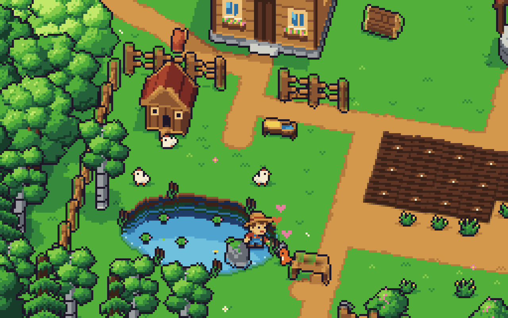

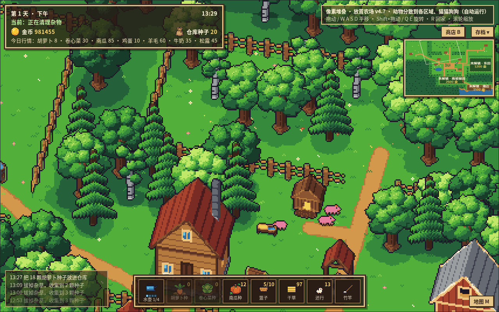
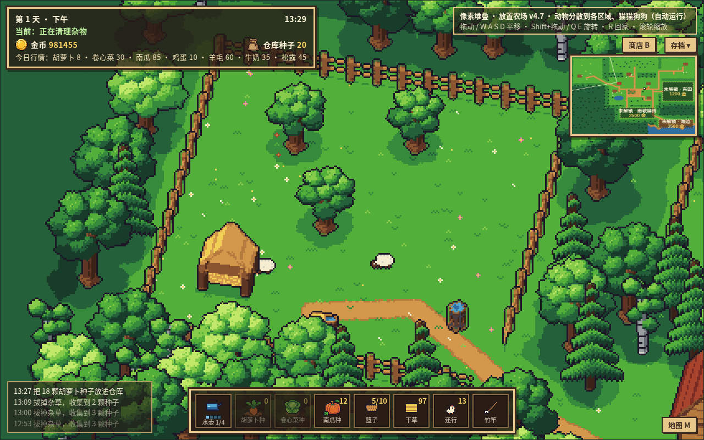
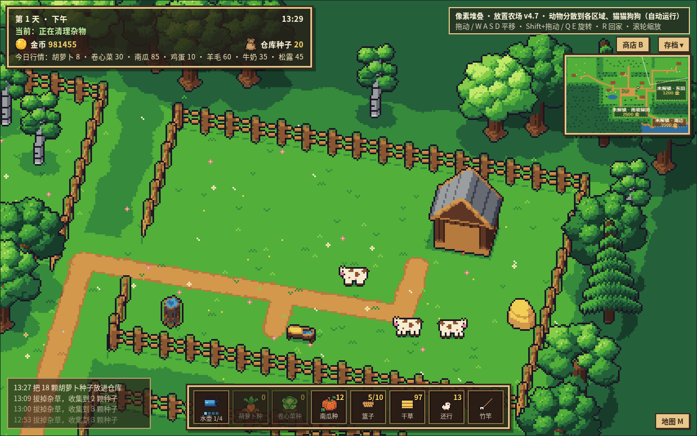


## 钓鱼和海边（v4.6）
- 开局背包里就有一根竹竿，不用买。田里的活和院子杂物都忙完了，农夫才会去家门口的池塘钓鱼（优先级比清理院子还低）。
- 抛竿、等待、咬钩、收线是一段安静的动画：整像素的钓线和浮标，咬钩时水面溅起一小簇水花（`fx.js` 的 `splash`）。
- 池塘里有鲫鱼、鲤鱼、草鱼、鲈鱼、锦鲤，稀有度和售价不同；钓到的鱼进篮子，农夫会拿到集市卖掉。鱼价固定，不参与每日行情波动。前期收入很低，只是填补空闲，第二天扩田的节奏仍和 v4.3.1 差不多。
- 商店「钓鱼」一栏：钢竿 400 金、碳素竿 1600 金，咬钩更快，少见的鱼更容易上钩。
- 大地图南边多了一条海岸（沙滩、分层海水、码头）。「海边」3500 金中后期解锁；再买海竿 2000 金，就能在码头钓沙丁鱼、海鲈、鲷鱼、金枪鱼、旗鱼，卖得更贵。
- 背包显示当前钓竿，篮子里的鱼按种类计数；左下角有一个最近渔获小记录。
- 规则在 `fish.js`（浏览器和 Node 都能跑），和 `animals.js` 一样是纯数据和纯函数。

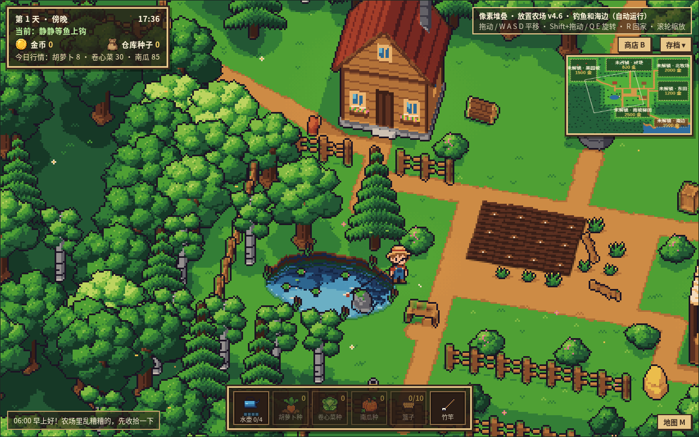


## 木材、房子和家人（v5.0）
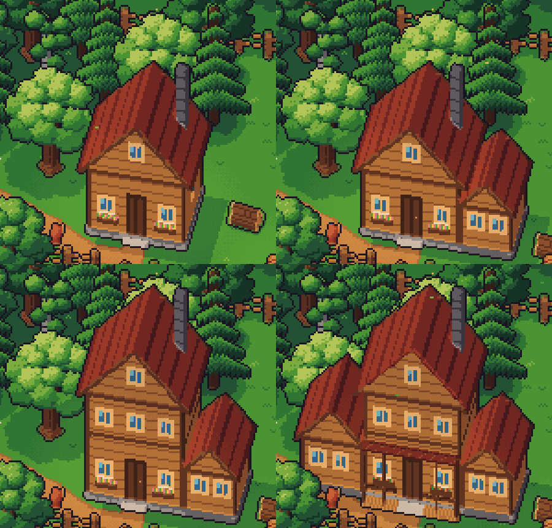

**砍树规则**
- 家门口和已买区域里的野树都能砍（v5.0 在家门口、东田、南坡、北牧场、果园坡各加了几棵）；没买的区域里的树要等买下才能砍。
- 果树不砍。地图边上一圈森林是风景，不在树的列表里，不能砍：农场要有个边框，而且木材要靠林场再生，不能一次砍光整张地图。
- 只有林场里的树会长回来（树桩 3 天长出小树，7 天长回大树）；别处的树砍掉就没了，得到木材和树苗，树桩当晚挖走。

**砍树掉落**（每次砍倒约 60% 掉一样，带像素特效和飘起的小图标）

| 掉落 | 概率 | 内容 |
|---|---|---|
| 果子 | 25% | 2 个苹果或橘子，进篮子 |
| 野花 | 15% | 1 束，进篮子；送给阿禾 +12 好感，卖 5 金 |
| 稀有种子 | 8% | 2 颗草莓或西瓜种子，进仓库（没解锁也能种） |
| 铜钱 | 8% | 10–30 金 |
| 鸟窝 | 4% | 1 个鸡蛋 |

**木材是材料**：木材放在仓库里，不再自动卖掉；仓库放得下多少由房子决定，放不下的部分才拿去集市卖（4 金一份）。木材用来扩建房子和给动物棚子围篱笆。

| 房子 | 价格 | 人口上限 | 仓库木材 | 样子 |
|---|---|---|---|---|
| 小木屋 | 开局 | 1 | 100 | 原来的房子 |
| 大木屋 | 800 金 + 40 木材 | 2（阿禾） | 200 | 东边加一间矮屋 |
| 二层农舍 | 3000 金 + 150 木材 | 3（第一个孩子） | 400 | 主屋加盖二楼 |
| 庄园 | 8000 金 + 400 木材 | 4（第二个孩子） | 800 | 西边加厢房，门前加门廊 |

另一个长期用木材的地方：**木篱笆**（200 金 + 60 木材）给猪圈、羊圈、牛棚围上篱笆（鸡舍的院子本来就有），所有动物每晚心情 +4。

**阿禾和孩子们**（规则在 `family.js`）
- 阿禾就是集市的店主。农夫每天第一次去集市会和她聊几句（+3 好感），篮子里有野花（+12）、鱼（+7）、苹果或橘子（+5）、鸡蛋（+4）就送她一样（羊毛、牛奶、松露照常卖）；每天头两趟卖东西各 +1。
- 好感满 100、房子至少是大木屋时，她第二天早上搬来，和农夫一起干活；房子不够大她会等。她搬走后，摊子由她爸爸（灰头发、棕围裙）照看。
- 集市 7:00–19:00 开门。晚上店主回家睡觉，摊子上挂一块关门的木牌；这时谁也不去买卖，篮子里的东西留到第二天早上再卖。
- 她住进来 7 天后、房子至少二层农舍时，家里添第一个孩子小豆；房子是庄园时，再过 10 天添小米。
- 孩子 0–4 天是宝宝，白天睡在门口的摇篮里；5–13 天是小孩，只干轻活（喂干草、捡蛋、挤奶剪毛、摸动物和猫狗、摘果子、拔草、收拾院子、卖自己篮子里的东西）；14 天起是少年，田里的活都能干，只是不去买东西、不钓鱼。
- 不发工钱。一家人用同一张任务板：谁已经在做的格子、树、动物、饲料槽，别人不会再去；买干草、买种子、取种子、钓鱼同一时间只有一个人做。各人有自己的水壶、种子袋和篮子：阿禾走路和农夫一样快、篮子一样大；少年快 10%、篮子 3/4；小孩慢 20%、篮子一半。猫狗只跟着农夫。晚上一家人都回家睡觉，早上 6 点一起起床。
- 背包栏多了「木材 n/上限」，认识阿禾后有「阿禾 好感」，搬来后有「家人 n/上限」（鼠标悬停看每个人在干什么）。

**分工（v5.3）**：一家人还是同一张任务板，但每个人有自己管的区域。有别人在外面干活时，自己区域的活 +15 分，别人管的区域的活 −18 分（仍然比钓鱼、歇着高，所以闲下来的人会去帮忙），没人管的活（卖东西、存种子）不加减。农夫一个人的时候没有任何偏好，和以前完全一样。

| 人 | 管的区域 |
|---|---|
| 农夫 | 田（收获、浇水、播种、锄地、拔草、清理、取种子、买种子）、砍树和移植 |
| 阿禾 | 动物（喂干草、加水、挤奶剪毛、摸动物、买干草）、鸡舍捡蛋、果园摘果；给饲料槽打水也算她的 |
| 小豆（小孩 → 少年） | 院子和猫狗 → 少年后帮农夫管田 |
| 小米（小孩 → 少年） | 鸡舍和猫狗 → 少年后帮阿禾管动物和果园 |

- 别人站的地方和要去的目标周围 5 格内的活会减分，选格子时也绕开，所以两个人不会挨着收同一排；别人正在做的格子和它旁边一格直接不选。
- 家里有人一起干活后，农夫每天最多钓 75 分钟鱼；阿禾歇着时去她照看的棚子边或果树下，不坐农夫的长椅；小孩歇着时在院子里或鸡舍边玩。
- 背包栏「家人」后面多一格倒数：「小豆 7 天 / 明天」，房子不够大时显示「要扩建」，悬停看「小豆还有 N 天到来」。左上角心条的提示里也有这句。
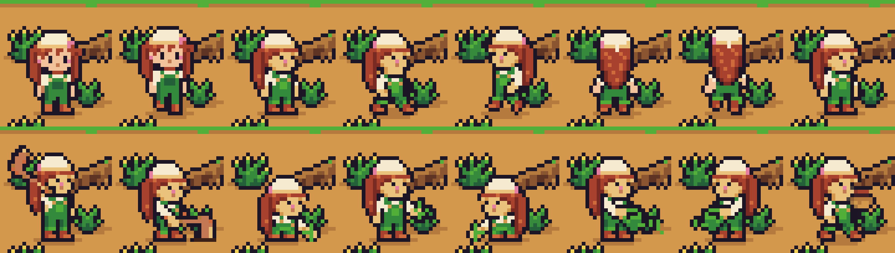
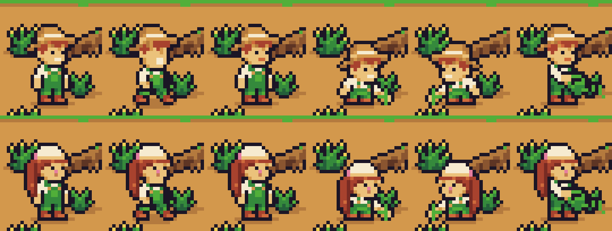
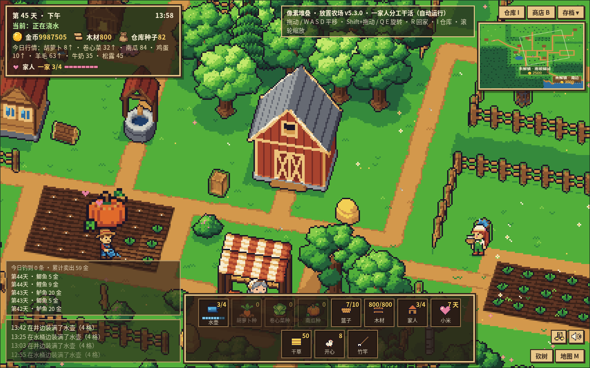

- `node tools/roles-sim.js [天数] [存档.json]` 用真实游戏无头跑，打印两人之间 3 格 / 6 格内的时间占比、同时做同一种活的占比和每个人的活计构成（`PF_KIDS=1` 加两个孩子）。在一份第 47 天的真实存档上跑 5 天：两人 3 格内从 5.8% 降到 1.2%，同时做同一种活从 22% 降到 4%，农夫钓鱼从 33% 降到 17%；在新开垦的大农场上，3 格内从 35.8% 降到 1.0%。

`node tools/econ.js 80`（seed 1 / 2 / 3）：第 1–2 天在集市认识阿禾，第 10–12 天好感满，第 16 天扩建大木屋、第 17 天阿禾搬来（等房子的这几天是盼头），第 36–38 天买篱笆，第 38–40 天二层农舍，第 39–41 天小豆出生，第 68–71 天庄园和花洒水壶，第 69–72 天小米出生；80 天累计收入 15.3–15.8 万金。集市晚上关门后没有少赚（篮子留到第二天早上卖）。

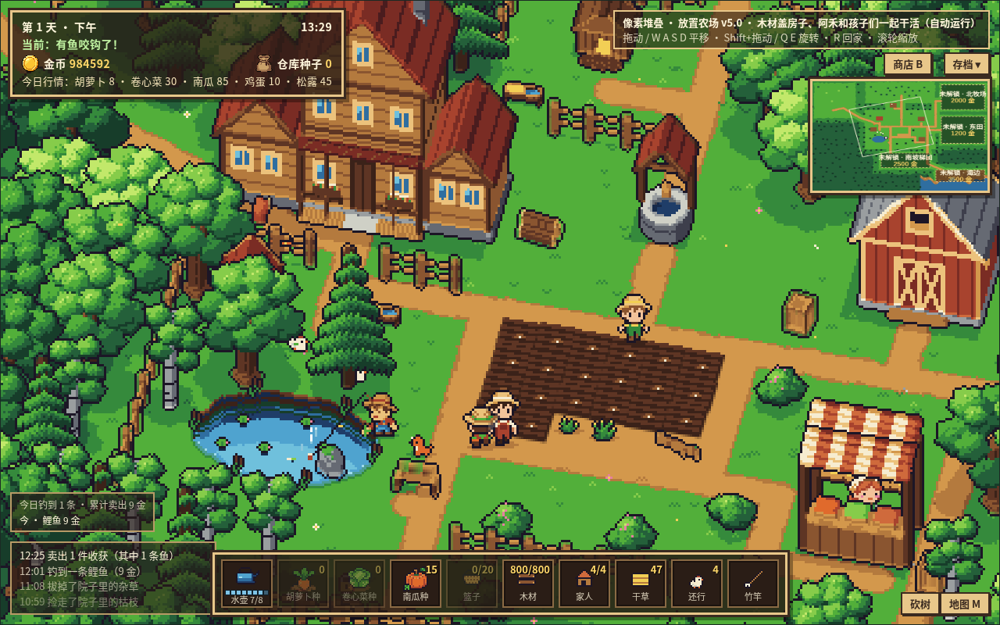
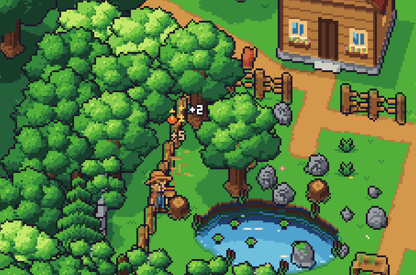
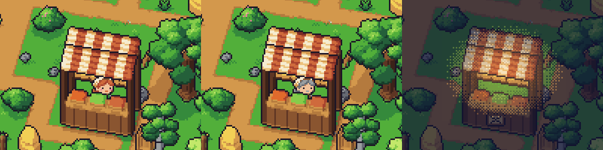
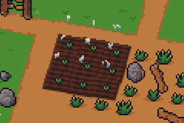

## 存档
- 自动存在这个浏览器的 localStorage 里（键名 `mouzhi/pixel-farm:save`，上一份好的存档在 `:bak`）。每天早上、每 15 秒、切到别的标签页或关闭页面时都会保存，刷新不丢进度。不同浏览器、不同设备各有各的存档。
- 离线收益：关掉页面或切走一段时间（1 分钟以上）再回来，按最近 3 天的平均日收入、在线 50% 的速度结算金币，最多算 3 个游戏日，回来时弹一张小结。离线期间田地不变。
- 右上角「存档」菜单：看上次保存时间、导出存档文字、导入存档、重置（要点两次，旧档会另存一份）；另外可以导出游玩记录，或在 Chrome 里同步到本机文件夹（见下面「游玩记录和本地同步」）。
- 主存档损坏时自动用备份恢复，损坏的数据另存一份；如果浏览器里有更新版本的存档，旧页面不会覆盖它。
- 存档版本 3（v4.2）加了院子杂物列表（种类和变体编号、位置）；旧存档会自动升级，并在加载时补一圈院子杂物，田地、金币、商店和种子不变。空的院子列表表示已经清完，不会重新生成一整圈。
- 存档版本 4（v4.3）加了区域和斧头的商店等级、树（位置、种类、树桩 / 树苗 / 大树、果子是否成熟）、砍树和种树指令、木材和树苗；每格田记着属于哪块地。旧存档升级后什么都没买，树按默认森林生成。
- 存档版本 5（v4.3.1）把家门口田的升级从两次各 +6 格改成三次各 +4 格。旧档里买过第一档（18 格）的会升到新的第二档（20 格），买过第二档的仍是 24 格，已开放的格子不会变少。
- 存档版本 6（v4.5）加了牧场、建筑和动物的商店等级、动物列表（种类、心情、产出倒计时、没收的产品、今天摸过没有）、饲料槽和水槽、干草库存，以及蛋 / 羊毛 / 牛奶的价格。旧存档升级后什么都没买，干草为 0。动物的位置不存，读档后在牧场里重新站好。
- 存档版本 7（v4.6）加了钓竿、海竿和海边的商店等级，以及 `catches` 渔获记录。旧存档升级后自动拥有竹竿（`rod` 为 0 表示已有，不是没买），没有海竿和海边，渔获记录为空。篮子可以装鱼。
- 存档版本 8（v4.7）把一个饲料槽改成每个棚子一个（`troughs`），加了猪圈、羊圈、猪、猫、狗的商店等级和松露价格。v6 / v7 的旧档什么都不丢：鸡舍原样保留，鸡搬到家门口的新鸡舍；有羊的档送一个羊圈（没买果园坡的同时送果园坡）；牛棚改成只养牛，原来的饲料槽和水槽归牛棚（没有牛棚就归鸡舍）。
- 存档版本 9（v5.0）加了房子和木篱笆的商店等级、`family`（好感、认识 / 聊天 / 搬来的日子、孩子）和 `members`（家人身上的水、种子、篮子）；木材、区域、动物都不变。旧档里有自己树列表的，补上新加的野树（只补一次）。v5.1 的惊喜字段（作物的 `glow` / `giant`，篮子里的珍品）写在同一版本上，不另升 `saveVersion`。
- 代码：存档读写和版本迁移在 `save.js`，节奏、经济和商店数值在 `sim.js`，地图、区域、果树、木材、砍树掉落和房子档位在 `world.js`，钓鱼规则在 `fish.js`，家人规则在 `family.js`，田里的惊喜在 `surprise.js`，游玩记录和本地文件夹同步在 `playlog.js`，界面（背包、商店、倍速、小地图、砍树种树按钮、存档菜单）在 `ui.js`。规则见 CONTRIBUTING.md「存档兼容」。

## 游玩记录和本地同步
游玩记录不写进存档，也就不用升 `saveVersion`。它单独放在这个浏览器的 localStorage 里，键名是 `mouzhi/pixel-farm:playlog`，最多保留最近 365 天的每日摘要和最近 2000 条重要事件。每天早上、最多每约 60 秒、以及离开页面时会写入。

每日摘要包括：游戏日、真实时间、当天开始/结束的金币、收入来源（作物 / 水果 / 动物 / 鱼 / 木材 / 院子 / 离线）、按项目计的支出、购买记录（游戏日、游戏时刻、农场创建以来的真实分钟数）、田地/区域/动物数量、农夫忙碌/空闲/睡觉的游戏分钟数及空闲在做什么（钓鱼 / 休息 / 巡视）、离线结算、当时的倍速、以及一次 FPS 抽样。重要事件包括购买、解锁区域、砍树/种树指令、开关会话、改倍速、离线结算。

### 同步到本机文件夹（Chrome）
用 Chrome 打开游戏时，可以让它把两份可读的 JSON 写到你选的文件夹里，方便开发时直接读取本机存档和日志，不必复制粘贴：

1. 建议先在「文稿」里建一个文件夹，例如 `pixel-farm-sync`（完整路径一般是 `~/Documents/pixel-farm-sync`）。
2. 打开游戏页面，点右上角「存档」。
3. 点「同步到本地文件夹…」，在弹出的系统对话框里选中刚才那个文件夹，允许编辑。
4. 之后每个游戏日早上、最多约每 60 秒、以及关掉或切走页面时，会更新文件夹里的两个文件：
   - `pixel-farm-save.json`：当前存档的漂亮排版 JSON，外加 `meta`（`kind` 为 `pixel-farm-save`，还有导出时间、游戏版本、`saveVersion`）。真正的存档对象在 `save` 字段里。
   - `pixel-farm-playlog.json`：游玩记录的漂亮排版 JSON，外加 `meta`（`kind` 为 `pixel-farm-playlog`，`schema` 为 1），以及 `sessions`、`days`、`events`。
5. 浏览器下次打开页面时，可能要你再点一下授权：页面上会出现一个不显眼的「点此恢复本地同步」按钮，点了就会继续写文件。存档菜单里也能看到上次同步时间。
6. 不想再同步时，在菜单里点「停止本地同步」。换用别的浏览器时，可以用「导出游玩记录」下载同一份 `pixel-farm-playlog.json`。

`pixel-farm-playlog.json` 的主要字段：

```json
{
  "meta": { "kind": "pixel-farm-playlog", "schema": 1, "exportedAt": "2026-11-17T16:00:00.000Z", "gameVersion": "4.7.1" },
  "startedAt": 1731860000000,
  "sessions": [
    { "startedAt": 1731860000000, "endedAt": null, "dayStart": 1, "dayEnd": 1, "coinsStart": 0, "coinsEnd": 8, "gameVersion": "4.7.1", "farm": 1731860000000 }
  ],
  "days": [
    {
      "day": 1, "farm": 1731860000000, "realAt": 1731860000000,
      "goldStart": 0, "goldEnd": 8, "open": false,
      "income": { "crops": 0, "fruit": 0, "animals": 0, "fish": 0, "wood": 0, "yard": 8, "offline": 0 },
      "spend": { "seeds": 0 },
      "purchases": [{ "id": "field", "name": "田地", "label": "开垦 4 格", "cost": 60, "day": 2, "t": 480, "realMin": 12.5, "at": 1731860750000 }],
      "tiles": 12, "regions": 0, "animals": 0,
      "busyMin": 400, "idleMin": 200, "sleepMin": 840,
      "idle": { "fish": 120, "rest": 50, "patrol": 30, "other": 0 },
      "fps": { "avg": 59.8, "min": 48.0, "n": 300 },
      "offline": [{ "gold": 12, "days": 1, "awaySec": 600, "capped": false, "avg": 24, "at": 1731861000000 }]
    }
  ],
  "events": [
    { "type": "session-start", "at": 1731860000000, "day": 1, "t": 360, "coins": 0 },
    { "type": "purchase", "id": "field", "cost": 60, "day": 2, "t": 480, "realMin": 12.5 }
  ]
}
```

`days[].t` 和事件里的 `t` 是游戏钟的分钟数（06:00 为 360）。`busyMin` / `idleMin` / `sleepMin` 也是游戏分钟。`farm` 是这个农场的 `createdAt`，重置后再玩会另起一条时间线，旧记录仍按原来的 `farm` 留着。


## 田里的小惊喜（v5.1）
惊喜是给观看用的，不是让玩家去点、去凑。大概每 1–3 天会遇到一次，多出来的金币控制在总收入的大约 10% 以内（可用 `node tools/econ.js 40` 核对）。数值和判定在 `surprise.js`。

- **发光的作物**：作物成熟的那个早上有 2% 的机会整棵发光（金色像素闪一下，`fx.js` 的 `glow` 特效会再冒出几颗十字星；`?nofx` 时粒子关掉，植株本身仍有金点）。卖掉是普通售价的 3 倍。
- **巨大作物**：卷心菜、南瓜、西瓜在同一块田里凑齐 2×2 且都成熟后，每天早上有 10% 的机会合成一棵占四格的巨大作物，卖掉是单棵的 6 倍（比四棵分开卖再多一半）。农夫会把它举过头顶，走起来还带一点开心的弹跳。自动播种会稍微优先把同类多种在一起，方便自然出现，不用你摆。
- **猫咪的种子**：每颗本该是胡萝卜的种子有 18% 的机会换成草莓或西瓜种子（商店才卖的那种），并弹出一句提示。
- **鸡蛋和松露**：捡蛋时分别有 4% / 6% 的机会遇到金蛋（5 倍）或双黄蛋（2 倍）；找松露时有 5% / 7% 的机会遇到白松露（4 倍）或大松露（2 倍）。

每次惊喜都会在屏幕上短短提示一句，并记进游玩记录，事件类型是 `surprise`（`kind` 为 `glow` / `giant` / `cat-seed` / `gold-egg` / `double-egg` / `white-truffle` / `big-truffle`）。

这些状态附在已有的田地作物和篮子条目上（`glow`、`giant`、`giantOf`，篮子里可以是带 `glow` / `giant` / `rare` 的对象），缺省就当没有，**不升 `saveVersion`**（仍为 9）。家人（阿禾和长大的孩子）也可以收获巨大作物并头顶着去卖。

## 风格指南（风格 A）

### 调色板
- 固定 35 色（v3.2 为分层水面加了 3 色：最深水 `#16294a`、天光中间色 `#6fc0dc`、浅滩青 `#4c9c94`），写在 `assets/palette.js`，色板图在 `assets/palette.png`。
- 颜色按 ramp 分组，每组从暗到亮：
  - ink：2 色，全局最暗。
  - green：6 色，草地基色是 `#52af3a`。
  - wood：6 色，小路是 `#d3984c`。
  - roof：4 色，红屋顶。
  - stone：4 色。
  - water：4 色。
  - skin：2 色。
  - accent：4 色，奶白、麦黄、橙、粉。
- 所有体素、地面、水面、贴花和手绘小精灵都只用这套调色板。SpriteCook 生成的角色和作物量化到原来的 32 色。
- 白天画面约 98% 的像素正好落在色板上。剩下的是半透明的农夫身影，以及浏览器 1 级的取整误差。傍晚和夜里的色调、灯光是叠在上面的。

### 明暗（借鉴 D：按面分级，不做渐变）
- 体素只记一个"作者色"，着色只在它所在的 ramp 里往暗处走：
  - 顶面：作者色本身。
  - 斜面（屋顶、圆形物体上半）：作者色；朝向屏幕右侧时暗一级。
  - 侧面：暗一级；朝向屏幕右侧时暗两级。
- 光源固定在屏幕左上方。所以模型旋转时，每个物体按自己在屏幕上的朝向，在 16 个角度扇区里各用一套切片。
- 不加环境光遮蔽，不加噪点，不做自由渐变。
- 面的法线从体素周围的占用情况算出，所以任意坡度的屋顶都能用。圆的东西（石头、干草堆）直接用解析法线。

### 描边（选择性描边）
- 每个物体一条外描边，不是每层切片一条：
  - 堆叠物体在"按角度缓存"的那张图上描。
  - 树在"按姿态缓存"的那张图上描。
  - 小精灵在生成时描。
- 描边色取相邻像素所在 ramp 的最暗一级：树是深绿 `#173d2a`，木头是深棕 `#3b2219`，屋顶是 `#4a1c1e`。最暗一级本身再用 ink `#1c1626`。
- 地面、耕地不描边。

### 像素密度与比例
- 画布是 426×266 原生像素，按整数倍放大（1280×800 下是 3 倍）。
- 1 格 = 16 像素，经典 16-bit 图块尺寸。
- 体素 1:1 对应屏幕像素，墙面 1 像素一层。
- 农夫约 16×24：大头小身，3 头身左右的 Q 版。
- 房子 70×58，墙高 34，屋脊高约 68，再加烟囱。房子总高约是农夫的 3 倍，和样图 A_1 的比例接近。
- 树的冠幅约 50 像素，和房子差不多高。灌木约 20 像素。

### 少细节（借鉴 D）
- 堆叠物体只保留读得出形状的大块：
  - 墙板每 5 层一条缝。
  - 屋顶每 6 层一道瓦线。
  - 窗户是奶白框 + 一块玻璃 + 一处高光。
- 1 像素宽、会在旋转时断开闪烁的纹理一律不做。
- 草地纹理（草丛、小花、石子）是不旋转的 2D 贴花，只跟着位置平移，所以转镜头时地面不会"爬"。

### 树（v3.2 造型，v3.3 把风动放缓）
参考：[traveling waves 森林帖](https://x.com/asynkimo/status/2121230694860890582)，以及 SpriteCook 的[树木风动教程](https://www.spritecook.ai/blog/pixel-art-trees-wind-animation)。
- 树冠由很多个"叶团"组成：橡树 14–19 团，桦树 8–11 团，灌木 6 团。
  - 每个叶团是一张小 2D 精灵，边缘是扇贝形。内部按抖动网格分成一个个"叶簇小格"，每格左上亮、右下暗，所以看得出一簇簇叶子，而不是噪点。
  - 叶团右下沿有一条最深色的分隔边，相邻叶团因此分得开。
  - 树冠上层的叶团最亮，只有顶部叶团才有最亮一级；中层暗一级，下层暗两级，所以整棵树是"左上受光、下面背光"。
- 每个叶团背后都有一个不动的深色"内层"。叶团被风吹起时，不会露出空洞。
- 树种和配色：
  - 普通橡树（绿）、亮橡树（偏黄绿）、深色橡树（后排用，显得有纵深）。
  - 分层松树：5–6 层枝叶，下沿是锯齿状针叶。树干完全不动；只有靠上的几层会偶尔偏 1 个像素。
  - 白桦（灰白树干带黑纹）、小橡树、灌木（部分带浆果）。
- 布局：农场四周两排交错的"林缘"。
  - 后排是大树和深色树，前排是高矮混合。
  - 靠近默认镜头的一侧只放矮树和灌木，不挡农场。
  - 林下地面更深（`#358a3c` → `#24603a`）。
  - 池塘后面也有几棵树，好让水里有倒影。
- 只有叶团的*位置*随镜头旋转，球从哪边看都一样，所以转镜头时树冠不闪。
- 风沿用行进波，v3.3 放慢、收小，避免各层错开跳动：
  - 6 股阵风加外围微风，过阻尼弹簧控制轻微倾斜（阔叶周期约 5 秒，松树约 8 秒）。行进波周期约 5.4 秒。
  - 同一棵树共用一个风场采样，再按高度加权，整冠一起摆，层与层不会各自错开。
  - 位移只走整像素：阔叶树冠多为 0–1 像素，阵风高峰最多 2 像素；松树上限 1 像素，且没有上下起伏。任何树种的树干都完全不动。
  - 叶团每秒换 10 次姿态。各棵树在错开的帧上换姿态，不会集中在同一帧。
- 每棵树每个姿态的画面，直接在像素数组里拼好（树干堆叠 + 叶团 + 一圈描边），再整张写入，不用从画布回读。

### 水面（v3.2，参考 @asynkimo 的分层池塘）
参考：[Boring water 帖子串](https://x.com/asynkimo/status/2122402277441069409)，以及 SpriteCook 的[池塘教程](https://www.spritecook.ai/blog/pixel-art-pond-water-reflections-ripples)。
- 地面里的池塘只是一种平涂的标记色。每一帧在屏幕空间重新给水面着色，所以"远岸""近岸"会跟着镜头转。
- 每个水面像素只取一个色阶编号。各层之间互相覆盖色阶，最后才一次性换成调色板颜色，所以水面永远不会混色发糊。分 6 层：
  1. 离岸越远越深：深水核心，靠岸一圈浅一级。
  2. 近岸一半映着天空：离远岸越远越亮，分两档。
  3. 倒影：池塘后面的树（用当前被风吹动的姿态）和香蒲，上下翻转、压扁到 55%，只用 3 个暗色阶。离岸 3 行以后，每行按整像素左右错开。
  4. 浅滩和水波：近岸浅滩是青色，近岸地面变湿、暗一级，岸边有一圈"拍岸"短线。水中的长苔石头四周有泡沫。
  5. 后岸：岸边有一道泥土唇边。它在水里映成深色的 6 行，有微弱波纹，水线会慢慢"爬"上岸。
  6. 点缀：水滴涟漪（5 帧圆环）；每圈随机 20 个闪光点，每个闪光是一条会变长再断开的短横线；落叶会掉进水里漂一会儿再沉下去；睡莲叶上下浮动，下面有一行影子。v4.4 按 asynkimo 第 6 步又补了暖色（乳白 / 金）的十字闪光，以及从空中落入深水、溅起一圈涟漪的水滴。
- 所有动画都在同一个 5 秒循环里，而且每种动画在一个循环里都转整数圈，所以循环处没有跳变。

### 劳作特效（v4.4）
开垦扬尘、浇水水花、收获闪光、拔草碎叶、碎石、砍树木屑、卖出时弹出的金币，都是短促的整像素特效，只用风格 A 调色板，走一个最多 180 个粒子的对象池，不每帧新建 canvas。做法参考了 [pixelfx](https://github.com/patch-gg/pixelfx)（MIT）的视觉语法（沙土扇形、带尾巴的水滴落地溅起小水冠、闪烁的十字星、会转动的金币），但没有引入它的 ESM 运行时，而是用一份很小的纯 JS（`fx.js`）按我们的画布重写。`?nofx` 可关掉。

## 长时间运行（v3.1 修复）
v3.0 在 Chrome 里挂久了，画面会只剩灯光、农夫和作物，地面、房子、树都消失了。

原因是每张体素切片各占一个 canvas，几分钟后就有约 1 万个 canvas、120MB 以上的像素内存，而且还在一直增长。GPU 内存紧张，或者标签页切到后台以后，Chrome 会回收这些 canvas 的 GPU 存储，它们就变成空白（context lost）。

v3.1 的修复：
- 每个模型的每个角度扇区，把所有切片合进一张图集。实测 canvas 稳定在约 4000 个，不再增长。
- 所有离屏 canvas 都改成 CPU 存储（`willReadFrequently`）。这类 canvas 不会被回收，往 CPU 主画布上画也不再需要从 GPU 回读。
- 按角度缓存的堆叠图，改成一个全局的"最近最少使用"缓存，像素上限约 64MB，最多 6000 张，超出就丢掉最久没用的。
- 加了一个看门狗：每 3 秒，以及标签页切回前台时，检查一次缓存。一旦发现缓存变空白，就从体素数据重建全部缓存，不用刷新页面。
- 事件记录只保留最近 300 条。

浸泡测试（`tools/soak.js`）：15 分钟、12 倍速，大约相当于模拟 40 天，并且定时旋转镜头。canvas 数量和内存一直是平的，没有报错。

## 技术要点
- 每个体素模型按 z 切成切片，逐层上移 1px，每层旋转相同角度，垂直压缩到 0.75。
- 大物体在每个角度都先 3 倍超采样堆叠，再用"多数颜色"缩回 1 倍。然后描边，按角度缓存。画面按 1.4° 一档旋转，空闲时预先算好附近的角度。
- 耕地是 2 层高的扁平堆叠，垄沟随之旋转，同样走这套缓存，所以不闪。
- 阴影先画成一张遮罩，再把遮罩下的地面换成同一 ramp 暗一级的颜色。阴影也留在色板内。
- 夜间光照按像素分档，再加 Bayer 抖动，只计算灯光覆盖的范围。
- 农夫被遮挡时，会显示半透明的身影。

## 素材（assets/）
- `palette.js`、`palette.png`：35 色调色板和色板图。
- `sprites.js`：精灵表，以 data URI 内嵌，所以 `file://` 也能跑。`chars.png` 和 `crops.png` 是同样内容的 PNG。
  - 农夫：
    - 正面、侧面、背面的基础图用 SpriteCook pixel-engine-image-v1 生成，16×24，提示词限定在本调色板里。每个方向挑了 3–4 个候选中最好的一个。
    - 动画用 pixel-engine-v1.5 生成，每段 4 帧，28×28：三个方向的走路、锄地、拔草、浇水。
  - 市场老板：基础图另做，再加 4 帧招手动画，卖菜时播放。
- `family_sprites.js`：阿禾和两个孩子的精灵表（v5.3），由 `tools/build_family.py` 从 `sprites.js` 生成，不要手改。脚本先按模板找到每一帧的头，只给身体换色（以前整张表一起换色，农夫侧脸的嘴和衬衫是同一种红，于是阿禾侧脸被换成一道奶白色的「白胡子」）；阿禾的头是手画的三个方向（奶白头巾配粉色小花、垂到背上的红棕色长发），举锄头时的手臂和锄头留在头发前面。
  - 成熟的胡萝卜、卷心菜、南瓜：16×16 公告板精灵。
  - 所有 SpriteCook 输出都由 `tools/build_sprites_A.py` 量化到 32 色。原始文件在 `assets/src/`，文件名以 `A` 开头。
- 程序化生成、可旋转的部分：
  - 房子、仓库、摊位、水井、栅栏、道具、石头和树枝、耕地、树：体素堆叠或叶团圆盘。
  - 草丛、小花、睡莲、香蒲、杂草、种子和幼苗：手绘的小 2D 精灵，用同一调色板。
- `hud_icons.png`：HUD 图标。

## 截图（shots/，不进 git）
`shots/` 由 `tools/shots.js` 等脚本生成，体积大，不进仓库（见 [EXCLUDED.md](EXCLUDED.md)）。README 配图放在 `docs/img/`。


- `style_A_vs_mock.png`：现在的游戏画面和目标样图 A_1 的并排对比。
- `compare_v2_vs_v3.png`：v2 和 v3 的对比。
- `trees_water_before_after.png`：v3.1 和 v3.2 的对比，包括全景、树特写和池塘特写。
- `trees_water_wind.gif`：10 秒的林缘风动和池塘动画。
- `rotation_style_A.gif`：转一整圈镜头，风照常吹。
- `00_morning.png` 到 `11_day2_morning.png`：一天里各个阶段的截图。
- `closeup_farmer.png`、`closeup_house.png`、`closeup_tree.png`、`closeup_market.png`、`closeup_sprite_sheet_x4.png`：特写。
- 较早版本的对比图（`rotation_before_vs_after.gif` 等）保留作参考。
- `preview.mp4` 和 `preview.gif`：从清晨到夜里的录屏，中间演示手动旋转镜头。

## 仓库结构和协作
```
index.html  game.js  playlog.js   游戏本体（GitHub Pages 直接发布 main 的根目录）
assets/                          运行时素材：调色板、精灵表、HUD 图标
assets/src/                      SpriteCook 原图和早期模型（构建用，游戏不加载）
tools/                           测试、截图、构建脚本（见 tools/README.md）
docs/img/                        README 配图
docs/late-game-roadmap.md        后期扩展路线图（第 6 阶段起）
.github/                         CI（语法检查和无头冒烟测试）、PR 模板
CONTRIBUTING.md                  分支、worktree、PR 检查清单、存档兼容、部署
EXCLUDED.md                      没有进仓库的大文件清单
```
分支、worktree 和 PR 流程见 [CONTRIBUTING.md](CONTRIBUTING.md)。

## v5.10.13 金鱼自动入塘 · 家庭日记（存档仍是 v15，追加 `diary` 字段）
小红书玩家留言「为什么金鱼放养不了啊」「有没有日记功能，打开可以看到小人这一天种了多少菜钓了多少鱼」。
- 原因：买来的金鱼先进仓库，要再点右下角小小的「放养金鱼」、再点池塘、再等家人走过去才会下水；手机上没有鼠标悬停提示，这一步几乎看不出来。另外满额判断只数金鱼、不数锦鲤：池塘里锦鲤多时还能买，但永远放不进去。
- 现在：商店买金鱼直接游进家门口的池塘（水花 + 提示「金鱼游进了家门口的池塘（n/8）」），不用再点。池塘按观赏鱼合计 8 条算，满了商店卡片写明「池塘已经养满了」，不扣钱。老存档里没放的金鱼读档时自动下水；篮子里钓到的锦鲤仍可选择卖或点「放养锦鲤」，一点就直接下水。
- 日记：「日记 K」按钮（或 K 键）打开日记本，一页一天，◀ ▶ 翻页，下面是最近几天的页签。记下每个人种了什么、收了什么、钓到什么，鸡蛋牛奶羊毛等，砍的木材，当天赚和花的金币，添置的东西，以及下雨、丰收节、运动会、宝宝出生、稀有鱼、民宿客人等。只留最近 30 天（每天几百字节）。每天早上提示一句「昨天…」。
- 测试：`node tools/diary-test.js`，`node tools/fishdiary-shots.js` → `fishdiary_*.png`（商店购买提示、池塘满、老存档补放、日记桌面和手机宽度、存档往返）。

## v5.10.12 加工坊能挪（存档仍是 v15，不加字段）
玩家反馈「加工坊不能跨区域移动，只能在同一个工坊地里挪，一个区域一旦变成工坊就没有后悔药吃了」。
- 「挪东西」选中加工坊后，所有工坊院都会框出来：绿框能放（显示 n/3），红框满了，当前所在的院子标「现在在这里」。点任何一块有空位的工坊院（哪个区域都行）就能搬过去；农田、自家院子不行，每块工坊院最多 3 座。
- 搬家时里面的原料、正在做的和做好的成品都跟着走；家人送料、取货、点灯都去新门口。
- 工坊院现在能在商店里改建成别的用途。改建页会先写清楚院子里的加工坊去哪：有空位的别的工坊院就自动搬过去；没有空位就先拆下来收进仓库（停工，原料和成品留着），等哪块工坊院有空位或新买/改建出工坊院，家人自动盖回去。
- 蜂箱、第二个圈舍所在的地仍然要先挪走才能改建（不变）。
- 测试：`node tools/fixws-shots.js` → `fixws_*.png`（跨区域挪、搬过去后继续生产、改建时搬走/收进仓库/再盖回去、存档往返、样例存档和本地真实存档）。

## v5.11.0.14 新房子能挪进第一圈的地（存档仍是 v15，`home.houses[].site` 也可是 `east` 等已买区域或 `home`）

新房子以前只能挪到外圈买下的花甸或农田。第一圈早先买下的地（比如东田）不是外圈地块，点过去会一律说「只能挪到花甸或农田」。现在买下的第一圈区域和家里的农场空地也能放，仍然一块地一座，不会压到农田、树、路、水、大门和其他建筑；家人要走得到门口，去水井和仓库的路也不能被堵住。点到不能放的地方会直接说明原因，比如「会压到农田，换一块空草地」。商店里新买的房子还是先盖在外圈花甸或农田。

## v5.11.0.13 未开放区域改成迷雾（存档仍是 v15，不加字段）

- 玩家反馈：「遮了和没遮一样」——v5.11.0.6 的半透明阴影下面房子、街道的轮廓都看得清，解锁就没惊喜了。现在还没开放的「农家乐区」「小镇」盖的是**不透明**的像素云海：只看得出「这边还有地图可解锁」，看不出下面有什么。
- 云是一团团圆鼓鼓的云朵（调色板里的石灰 + 奶白，左上受光，和树冠一个画法），两层慢慢飘：云体往东缓缓挪，上面零散的小云絮快一点、往北一点，看起来有层次。边缘是 4×4 有序抖动的羽化（宽 3–20 个世界单位，带一点噪声起伏，不是一条直线）；夜里跟着整张图一起变暗。
- 云下面的东西**完全不画**：房子、树、路边的灯、居民和动物、影子、夜里的窗户灯光、烟和萤火虫都不画（也省性能），小地图上的屋顶、人点同样不显示。点云只会提示怎么开放（「小镇还没开放：先把东大道买下来……」），工具（种树、挪东西）在云上不起作用，鼠标停在云上只显示开放条件。
- 每块云中间一把小锁加「待解锁」，很淡；小地图下面的「农家乐 / 小镇 / 海边」按钮未开放时变灰带锁，提示「待解锁 · ……」；小地图上同样是云，标签改成深色「小镇 · 待解锁」。
- 开放的那一刻云团用 1.7 秒散开退去（每格按一张大块噪声决定先后，所以是一块块散开、不是整体变淡），云下面的房子随云退开一处处露出来；另一块还锁着的区域不动。读档直接按现状显示。
- 大窗口 / 竖屏（画面跟着窗口变大）时云一直盖到地图北边、东边以外。
- 实现：`fog.js`（锁、提示、场、`reveal`、`paint` 只出不透明 / 透明的遮罩、`cloudTex` 云贴图）；`game.js` 每帧把遮罩按地面的变换画进一张屏幕大小的图层，`source-in` 填云体、`source-atop` 填云絮（画面和云的位置都没变时直接复用上一帧），再盖到物体上面。平时每帧几乎不加开销，散开那 1.7 秒每帧约 3 ms。
- 测试：`node tools/fog-test.js`；`node tools/fog2-shots.js` → `fog2_*.png`：云下的像素在「把云下所有东西都画出来 + 地面涂满条纹」前后完全一样（而关掉云时这些像素确实变了），各种视角 / 旋转 / 1920×1080 / 竖屏 / 夜里都一样；边缘羽化；散开到一半的画面；小地图同样的检查；点云和工具不起作用；老存档不播动画。CI 在 `agrilot` 一组。
- 相册（v5.11.0.11）：照片里永远没有云——拍照时云层不画（云下的东西照样不画，所以照片也不剧透）；「镇门打开」等小镇的云散完（1.7 秒）再拍。`album-shots` 的 towngate_fog 检查：拍照时云还在散就不拍，云飘到不同位置拍出的照片完全一样。

## v5.11.0.12 菜馆供餐（存档仍是 v15，追加 `diner.missedLast` / `servedLast` / `short` / `dishLast`）

玩家吐槽「不该造餐厅的，造了餐厅升满了都还说菜不够」：留言本最近 10 条全是「第 116/117/118 天 · ★★★ · 今天的菜不够」。

根因有三层：

1. **留言用了累计缺餐，不是当天的。** `diner.missed` 是开业以来的总数（海鲜摊缺料也会加进去）。客人早上结账时，`innRateCtx` 把这个总数传给 `rateStay`。只要哪天缺过一次，往后每天每组客人都会写「今天的菜不够」，星级也被压在 3 星左右。留言本最多 10 条，于是全是同一句。
2. **开饭前原料会被卖掉。** 菜馆 11:30 从家人篮子和工坊待取的成品里取料，但上午家人一篮子满了就去摊位卖掉。工坊订单和面包房会留原料，菜馆不会。晚些时候的成熟农场篮子里常常只剩西瓜、草莓、水果，做不了已解锁的菜。
3. **厨房升级几乎不加供餐能力。** 升级只增加菜式种类和座位展示，不增加能做的份数；旁边的菜园也只是地块，不出菜。满级厨房面对二层客栈的 16 位住客（每人两份，32 份）没有额外产量，水果农也做不出「卷心菜炒蛋」。

这次的改动：

- 评价只看最近一次供餐（昨天 11:30 或今天已做的），用 `diner.missedLast` / `short`；累计 `missed` 仍作统计，不再写进留言。海鲜摊缺料不再污染菜馆评价。
- 缺料时留言和日志会写出缺什么，例如「今天的菜不够，缺卷心菜、面粉」。同一天多组客人的留言合并成一条，并标「（3 组）」。旧存档里已经写下的重复行在留言本里也会合并显示。
- 厨房产量跟座位一起升：1 级 12 份、2 级 24 份、满级 36 份。菜园每天提供时蔬（8 / 16 / 24 份）和少量卷心菜、胡萝卜，升级能明显多做。开饭前会把要用的原料留在篮子里，不拿去卖掉。
- 满级厨房加上菜园，再配上一个正常的养殖和工坊（鸡蛋、面粉、果酱、奶酪等），就可以做完二层客栈满房的份数。

测试在 `tools/inn-test.js`（单元）和 `tools/restaurant-shots.js`（留言本和菜馆面板截图）。

## v5.11.0.11 相册（存档仍是 v15，追加可选的 `album`）
玩家说「可以加个相册功能，给关键画面留下影像……毕竟是个挂机游戏，有时候挂着挂着就错过了」。
- 24 个「第一次」：农场开张、第一只小动物、第一条鱼、认识阿禾、阿禾搬来、庄园落成、第一个 / 第二个宝宝、孩子第一次干活、第一天上学、第一次带同学回家、第一次捉虫、第一次去乐园、第一场小雨、第一个巨大作物、锦鲤或旗鱼、第一次家庭聚会、镇门打开、第一次赶集、第一次运动会、第一次丰收节、民宿第一组客人、孩子的婚礼、搬进新房。
- 发生的那一刻（要等人走出门的，会等几十分钟游戏时间）从画面里裁一张 160×110 的照片，拍立得样式，下面写第几天几点和一句话；顶部弹出「📷 存进相册」小卡片，点一下直接打开。镜头在别处时额外画一帧再画回来，都在同一帧里完成，不会闪；实测裁剪 4–5 ms，镜头外 ~23 ms（一次 render 约 6.7 ms）。
- 存档里每张只有一行 `id|天|分钟|x|y|人`（24 张全拍满、每张四个人也不到 1.5 KB，真实存档补齐 20 张约 0.6 KB）。图片放在单独的 localStorage 键 `mouzhi/pixel-farm:album:<createdAt>`，不进存档、不进云存档。
- 还在等人走出门的照片（开张、宝宝、婚礼、阿禾搬来、同学）在存档里多一段 `游戏分钟.跟拍谁.重新定位`，存档后刷新也会照常拍；拍完这段就去掉。
- 补进相册只看「这件事真的发生过」的记录：在集市卖过东西（`market.days`）、办过运动会 / 丰收节（那一天已经过去）、民宿真的收过房钱、镇门已经打开……建好广场、解锁建筑都不算。补拍的照片在真正发生时会被现场照片替换。
- 窗口很小、放大到最大时帧缓冲比照片还小：拍照这一帧临时放大帧缓冲，拍完放回去。
- 换了设备、清了缓存、或是老存档：照片按存档里的地点和人物「补拍」（家人回到原地摆个姿势，标「补拍」），打开相册时一张一张补，不卡。老存档里已经发生过的大事，从里程碑、成就、孩子生日、镇上的记录补进相册（日子不知道的写「很早以前」）。
- 网页版：右上角「相册 L」按钮；照片按日子排，还没发生的显示「???」和一句提示，当作小目标。点开放大两倍，可以左右翻。
- 日记：当天拍了照片，日记页下面有「📷 标题」，点一下跳到那张照片。日记本顶上有「📷 相册」页签——小红书版就从日记的书本图标进去，不加新按钮，手机上两列大图。
- 测试：`node tools/album-test.js`（24 个时刻、打包和读回、恶意数据、补拍事实、大小上限、图片存储、v10/v15 样例往返）；`node tools/album-shots.js` → `album_*.png`（弹窗和性能、相册格子带锁定框、放大、补拍、重新加载图片还在、日记链接、手机竖屏日记页签）。CI 放在 `townscale` 一组。
- 合进 v5.11.0.6–0.10 后：房子放大（0.9）以后农家菜馆和孩子的小木屋更高，这两处的取景往上挪，屋顶完整进框（`album_frames_sheet.png` 是所有地点的取景一览）；「镇门打开」那一下小镇的阴影刚开始褪，照片等阴影褪完（1.2 秒）再拍，拍出来是镇子打开的样子，也不和褪色的那几帧挤在一起（`album_towngate_fog.png`）；存档瘦身（0.8）不动相册字段：24 张都拍了、还带着待拍字段也只有约 1.3KB，day-72 存档紧凑后约 19KB，离 48KB / 小红书 64KB 很远。

## v5.11.0.10 孩子的好感一直看得见（存档仍是 v15，不加字段）

- **问题**：点左上角的心（家人 4/4）打开的面板里，每个孩子的同学好感（♥ 和「要好 / 熟悉」）、镇上的人，从 v5.9.0 起在实际游玩里几乎看不到。原因是 `game.js` 的 `hud()` 每一帧都把打开的面板改写成只有提示文字，ui.js 每 250ms 画上去的好感行只活一帧。存档里的好感（`home.rel`）一直都在，没有丢。截图脚本用 `?manual`（不跑逐帧 HUD），所以以前没测出来。
- **修复**：面板只由 ui.js 画，内容没变就不重画（「换个活法」按钮不会被重画打断）。每个还没成家的孩子多一行进度：少年写「和阿团 62/80，到 80「走得很近」就能成家」，没到少年写「长成少年以后才谈婚事」；同学行后面带上好感数字。
- **阶段没有变**：「少年」在「帮工」之后（宝宝 → 玩耍 → 上学 → 帮工 → 少年）。v5.4.3 以前就在干活的孩子会被保底在「帮工」，这是下限不是上限，出生满 43 天照样长成少年。
- 测试：`tools/kidslove-shots.js`（home 组，不带 `?manual`，数 90 帧里好感行每帧都在）；`tools/kids-test.js` 加了保底帮工的孩子按时长成少年，并进了 unit 组。

## v5.11.0.9 房子比例（存档仍是 v15，不加字段）

玩家反馈「房子你整体看一下，好多房子都偏小，修正修正」：v5.11.0 放大了小镇的房子，农家乐、海边和家里的几种建筑还是老模型，摆在一起显小。
按同一套规则（门和大人差不多高，平房 ≥ 2.4 人、二层 ≥ 3.2 人、公共建筑更大、作坊和小屋小一号、牲口棚按动物）把它们补上，详见
[docs/building-scale.md](docs/building-scale.md)（量法、规则、每栋前后对比表）。

- 农家乐小木屋 / 二层客栈：门 9 → 22 体素，正面 1.9 → 2.8 人 / 2.5 → 3.8 人，碰撞块 14 × 10 → 18 × 13，四间在农家乐区里重新排开（476 / 500 / 540 / 564），中间的小路不变。
- 农家菜馆：门 10 → 22（双开门），正面 2.2 → 3.3 人，碰撞块 20 × 12 → 28 × 16，桌子和去门口的小路往南挪一点；厨房升级的木架子搭在东翼上。
- 海边小屋：门 8 → 19，正面 1.5 → 2.4 人，位置不变。孩子成家的小木屋、磨坊 / 果酱铺 / 奶酪坊：占地和位置都不变，只把墙和门加高。集市摊位、海鲜摊：遮阳棚抬到摊主帽子上面。
- 都是重新写体素模型（1 体素的细线），不是拉伸旧图；地图不扩大，玩家摆放 / 挪过的东西不动。
- 测试：`node tools/scale-audit.js`、`node tools/scale-shots.js`（CI 新的 `scale` 组）、`node tools/inn-test.js`。

## v5.11.0.7 物品栏改版（网页版桌面；存档不变，仍是 v15）

- **图标修好**：底部物品栏的种子以前是把整张成熟作物图拖到 32px 框后面，v5.9.1 加的 `#inv .slot i{background-size:28px!important}` 又把整张图压成 28px 宽：胡萝卜（第 0 格）显示成一排彩色小点，其余种子滑出框外什么都看不到。现在每个格子都是一张 16×16 小图按 2 倍显示：每种作物一个种子袋（纸袋、作物颜色的封条、袋上画着这种作物；以后新加的作物没有专门的画时用一袋种子的通用图），树苗换成装在麻袋里的小苗（不再和果子本身用同一张图），新加一个「仓库」木箱图标。
- **三种样子**：
  - 完整：阿禾还没搬来时（新玩家），格子下面写名字，和以前一样好认。
  - 紧凑：家人搬来以后，40px 的格子只放图标和数量，名字和说明放到鼠标悬停的像素提示框里；孩子们合成一个「家人」格子（每个孩子的年龄、上学或干活写在提示里）；多一个「仓库」格子，显示今天按行情能卖多少钱，点一下打开仓库。
  - 收起：一条细条，只留水壶（带水量条）、篮子、家人（几个人在干活）、仓库。家人搬来后默认收起；▴ / ▾ 切换，记在浏览器的 `localStorage`（`mouzhi/pixel-farm:ui:inv`），不进存档。
- 水壶的水量条改成按比例填充，三种样子里都放得下。
- 小红书版：外壳自己把物品栏放进底栏的背包里，这里检测到外壳就一直用完整样子、不加收起按钮；图标修复和孩子合并会跟着下一个小红书版本一起带上。
- 测试：`node tools/hotbar-shots.js`（CI agrilot 组）→ `hotbar_after_*.png`：新玩家完整样子（每个种子都有自己的图、名字可见、水量条）、悬停提示在物品栏上方且在屏幕内、移开就消失；72 天存档默认收起、展开为紧凑、家人只有一个格子、家人提示里有每个孩子、仓库提示和点击打开仓库、收起后刷新仍收起、存档里没有这个偏好；格子多的时候仍是一行。画面跟着窗口大小走（v5.11.0.5.2）之后，在 1920×1080 和 1280×600 / 1024×560 / 1440×520 的矮窗口里：物品栏一行、在窗口内、不压小地图和（v5.11.0.6 变灰的）跳转按钮、右下角按钮，提示框不出屏。`HOTBAR_TAG=before` 拍旧版对比图（不做检查）。


## v5.11.0.6 未开放区域的地图阴影（存档仍是 v15，不加字段）
- 还没开放的「农家乐区」和「小镇」盖一层淡淡的暗色阴影（约 50%），边缘用 4×4 有序抖动做成像素风的渐变，西边沿着老地图边缘（x 448）稍微弯曲，不会像尺子一样切过树林；海面不盖，阴影停在海岸线。
- 锁的状态完全从现有门槛推出来，不存档：小镇 = 商店买下「小镇」（东大道 → 孩子上过学 → 12000 金 + 60 木）；农家乐区 = 小镇开放并且繁荣度到 3（民宿自己的门槛），或者已经有民宿 / 菜馆（老存档直接没有阴影）。农场本身、外圈地块、林场东田这些老区域都不盖（它们本来就有锁牌和价格）。
- 东大道买下以后，穿过农家乐区的那段路一直是亮的（孩子每天走这条路去上学）。
- 每块阴影中间挂一把放大的小锁；点阴影或鼠标停在上面会说怎么开放（例如「小镇还没开放：先把东大道买下来……」）。
- 开放的那一刻阴影用 1.2 秒淡出（`max(新, 旧×(1−t))`，旁边还锁着的区域不闪）；读档时直接按现状显示，不播淡出。
- 小地图上同样盖阴影，农家乐区的标签在开放前显示「农家乐区 · 未开放」；小地图下面的「农家乐 / 小镇 / 海边」按钮在未开放时变灰、带小锁，鼠标停留显示开放条件，点了照样跳过去看，并提示怎么开放。
- 实现：`fog.js`（纯函数：锁、提示、每世界单位一格的阴影场、淡出混合、抖动上色），`game.js` 只缓存一张 568×592 的画布，用地面同一个变换画在物体之后、灯光之前，所以滚动、旋转都贴着地面；只有锁变了或淡出时才重画。每帧多约 0.5 ms。
- v5.11.0.5 农家乐区合进来以后：民宿一盖起来（或老存档迁移过来）阴影就淡出；繁荣度不到 3 时农家乐区仍有阴影（那时还不能建）。
- 测试：`node tools/fog-test.js`，`node tools/fog-shots.js`（截图 `fog_*.png`）。
## v5.11.0.5.3 松树重画（存档仍是 v15，不加字段）

- 玩家说松树像「一根树干串着几张饼」：树干是一整根体素柱，一直伸到树高 H−6，比顶上那片小小的「帽子」还高；每层树叶只是一片扁平的锯齿三角，往上只盖住自己中心以上几个像素，所以层与层之间、树顶都露出树干。
- 现在是一棵冷杉：每层是一个尖顶的针叶锥，高度约是层距的 1.9 倍，往上一直藏到上一层后面，最上面一层的尖就是树尖（全是叶子）。树干只剩树脚 3–4 像素的一小截，上面的部分被最低一层的裙边盖住。左上受光、右侧和每层裙边下面是深色，描边和其他树一样。
- 树的大小、占地、影子、风动（只有上面几层轻轻摆 1 像素，树干不动）都不变；砍树、树桩、小地图不受影响。
- 测试：`node tools/pine-shots.js` → `pine_*.png`（三种松树 × 6 个视角 × 风动/砍树倾斜：顶部没有树干、中间一列从树尖到最低一层全是叶子、树脚树干 2–4 像素；近景和场景三档缩放）。CI 放在 `home` 一组。

## v5.11.0.5.2 画面铺满窗口（热修，存档仍是 v15，不加字段）
玩家反馈「一刷新，画面变小了，不是全屏了」。原因：画面一直是固定 426 × 266 的像素缓冲，按整数倍放大后居中，放不下下一个整数倍就在四周留黑边。窗口一矮（比如浏览器多了一条提示栏或书签栏），倍数从 4 掉到 3、从 3 掉到 2，四周就空出一大圈。v5.11.0.4 之前也一样，不是细雨带进来的。
- 现在像素大小还按原来的规则选（426 × 266 在这块屏幕上能放下的最大整数倍），但像素缓冲按窗口大小来定，铺满整个窗口，边上最多裁掉不到一个像素。窗口宽一些、矮一些，看到的地图就多一些，像素大小不变、仍然方方正正。
- 滚轮放大、改窗口大小、缩放浏览器、刷新之后都一样铺满。`?view=WxH` 截图模式不变；小红书版有自己的竖屏画面，不受影响。
- 测试：`node tools/fill-shots.js` → `fill_*.png`（1024×546、1366×657、1920×969、1280×800、DPR 1.25 / 1.5 / 2、2560×1300，刷新后、滚轮放大后、改窗口大小后：画布四边都贴住窗口，倍数是整数）。CI 放在 `smoke` 一组。

## v5.11.0.5 农家乐区（计划里的 v5.11.1 农家乐区部分）（存档仍是 v15，追加 `inn.where` / `inn.moved` 和地块的 `free`）

玩家反馈：新地图已经有一块农家乐专用空地，商店「农家乐」页却还写着「先在「地块」里把林间空地、南河湾、河对岸或东坡改建成民宿院」，卡片标题还露出英文「kitchen」「inn2」。这一版把 [docs/town-scale-plan.md](docs/town-scale-plan.md) 里 v5.11.1 的农家乐区做了（度假湾仍留给 v5.11.2）。

- **农家乐区**（镇门口 456..584 × −40..200，东大道从中间穿过）就是民宿的地方：开了镇门就能在这里盖，不用改建任何地块。东大道北边一排 4 间小木屋（二层客栈也在这里加盖），南边是农家菜馆、6 张桌子、菜园和游客小广场（菜馆盖好后出现）。价格、繁荣度 3 的门槛、一次盖一样都和以前一样，「0 / 4 间小木屋」照常累计。
- 地块不再有「民宿院」这个选项。游客从镇门进来，走进农家乐区住下，第二天早上原路离开；经营民宿的孩子也去那里。
- **老存档**：民宿原来在某块地上的，读档时小木屋、二层客栈、菜馆和厨房等级、正在盖的、住着的客人（房号不变）、星级、留言本、收入全部原样出现在农家乐区（这些在存档里本来就是按数量和序号记的，没有坐标，所以什么都不丢）。原来那块地变成「空院子」，可以在「地块」里**免费改建一次**（连乐园的设施费也免）；日志里说明一次，重复读档不会再弹，也不会再免费一次。
- 商店、日记里的项目名都是中文：「厨房升级」「二层客栈」，日记里也认得二层客栈、沙滩小屋、遮阳伞、海鲜摊、游客栈桥、日落观景台。
- 农家乐区西边缘原来有几棵装饰树的树冠盖住了菜园，挪掉了（树是在生成以后单独去掉的，其他树一棵不动）。小地图上的字从「农家乐区 · 预留」改成「农家乐区」（没开镇门时写「开镇门后可建」）。
- 测试：`node tools/inn-test.js`（农家乐区布局不压路、不重叠，迁移不丢东西、只免费一次，所有项目都有中文名）、`node tools/agrilot-shots.js`（CI recent-b 组：商店文字、真实购买盖进农家乐区、满配白天 / 南半边、游客从镇门走进小木屋过夜、老存档迁移和免费改建、日记名字）。新的合成存档样例 `tools/fixtures/save-v15-inn-resort.json`（林间空地上的民宿院 + 东南滩度假村，`node tools/agrilot-shots.js --make-fixture` 重新生成，不是玩家的真实存档）。

## v5.11.0.3 海岸线往下拖出现第二条岸线（存档仍是 v15，不加字段）
玩家反馈「海岸线这个地形，在视野往下移动的时候会出现bug」：往下拖到海上时，海中间横着多出一条弯弯的深褐色岸边和浅绿泡沫线，下面的海水颜色也不对，像岸线被重复画了一遍。
- 原因：分层水面（池塘、海）每帧在屏幕空间里算「水面形状、离岸距离、每列最远的一行」，这份几何缓存只按「视角 + 水面框」判断是否过期。海的框被裁到屏幕范围内，一旦海铺满了整个画面，框就不再变化；镜头继续往下拖时缓存没有重算，旧画面里岸线的泥边、泡沫和深浅分层就一直画在原来的屏幕位置上，于是海中间出现第二条岸线。旋转后、小地图跳到「海边」再拖、沿地图底边横拖都会出现。
- 修复：缓存再加上镜头位置（CX、CY），镜头一动就重算；静止时照旧复用。海的深浅分层改按世界坐标离岸距离算（距岸 22 / 50 个单位处各浅一档，等深线比岸线平缓一些），拖动时不再跟着画面滑动；被屏幕裁掉的海边缘按「还是海」处理，不再在屏幕边上画出一圈浅水和泡沫。池塘和小河的算法不变。
- 顺手修了一个旧问题：画布丢失后的重建会把水面缓存置成 null，下一帧画水会报错。
- 性能：海上平移每帧和改之前持平（约 11–14 ms vs 11–12 ms，本机无头 Chrome）；第一次看到海时多建一张约 1000×180 的分层表（一次性十几毫秒）。
- 测试：`node tools/coast-shots.js` → `coast_*.png`：小步拖动镜头（像鼠标拖拽）经过海岸、地图底边、旋转视角、「海边」跳转、池塘和小河，每一步都和清空水面缓存后重画的画面逐像素一致；同一片海从两个高度看分层不变。CI 放在 `home` 组。

## v5.11.0.1 活动倒计时（存档仍是 v15，不加字段）
玩家想在一个合适的地方看到「多少天发生一次的大事件」还有几天，比如丰收节、集市。
- HUD 日期和时钟下面多了一行小倒计时，只显示已经解锁的活动（集市要先盖集市广场，运动会要先扩建学校，丰收节要先铺好石板路）。收起时是最近的一次，例如「🏮丰收节 还有3天」；当天开始前写成「今晚18点」或「今天7点」，进行中写成「进行中」。点开列出接下来的几次。
- 活动登记在 `events.js` 里，算下一次日期是同一个函数（间隔天数 + 偏移）。以后加新活动（比如计划中每 28 天、和丰收节错开 14 天的海边节）只要再 `register()` 一条。
- 测试：`node tools/events-test.js`，`node tools/countdown-shots.js` → `countdown_*.png`（桌面、手机 390×844、展开列表、活动当天，以及第 72 天样例存档上未解锁时不显示）。

## v5.11.0 小镇放大（存档仍是 v15，不加字段，不改坐标）
玩家反馈「小镇功能越来越多，地图显小，房子只有一个半人高；以后农家乐、海边还要扩」。计划见 `docs/town-scale-plan.md`，这一版是第一阶段。
- **地图向东加 46 格**（112×74 → 158×74）。小镇整体搬到东头，384×308（原来约 3 倍面积）；镇门在东大道 x 596 处。镇门和小镇之间留出 **农家乐区**（预留空地，不长树不放东西，v5.11.1 再搬过去）；现有民宿院、海边度假村这一版不动。
- **房子按新比例重画**（新文件 `town-bldg.js`，一套参数化模板：墙、基座、层间腰线、木框、门、每层窗、山墙屋顶、烟囱、阁楼），再加上各家原有的特征（面包坊屋脊上的面包、木工坊的原木和锯、铁匠铺的马蹄铁和南墙炉口、诊所的绿十字、学校的钟楼和旗杆、镇公所的钟和旗、小店的条纹雨棚和招牌、阳台和晾衣绳……）。门和大人一样高（22 像素），平房约 2.7 人高、二层约 3.7 人高；配色和 1 像素细线不变。重画了：老平房、三种二层、面包坊、木工坊、铁匠铺、第二教室、书屋、诊所、孩子的三种小店、小店、学校、镇公所、脚手架。
- **节庆广场** 114×86：丰收长桌拆成三段、20 个座位；一圈 10 根灯笼柱常年立着，丰收节夜里点亮，主街上的灯笼柱只在节日那天立起。长桌宴和灯会都搬到这里，不再挤在喷泉广场上。
- **集市广场** 半径 36，六个摊位绕着放大的喷泉；广场铺成一圈圈的石块。
- **四块预留地**（R1–R4）：插着「待开发」木牌和四角木桩，地面空着。
- **石板主街 + 东大道**：东大道买成「大道」后，从农场路口到小镇东头铺成石板，走在上面快 1.3 倍（所有人：家人、孩子、邻居、客人）。孩子上学路比原来远了，但走大道快，单程约 95 分钟（v5.10.11 约 92–125 分钟），放学约 100 分钟（原约 103）。客人进出改走新镇门（`GUEST_WALK` 90 → 120）。
- 镇上路面铺石板后改成错缝石块（原来的棋盘格在放大后太花）；悬崖在小镇北边往后退了 13，城墙和悬崖不再挤在一起。
- **小地图**：按世界比例显示（不再拉伸），镇上房子按实际大小画，标出「小镇」「农家乐区 · 预留」；下面加了 **家 / 农家乐 / 小镇 / 海边** 四个跳转按钮（农家乐跳到现有民宿院，没有就跳到预留区；海边跳到度假村那块地）。手机竖屏下按钮缩小不折行。
- 存档：只记 id、数量和序号（镇上的建筑、地块、礼物槽位、客栈数量），农场一侧的坐标都不动，所以不需要迁移；礼物槽位数量不变（8 / 6 / 9），旧礼物都还在。
- 性能（同一场景：全部买齐、小镇全建好）：帧率 60 vs 60（v5.10.11 59–60）；镇上静止 3.0–3.3 ms/帧（原 4.1–4.9），平移 2.9–3.5 ms（原 4.4）；整张地面重建 1.48–1.64 s vs 1.23–1.25 s，约 1.2–1.3 倍（上限 1.45）。夜景基准（day59）：静止 3.0 / 平移 4.1 / 旋转 77.8 ms，原 2.8 / 4.0 / 80.5。
- 测试：`node tools/townscale-test.js`（布局：地图和小镇尺寸、房子不重叠不压路、每扇门都有路、树和预留地、20 个座位、礼物槽位、上学时间）；`node tools/v5110-shots.js` → `v5110_*.png`（全景、房子和人的比例、节庆广场、集市、二层街、小地图按钮、手机竖屏、从农场到每扇门的路线不穿房子、孩子上学背书包不戴帽子手里空着、所有样例存档和本地真实存档）。CI 新增 `townscale` 一组。


## v5.11.0.4 细雨（存档仍是 v15，不加字段）
玩家说原来的雨「感觉就是白色全屏划过」，想要有落点的细雨：落在地上或池塘里，打到地面有很小的效果和短暂的湿润。
- 去掉了屏幕上的白色长雨丝。现在每滴雨都有一个世界里的落点，只在落点上方 14–24 像素处出现，斜着落下，雨丝 1 像素宽、4–6 像素长，蓝灰色、半透明（不透明度约 0.8–1）。同屏约 25 滴（原来 44 道）。
- 落在地上：一个 3 帧的小水花（1–2 个像素向两边溅开），加一小块变深的湿印，1–2 秒内淡掉。路面原有的整体变湿和水洼不变。
- 落在池塘和海里：用池塘原有的涟漪（同样的 5 帧圆圈），只是出现在雨滴真正落下的地方，代替原来按固定节奏随机冒出来的雨中涟漪。河是地面的一部分，在河上画同样形状、同样颜色的圈，圈的大小不超出河面。
- 不会落进屋顶、树冠里：落点在高的房子、树的占地范围内就不落。雨丝和房子、树、人一起按远近排序，前面的房子会挡住后面的雨。
- 雨丝跟着地面走，转镜头、缩放都对得上。夜里雨丝和水花跟其他东西一起变暗，路灯照到的地方会亮一些。雨声不变。
- 雨滴、水花、湿印、涟漪都放在固定大小的对象池里（48 / 40 / 160 / 28），下雨时不分配新对象，也不重建地面。
- 性能（全部建好的 v5.11 小镇，每帧 advance + render，取中位数）：下雨时 3.35–3.42 ms/帧，v5.11.0.2 的旧雨是 3.45–3.72 ms；不下雨 2.85–3.15 ms。
- 测试：`node tools/weather-test.js`（雨滴落点、水花/湿印/涟漪、对象池上限和复用、雨停后清空），`node tools/rain-shots.js` → `rain_*.png`（农场近景、池塘涟漪、小镇、夜里的小镇、转过镜头的海边、手机竖屏、雨停之后、性能）。CI 放在 `recent-b` 一组。

## v5.11.0.2 触屏钩子（只给小红书版用；网页版鼠标操作不变，存档仍是 v15，追加可选的 `decor.kept`）

- 给小红书手机外壳（`platforms/xhs/touch.js`）用的钩子：`__farm.aimAt(x, y)` 把当前工具对准屏幕上一点（准星）并返回能不能放、砍树是否已标记、挪东西准星下是什么；`__farm.commitAt(x, y)` 等于在那一点点一下，返回结果。
- `__farm.setTouch({ slop, pickCss, onTap })`：onTap 返回 true 时这次点按由外壳处理（比如把那一点移到准星下），不再当成点地图；点按/拖动阈值（网页默认 5px，手机外壳设 10px）和最小选取半径（网页 0，手机外壳 22px）。网页版不调用，行为和 v5.11.0 一样。
- 「收回」：`__farm.storeThing(pick)` 让家人把摆好的装饰搬回仓库（派对区、加工坊、蜂箱、浇水器、房子不能收回）。收回的装饰记在 `decor.kept`，家人不会再自己拿出去摆，玩家亲手摆出去时扣掉。存档里只有用过才会出现这个字段；`decor.orders` 多了 `op: 'store'`。
- 测试：`node tools/touchhooks-shots.js`（CI home 组）：桌面默认值和鼠标点按/拖动不变、aimAt/commitAt 与点按一致、10px 阈值放过手指抖动、22px 选取半径、收回后过夜不被摆回、手摆用掉 kept、两个存档样例照常读入。

## v5.11.0.8 离线说明和存档瘦身（离线规则不变；存档仍是 v15，不加字段）

- **「欢迎回来」说清楚时间是暂停的**：第一行写「离开了 2 小时 0 分，游戏时间是暂停的：现在还是第 72 天 10:00」，第二行写「家人按在线一半的速度帮你干活，相当于 3 天的收入」。原来的「折合 3 天」读起来像过了 3 天，现在不再用这个说法。离线期间如果天气往后走了，会多写一句「日历没往前走，只有天气照常过了 3 天（其间下过小雨，田都湿了）」。
- **短暂离开也有提示**：离开不到 10 分钟时不弹窗，金币下面会飘一行小字，例如「+4,001 金（离开 4 分钟，时间暂停中）」，4 秒后淡出。24 小时额度用完时写什么时候恢复。窗口是滚动的，最早那条记录过 24 小时就先退回它的天数，所以写「离开 30 分钟，时间暂停中（离线额度 今天 16:47 起恢复 1.5 天）」；只有一条记录时写「…起恢复全部 3 天」。日志里也是这么写（原来写的「X 以后再算」其实是 3 天全部恢复的时间，会让人以为要等那么久）。手机竖屏下这一行也不会超出屏幕。
- **存档瘦身**：保存时不再写出读档时本来就会补上的默认值，包括地块的 open / tilled / watered / debris / weed / crop、树的 v / stage / age / ripe / cd、动物的 cd / ready / pet、小家的地块、为 0 的升级等级、种子数量和食槽。`rot` 保留两位小数，它只影响贴图角度；其他数字一律原样写入。`clock.t` 如果在 5:59.9996 被舍入成 6:00，读档后那天早上的换日就会被跳过，计时器和坐标也同理。读档逻辑 `validate()` 没改，所以旧的完整存档照常读取，旧版本页面也能读新存档。第 103 天的真实存档从 58.9KB 降到 36.0KB，day-72 fixture 从 40.0KB 降到 17.8KB，day-59 fixture 从 21.0KB 降到 13.1KB。存档导出字符串和同步文件夹里的 `pixel-farm-save.json` 也改用这种紧凑格式。小红书云存档直接上传本地存档的内容，单条上限 64KB，现在余量很大。
- **测试**：`node tools/save-compact-test.js`（CI unit）检查每个 fixture：紧凑存档读回来，除了小数被舍入，和原存档完全一样；读档 → 存档 → 读档前后一致；旧的完整存档读取时不做舍入；被省略的字段正好是 `validate()` 会补回的默认值。`node tools/offline-shots.js`（CI home 组）生成 `offline_*.png`，检查弹窗文案和时钟不动、雨天那句、额度用了一部分时的写法、金币下的小字和它的淡出、手机竖屏，以及页面真的按紧凑格式保存，并且保存 → 重新加载 → 再保存后状态一致。

## v5.11.0.15 聚会更热闹（存档仍是 v15）

- 派对长桌加长，取消会在投影中重叠的前后两排，改用两个充分隔开的就餐位，大家轮流吃饭；旁边的空草地摆出舞池、野餐聊天角和孩子的玩球区，挂上串灯。只使用已解锁且可到达的空地，不压路、水、田地和建筑；地方窄时竖排，放不下的角落不硬塞。
- 晚会上分三轮换活动：吃东西、举杯、跳舞、聊天；孩子会在各自的位置踢接弹跳的小球。盘子里的食物逐渐减少，能看到咬一口、碎屑、音符和聊天小气泡。其他时候的孩子和上学外观不变。
- 新买的派对区优先选旁边有活动空间的位置。活动站位和动画都是临时状态，不增加存档字段，不改存档格式、地图或音效。
- `node tools/party-shots.js` 检查活动、站位间距、道路可达、存档大小并输出 party_after/eat/play.png。`PF_ROOT=<旧版目录> PF_BEFORE=1 node tools/party-shots.js` 输出同场景的 party_before.png。

派对拥挤回归还会安排最多 10 人，覆盖三轮活动及正常相机附近五个角度、480 帧，直接比较实际人物精灵的不透明像素，禁止身体互相遮叠（不能只拿世界坐标距离当作不重叠）。

### v5.11.0.16
- 相册新照片提示与成就提示上下排列，不再互相盖字（第一次家庭聚会时两条会一起弹出）；小红书宿主可用 `pf:toaststack` 跟随相册提示的位置。存档仍是 v15。

### v5.11.0.19
- 成家后选了「经营民宿 / 菜馆」的孩子和爱人，白天真的去农家乐区干活了：在菜馆门口招呼食客、给客人端菜擦桌子、去菜园摘菜、打扫小木屋或给住客送热水、在门口迎客，两个人轮流换地方、不挤在一起；17:00 回家一次，晚上就在新房子边歇着。原来这条路判断「今天要不要去民宿」时漏传了是哪个孩子，结果永远是「不去」，两人整天坐在新房子门口。
- 下班回家：已经到家（门口、长凳、自家小田）就不再被叫回路上重新走一遍；住在农场东边的新房子也不会先绕回农场大门。去农家乐区不再先走到镇门口再折回来。
- 孩子的爱人算家人：顶部「家人 一家 N/M」和家人格子都把住在新房子的爱人算进去（例如 4/4 → 5/5，庄园自己的房间数不变），提示里写「阿团（小米的爱人）」和 TA 正在做什么。
- 不改存档：去向本来就存在 `home.path` 里（"inn"），修好后读档即生效；存档仍是 v15。`node tools/married-shots.js` 检查白天在农家乐区的时长、晚上不来回走、家人人数和提示。
