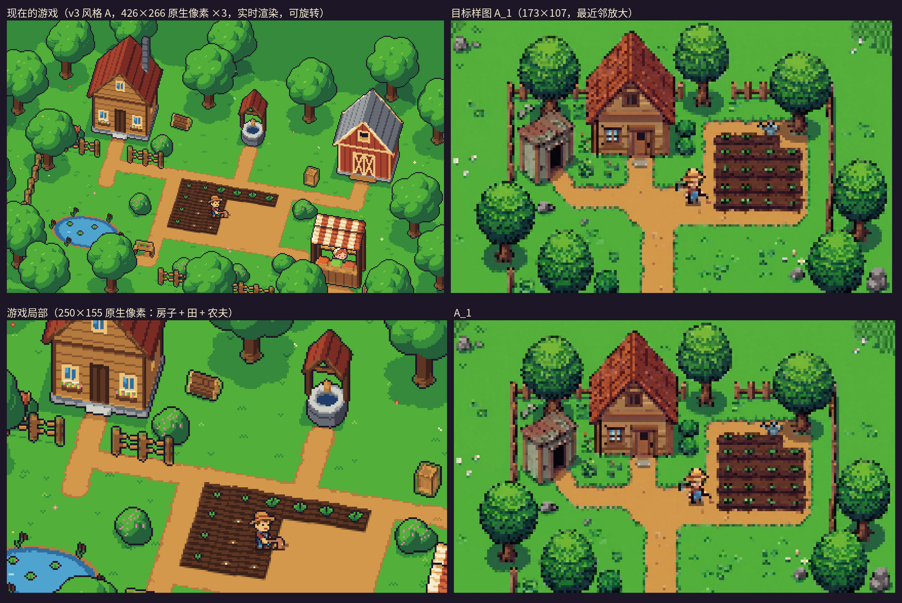
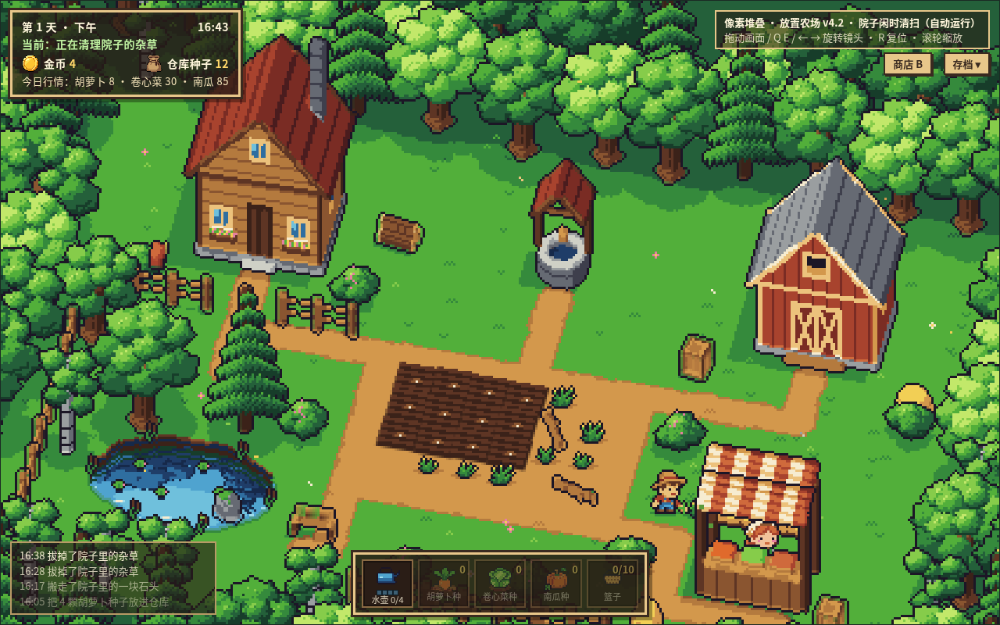
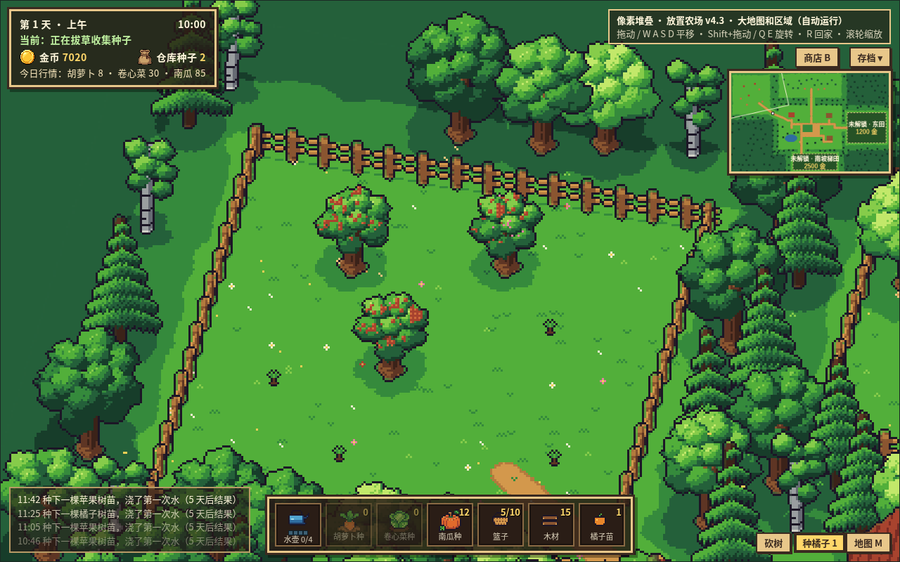
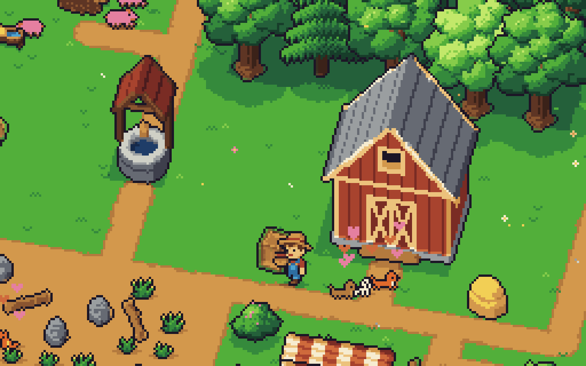
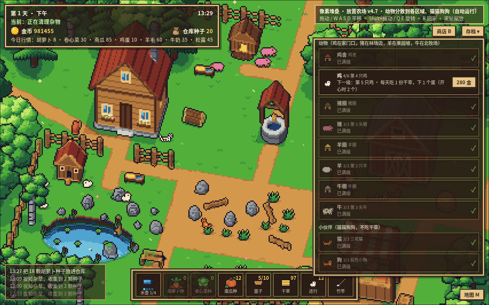
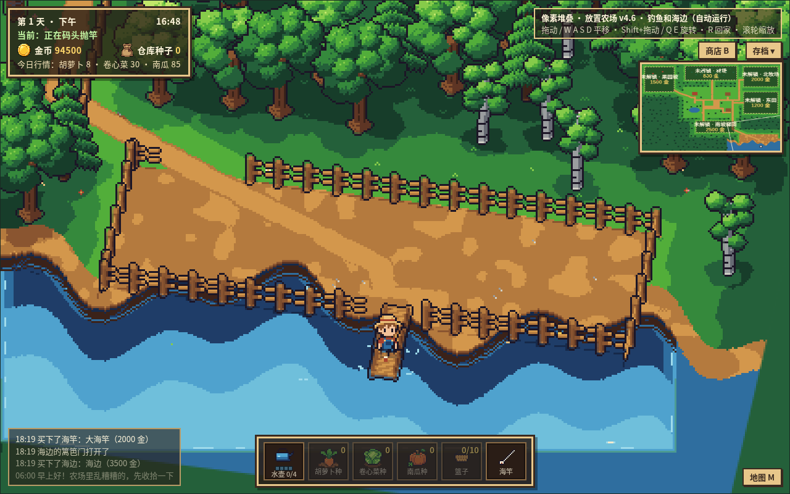

# 像素堆叠 · 放置农场 v4.7.1 · 风格 A

一个自动运行的放置农场：农夫自己干活赚钱，玩家用金币在商店解锁新内容（见玩法设计稿的分阶段路线）。v4.0 是第 1 阶段：存档和慢节奏；v4.1 是第 2 阶段：商店、工具升级和种子经济；v4.2 让农夫在田里没事时去清理院子；v4.3 是第 3 阶段：大地图、可购买的区域、斧头、砍树和移植果树；v4.3.1 把家门口的田改成三次各 +4 格，第二天就能扩第一次。v4.4 给劳作加上短促的像素特效，并把池塘第 6 层的闪光和水滴按 @asynkimo 的帖子补全；v4.5 是第 4 阶段：北牧场、鸡舍和牛羊棚、鸡羊牛，农夫喂食饮水、捡蛋挤奶剪毛卖给商人。v4.6 加了钓鱼：开局就有竹竿，闲下来去池塘钓；商店可升级钢竿和碳素竿；中后期解锁东南海边，买了海竿就能在码头海钓。不需要构建，所有素材都在本目录里，离线也能运行。v4.7 把动物分散到各区域：家门口第一周就能盖鸡舍养鸡，猪在林场边、羊在果园坡、牛在北牧场，各自要先买区域再盖棚子；另外加了猫猫狗狗这些陪伴型小伙伴。不需要构建，所有素材都在本目录里，离线也能运行。v4.7.1 加上游玩记录：每天的收支、忙碌和闲下来的时间会记在浏览器里，Chrome 还可以把存档和日志同步到本机一个文件夹（比如「文稿 / pixel-farm-sync」），开发时可以直接读，不必来回粘贴。

v3 把整套美术按「风格 A」重做：参考 16-bit SNES/GBA 农场游戏（Stardew Valley、Fields of Mistria 那种精神）。另外借了 D 的两点：堆叠物体少细节、按面分级着色。

## 在线试玩
https://mouzhi.github.io/pixel-farm/ （`main` 分支即线上版本）



## 运行
- 直接双击 `index.html`，用 Chrome / Edge / Safari 打开就行。
- 也可以在本目录运行 `python3 -m http.server 8000`，然后打开 http://localhost:8000 。

URL 参数：
- `?speed=4`：时间流速倍数，默认是 1，一天大约 5 分钟（白天约 4.7 分钟，睡觉快进约 30 秒）。
- `?manual`：不自动跑动画，测试脚本用 `__farm.advance()` 推进。
- `?angle=0.22`：初始镜头角度，默认是 0.22，接近正面略带斜角。
- `?seed=123`：换一个随机农场布局。
- `?cursor=1`：显示一个假鼠标圈，录屏时用。
- `?nowind`：关掉风，调试用。
- `?nofx`：关掉劳作特效（尘土、水花、收获闪光、金币等），调试用。

## 操作
- 地图有 64×50 格（v4.6 起向南加了海边），农场只是中间一块。鼠标拖动、手指滑动或按 W A S D 平移镜头；右键拖动、Shift+拖动或 Q / E、← / → 旋转；按 R 回到农场、恢复默认角度。
- 右上角的小地图显示整张地图、未解锁的区域和价格，点哪里镜头就去哪里；按 M 或右下角「地图」开关。
- 滚轮按整数倍放大画面，像素始终保持方正（缩小看全图用小地图）。
- 按 B 或右上角「商店」打开商店，Esc 关闭。买了游戏倍速后，商店左边会出现 1× / 2× / 4× 按钮。
- 屏幕偏移每帧取整到整像素，所以平移和静止时东西都逐像素对齐，没有抖动。

## 每天的循环（v4.2）
农夫用「任务板」决定做什么：每种活（收获、浇水、播种、取种子、买种子、存种子、卖菜、拔草、清杂物、开垦、清理院子）都有一个基础优先级，再减去走过去的距离，分最高的先做。下午 3 点后浇水优先级抬高，篮子满了必须先去卖。田里的活都做完以后，农夫会去清理院子里的杂草、石头、枯枝和小石子，不会再一到下午就坐在池塘边发呆。

1. 收获成熟的作物，放进篮子（最多 10 个，可升级）。收获时有一定概率留下这种作物的种子（胡萝卜 70%，南瓜 60%，西瓜 55%，偶尔两颗）；草莓是多年生，一棵能摘 10 次，最后一次才留种。
2. 清理石头和树枝，拔草收集胡萝卜种子，把种子放进仓库。
3. 开垦土地。开垦过的地永久保留，收获后不会变回荒地。开局只开放家门口田的 12 格，另外 12 格先荒着，以后用金币解锁。
4. 播种：农夫按当天行情挑每格每天最赚的作物（胡萝卜 1 天、卷心菜 2 天、南瓜 4 天成熟；草莓、西瓜要在商店解锁）。买高价种子最多花手头一半的钱。
5. 浇水：水壶装 4 格水（可升级到 8 / 16 / 30），空了去井边装满。每格每天浇一次就管一整天；作物只在夜里长一天，前提是当天浇过水。
6. 去集市整篮卖掉，顺便卖掉多出来的种子（随身种子超过一整片地的用量才卖），种子不够时向商人买。商人收购价每天小幅波动（HUD 的「今日行情」，↑↓ 表示高于或低于基础价）。
7. 田里没事做了，就去清理院子四周（不挡路、不压在建筑和田上）的杂草、石头、枯枝和小石子。杂草有时会掉 1 颗胡萝卜种子，石头和枯枝偶尔有 1 金，小石子没有收益。
8. 回家睡觉。夜里田里的空地还会长杂草杂物；院子里也会慢慢冒出几处，但有上限，不会越来越乱。

底部的背包栏显示水壶剩余水量、随身的各种种子（只显示已解锁的）和篮子里的作物。



## 商店（v4.1）
金币只花在这里，农夫会自动用上买到的东西：

| 物品 | 等级和价格 |
|---|---|
| 家门口的田 | 开垦 4 格 60 → 再开 4 格 130 → 最后 4 格 250（共 24 格） |
| 水壶 | 8 格 80 → 16 格 600 → 30 格 2000 |
| 鞋子 | 走路 ×1.25 200 → ×1.5 800 → ×1.8 2500 |
| 锄头 | 开垦快一倍 250 → 一锄翻 3×3 3000 |
| 篮子 | 20 个 300 → 40 个 1200 |
| 游戏倍速 | 2× 600 → 4× 3000 |
| 草莓种子 | 800（4 天结果，之后每天摘一次，共 10 次） |
| 西瓜种子 | 2500（6 天成熟，卖 220） |


按设计稿的推荐顺序买，大约第 3 天（11 分钟）买第一把水壶，第 11 天左右 24 格全开，第 13–15 天买 2× 倍速，20 天累计收入约 4,800–5,700 金（`node tools/econ.js` 用真实游戏跑出来的数字）。

## 大地图和区域（v4.3）
农场四周是森林，四块地用篱笆围着，在商店「区域」一栏买下后篱笆门打开，农夫顺着小路过去干活。没买的区域地面偏暗，门口有一把锁和写着名字、价格的牌子（点牌子打开商店），商店里每块地都有「看看」按钮把镜头移过去。

| 区域 | 位置 | 价格 | 内容 |
|---|---|---|---|
| 林场 | 北边森林 | 800 | 可以砍的树，砍掉的树桩 3 天后长出小树、7 天后长回大树 |
| 东田 | 东边 | 1200 | 24 格新田（开垦前杂草石头多），有自己的水桶 |
| 果园坡 | 西北 | 1500 | 3 棵苹果树，空地可以移植果树 |
| 南坡梯田 | 南边 | 2500 | 24 格新田，有自己的水桶 |

斧头 500 金。砍树和种树是玩家下的指令，农夫有空就去做（指令最多 24 条）：

- **砍树**：买了斧头和林场后，右下角出现「砍树」按钮。点它，再点林场里的树，树上出现小斧头标记；再点一次取消。农夫砍倒一棵得 5 份木材（集市 4 金一份）和 1 棵果树苗（苹果 60%、橘子 40%）。果树不能砍。
- **移植**：有树苗时右下角出现「种苹果 n」「种橘子 n」。点它，再点一块空草地（农场里或已买的区域，不能在田里、路上、房子边、别的树旁或院子杂物上），那里插一面小旗；农夫会去种下并浇水。树苗 5 天后结果。
- **果树**：苹果树每 3 天结 5 个（12 金一个），橘子树每 2 天结 4 个（15 金一个）。熟了农夫自己去摘，和菜一起放篮子卖。
- Esc 或「指令 n ✕」退出模式、取消全部指令。




## 动物和小伙伴（v4.5 北牧场，v4.7 分散到各区域）
v4.7 起动物不再全挤在后期的北牧场：开局的家门口就能养鸡，猪、羊、牛分别跟着林场、果园坡、北牧场解锁。商店「动物」一栏每种动物都要「区域 + 棚子」两个条件（没满足的卡片写着「先买…」，卡片上的「看看」会把镜头移到棚子的位置）。买下的棚子和动物马上出现；动物在自己棚子周围慢慢走、低头吃草，天黑后回到棚门口。每个棚子有自己的饲料槽和水槽。

| 动物 | 在哪 | 先买 | 棚子 | 动物价格 | 吃 | 产出 | 脚本玩家大约第几天买到 |
|---|---|---|---|---|---|---|---|
| 鸡 ×6 | 家门口西边的篱笆院子 | — | 鸡舍 300 | 100–340 | 1 份干草 | 每天 1 个蛋（10 金） | 鸡舍第 7 天，第 1 只鸡第 7–8 天 |
| 猪 ×3 | 房子后面、林场小路旁的空地 | 林场 800 | 猪圈 500 | 400–560 | 2 份 | 每 2 天拱出 1 颗松露（45 金） | 猪圈第 18–20 天，第 1 头猪第 19–20 天 |
| 羊 ×3 | 果园坡西边 | 果园坡 1500 | 羊圈 900 | 700–900 | 2 份 | 每 3 天 1 份羊毛（60 金） | 第 32–33 天 |
| 牛 ×3 | 北牧场 | 北牧场 2000 | 牛棚 1500 | 1400–1900 | 3 份 | 每天 1 瓶牛奶（35 金） | 第 46–47 天 |

（「大约第几天」来自 `node tools/econ.js 60` 的脚本玩家，种子 默认 / 7 / 42；先买工具和田的玩家会晚一点，优先买鸡舍的玩家第 5–6 天就能养鸡。脚本玩家 60 天累计 79k–83k 金，其中动物产品约 11.4k–12.1k，买干草约 2k。）

照顾的循环（都由任务板自动安排，玩家不用操作）：

- **干草**：上午把当天需要的干草倒进各个棚子的饲料槽。干草在集市买（3 金一捆，顺路卖菜时补到 4 天的量，最多花一半金币）；有了任何一个棚子以后，田里拔的每棵杂草也会晒成 1 份干草。仓库最多 99 份。
- **水**：鸡舍的水槽每天加 1 格水，其他棚子 2 格；果园坡（v4.7 新加）和北牧场有自己的水桶。
- **抚摸**：每只动物每天摸一下（18 点前，有空才去），头上冒小红心。
- **收获**：蛋、松露、羊毛、牛奶放进篮子，和菜一起卖给商人，价格每天像作物一样小幅浮动。每只动物最多攒 3 份没收的产品。
- **心情**：每只动物有一个 0–100 的心情值，开局 60。吃饱 +8、没吃 −25，有水 +4、没水 −15，摸过 +8、没摸 −6。心情 80 以上产量翻倍，30 以下（闷闷不乐）不产；没吃饱的那晚也不产。物品栏的「动物」格显示平均心情，鼠标停上去看每只的数值。
- 下午 2 点以后喂食和加水的优先级会提高，地多活多时农夫也会在天黑前赶去喂。

### 小伙伴：猫猫狗狗（v4.7）
商店「小伙伴」一栏，不需要区域，不吃干草，买了就在大地图上跟着农夫生活：

| 小伙伴 | 毛色（按购买顺序） | 价格 | 小加成 |
|---|---|---|---|
| 猫 ×3 | 橘猫、黑猫、三花猫 | 120 / 180 / 260 | 每只每天早上在门口放 1 颗胡萝卜种子 |
| 狗 ×3 | 柴犬、黑白狗、棕色小狗 | 160 / 240 / 320 | 每只让农夫走路快 3% |

- 狗跟在农夫身后走，农夫停下干活时坐在旁边，等久了趴下睡觉。
- 猫自己溜达，找一块晒得到太阳的地方（房前、池塘边、各个区域里的空地）趴着睡，偶尔跑到农夫附近。
- 晚上和农夫在家时，猫狗都回到门廊睡觉。
- 点一下猫或狗就摸摸它，冒小红心；农夫每天也会抽空摸每只一次。
- 动作都是整像素、慢悠悠的，不会抖动；猫狗不存进存档（由商店等级决定），读档后在家门口重新出现。








## 钓鱼和海边（v4.6）
- 开局背包里就有一根竹竿，不用买。田里的活和院子杂物都忙完了，农夫才会去家门口的池塘钓鱼（优先级比清理院子还低）。
- 抛竿、等待、咬钩、收线是一段安静的动画：整像素的钓线和浮标，咬钩时水面溅起一小簇水花（`fx.js` 的 `splash`）。
- 池塘里有鲫鱼、鲤鱼、草鱼、鲈鱼、锦鲤，稀有度和售价不同；钓到的鱼进篮子，农夫会拿到集市卖掉。鱼价固定，不参与每日行情波动。前期收入很低，只是填补空闲，第二天扩田的节奏仍和 v4.3.1 差不多。
- 商店「钓鱼」一栏：钢竿 400 金、碳素竿 1600 金，咬钩更快，少见的鱼更容易上钩。
- 大地图南边多了一条海岸（沙滩、分层海水、码头）。「海边」3500 金中后期解锁；再买海竿 2000 金，就能在码头钓沙丁鱼、海鲈、鲷鱼、金枪鱼、旗鱼，卖得更贵。
- 背包显示当前钓竿，篮子里的鱼按种类计数；左下角有一个最近渔获小记录。
- 规则在 `fish.js`（浏览器和 Node 都能跑），和 `animals.js` 一样是纯数据和纯函数。




## 存档
- 自动存在这个浏览器的 localStorage 里（键名 `mouzhi/pixel-farm:save`，上一份好的存档在 `:bak`）。每天早上、每 15 秒、切到别的标签页或关闭页面时都会保存，刷新不丢进度。不同浏览器、不同设备各有各的存档。
- 离线收益：关掉页面或切走一段时间（1 分钟以上）再回来，按最近 3 天的平均日收入、在线 50% 的速度结算金币，最多算 3 个游戏日，回来时弹一张小结。离线期间田地不变。
- 右上角「存档」菜单：看上次保存时间、导出存档文字、导入存档、重置（要点两次，旧档会另存一份）；另外可以导出游玩记录，或在 Chrome 里同步到本机文件夹（见下面「游玩记录和本地同步」）。
- 主存档损坏时自动用备份恢复，损坏的数据另存一份；如果浏览器里有更新版本的存档，旧页面不会覆盖它。
- 存档版本 3（v4.2）加了院子杂物列表（种类和变体编号、位置）；旧存档会自动升级，并在加载时补一圈院子杂物，田地、金币、商店和种子不变。空的院子列表表示已经清完，不会重新生成一整圈。
- 存档版本 4（v4.3）加了区域和斧头的商店等级、树（位置、种类、树桩 / 树苗 / 大树、果子是否成熟）、砍树和种树指令、木材和树苗；每格田记着属于哪块地。旧存档升级后什么都没买，树按默认森林生成。
- 存档版本 5（v4.3.1）把家门口田的升级从两次各 +6 格改成三次各 +4 格。旧档里买过第一档（18 格）的会升到新的第二档（20 格），买过第二档的仍是 24 格，已开放的格子不会变少。
- 存档版本 6（v4.5）加了牧场、建筑和动物的商店等级、动物列表（种类、心情、产出倒计时、没收的产品、今天摸过没有）、饲料槽和水槽、干草库存，以及蛋 / 羊毛 / 牛奶的价格。旧存档升级后什么都没买，干草为 0。动物的位置不存，读档后在牧场里重新站好。
- 存档版本 7（v4.6）加了钓竿、海竿和海边的商店等级，以及 `catches` 渔获记录。旧存档升级后自动拥有竹竿（`rod` 为 0 表示已有，不是没买），没有海竿和海边，渔获记录为空。篮子可以装鱼。
- 存档版本 8（v4.7）把一个饲料槽改成每个棚子一个（`troughs`），加了猪圈、羊圈、猪、猫、狗的商店等级和松露价格。v6 / v7 的旧档什么都不丢：鸡舍原样保留，鸡搬到家门口的新鸡舍；有羊的档送一个羊圈（没买果园坡的同时送果园坡）；牛棚改成只养牛，原来的饲料槽和水槽归牛棚（没有牛棚就归鸡舍）。
- 代码：存档读写和版本迁移在 `save.js`，节奏、经济和商店数值在 `sim.js`，地图、区域、果树和木材规则在 `world.js`，钓鱼规则在 `fish.js`，游玩记录和本地文件夹同步在 `playlog.js`，界面（背包、商店、倍速、小地图、砍树种树按钮、存档菜单）在 `ui.js`。规则见 CONTRIBUTING.md「存档兼容」。

## 游玩记录和本地同步
游玩记录不写进存档，也就不用升 `saveVersion`。它单独放在这个浏览器的 localStorage 里，键名是 `mouzhi/pixel-farm:playlog`，最多保留最近 365 天的每日摘要和最近 2000 条重要事件。每天早上、最多每约 60 秒、以及离开页面时会写入。

每日摘要包括：游戏日、真实时间、当天开始/结束的金币、收入来源（作物 / 水果 / 动物 / 鱼 / 木材 / 院子 / 离线）、按项目计的支出、购买记录（游戏日、游戏时刻、农场创建以来的真实分钟数）、田地/区域/动物数量、农夫忙碌/空闲/睡觉的游戏分钟数及空闲在做什么（钓鱼 / 休息 / 巡视）、离线结算、当时的倍速、以及一次 FPS 抽样。重要事件包括购买、解锁区域、砍树/种树指令、开关会话、改倍速、离线结算。

### 同步到本机文件夹（Chrome）
用 Chrome 打开游戏时，可以让它把两份可读的 JSON 写到你选的文件夹里，方便开发时直接读取本机存档和日志，不必复制粘贴：

1. 建议先在「文稿」里建一个文件夹，例如 `pixel-farm-sync`（完整路径一般是 `~/Documents/pixel-farm-sync`）。
2. 打开游戏页面，点右上角「存档」。
3. 点「同步到本地文件夹…」，在弹出的系统对话框里选中刚才那个文件夹，允许编辑。
4. 之后每个游戏日早上、最多约每 60 秒、以及关掉或切走页面时，会更新文件夹里的两个文件：
   - `pixel-farm-save.json`：当前存档的漂亮排版 JSON，外加 `meta`（`kind` 为 `pixel-farm-save`，还有导出时间、游戏版本、`saveVersion`）。真正的存档对象在 `save` 字段里。
   - `pixel-farm-playlog.json`：游玩记录的漂亮排版 JSON，外加 `meta`（`kind` 为 `pixel-farm-playlog`，`schema` 为 1），以及 `sessions`、`days`、`events`。
5. 浏览器下次打开页面时，可能要你再点一下授权：页面上会出现一个不显眼的「点此恢复本地同步」按钮，点了就会继续写文件。存档菜单里也能看到上次同步时间。
6. 不想再同步时，在菜单里点「停止本地同步」。换用别的浏览器时，可以用「导出游玩记录」下载同一份 `pixel-farm-playlog.json`。

`pixel-farm-playlog.json` 的主要字段：

```json
{
  "meta": { "kind": "pixel-farm-playlog", "schema": 1, "exportedAt": "2026-11-17T16:00:00.000Z", "gameVersion": "4.7.1" },
  "startedAt": 1731860000000,
  "sessions": [
    { "startedAt": 1731860000000, "endedAt": null, "dayStart": 1, "dayEnd": 1, "coinsStart": 0, "coinsEnd": 8, "speed": 1, "gameVersion": "4.7.1", "farm": 1731860000000 }
  ],
  "days": [
    {
      "day": 1, "farm": 1731860000000, "realAt": 1731860000000,
      "goldStart": 0, "goldEnd": 8, "open": false,
      "income": { "crops": 0, "fruit": 0, "animals": 0, "fish": 0, "wood": 0, "yard": 8, "offline": 0 },
      "spend": { "seeds": 0 },
      "purchases": [{ "id": "field", "name": "田地", "label": "开垦 4 格", "cost": 60, "day": 2, "t": 480, "realMin": 12.5, "at": 1731860750000 }],
      "tiles": 12, "regions": 0, "animals": 0,
      "busyMin": 400, "idleMin": 200, "sleepMin": 840,
      "idle": { "fish": 120, "rest": 50, "patrol": 30, "other": 0 },
      "speed": 1, "fps": { "avg": 59.8, "min": 48.0, "n": 300 },
      "offline": [{ "gold": 12, "days": 1, "awaySec": 600, "capped": false, "avg": 24, "at": 1731861000000 }]
    }
  ],
  "events": [
    { "type": "session-start", "at": 1731860000000, "day": 1, "t": 360, "coins": 0 },
    { "type": "purchase", "id": "field", "cost": 60, "day": 2, "t": 480, "realMin": 12.5 }
  ]
}
```

`days[].t` 和事件里的 `t` 是游戏钟的分钟数（06:00 为 360）。`busyMin` / `idleMin` / `sleepMin` 也是游戏分钟。`farm` 是这个农场的 `createdAt`，重置后再玩会另起一条时间线，旧记录仍按原来的 `farm` 留着。


## 风格指南（风格 A）
### 调色板
- 固定 35 色（v3.2 为分层水面加了 3 色：最深水 `#16294a`、天光中间色 `#6fc0dc`、浅滩青 `#4c9c94`），写在 `assets/palette.js`，色板图在 `assets/palette.png`。
- 颜色按 ramp 分组，每组从暗到亮：
  - ink：2 色，全局最暗。
  - green：6 色，草地基色是 `#52af3a`。
  - wood：6 色，小路是 `#d3984c`。
  - roof：4 色，红屋顶。
  - stone：4 色。
  - water：4 色。
  - skin：2 色。
  - accent：4 色，奶白、麦黄、橙、粉。
- 所有体素、地面、水面、贴花和手绘小精灵都只用这套调色板。SpriteCook 生成的角色和作物量化到原来的 32 色。
- 白天画面约 98% 的像素正好落在色板上。剩下的是半透明的农夫身影，以及浏览器 1 级的取整误差。傍晚和夜里的色调、灯光是叠在上面的。

### 明暗（借鉴 D：按面分级，不做渐变）
- 体素只记一个"作者色"，着色只在它所在的 ramp 里往暗处走：
  - 顶面：作者色本身。
  - 斜面（屋顶、圆形物体上半）：作者色；朝向屏幕右侧时暗一级。
  - 侧面：暗一级；朝向屏幕右侧时暗两级。
- 光源固定在屏幕左上方。所以模型旋转时，每个物体按自己在屏幕上的朝向，在 16 个角度扇区里各用一套切片。
- 不加环境光遮蔽，不加噪点，不做自由渐变。
- 面的法线从体素周围的占用情况算出，所以任意坡度的屋顶都能用。圆的东西（石头、干草堆）直接用解析法线。

### 描边（选择性描边）
- 每个物体一条外描边，不是每层切片一条：
  - 堆叠物体在"按角度缓存"的那张图上描。
  - 树在"按姿态缓存"的那张图上描。
  - 小精灵在生成时描。
- 描边色取相邻像素所在 ramp 的最暗一级：树是深绿 `#173d2a`，木头是深棕 `#3b2219`，屋顶是 `#4a1c1e`。最暗一级本身再用 ink `#1c1626`。
- 地面、耕地不描边。

### 像素密度与比例
- 画布是 426×266 原生像素，按整数倍放大（1280×800 下是 3 倍）。
- 1 格 = 16 像素，经典 16-bit 图块尺寸。
- 体素 1:1 对应屏幕像素，墙面 1 像素一层。
- 农夫约 16×24：大头小身，3 头身左右的 Q 版。
- 房子 70×58，墙高 34，屋脊高约 68，再加烟囱。房子总高约是农夫的 3 倍，和样图 A_1 的比例接近。
- 树的冠幅约 50 像素，和房子差不多高。灌木约 20 像素。

### 少细节（借鉴 D）
- 堆叠物体只保留读得出形状的大块：
  - 墙板每 5 层一条缝。
  - 屋顶每 6 层一道瓦线。
  - 窗户是奶白框 + 一块玻璃 + 一处高光。
- 1 像素宽、会在旋转时断开闪烁的纹理一律不做。
- 草地纹理（草丛、小花、石子）是不旋转的 2D 贴花，只跟着位置平移，所以转镜头时地面不会"爬"。

### 树（v3.2 造型，v3.3 把风动放缓）
参考：[traveling waves 森林帖](https://x.com/asynkimo/status/2121230694860890582)，以及 SpriteCook 的[树木风动教程](https://www.spritecook.ai/blog/pixel-art-trees-wind-animation)。
- 树冠由很多个"叶团"组成：橡树 14–19 团，桦树 8–11 团，灌木 6 团。
  - 每个叶团是一张小 2D 精灵，边缘是扇贝形。内部按抖动网格分成一个个"叶簇小格"，每格左上亮、右下暗，所以看得出一簇簇叶子，而不是噪点。
  - 叶团右下沿有一条最深色的分隔边，相邻叶团因此分得开。
  - 树冠上层的叶团最亮，只有顶部叶团才有最亮一级；中层暗一级，下层暗两级，所以整棵树是"左上受光、下面背光"。
- 每个叶团背后都有一个不动的深色"内层"。叶团被风吹起时，不会露出空洞。
- 树种和配色：
  - 普通橡树（绿）、亮橡树（偏黄绿）、深色橡树（后排用，显得有纵深）。
  - 分层松树：5–6 层枝叶，下沿是锯齿状针叶。树干完全不动；只有靠上的几层会偶尔偏 1 个像素。
  - 白桦（灰白树干带黑纹）、小橡树、灌木（部分带浆果）。
- 布局：农场四周两排交错的"林缘"。
  - 后排是大树和深色树，前排是高矮混合。
  - 靠近默认镜头的一侧只放矮树和灌木，不挡农场。
  - 林下地面更深（`#358a3c` → `#24603a`）。
  - 池塘后面也有几棵树，好让水里有倒影。
- 只有叶团的*位置*随镜头旋转，球从哪边看都一样，所以转镜头时树冠不闪。
- 风沿用行进波，v3.3 放慢、收小，避免各层错开跳动：
  - 6 股阵风加外围微风，过阻尼弹簧控制轻微倾斜（阔叶周期约 5 秒，松树约 8 秒）。行进波周期约 5.4 秒。
  - 同一棵树共用一个风场采样，再按高度加权，整冠一起摆，层与层不会各自错开。
  - 位移只走整像素：阔叶树冠多为 0–1 像素，阵风高峰最多 2 像素；松树上限 1 像素，且没有上下起伏。任何树种的树干都完全不动。
  - 叶团每秒换 10 次姿态。各棵树在错开的帧上换姿态，不会集中在同一帧。
- 每棵树每个姿态的画面，直接在像素数组里拼好（树干堆叠 + 叶团 + 一圈描边），再整张写入，不用从画布回读。

### 水面（v3.2，参考 @asynkimo 的分层池塘）
参考：[Boring water 帖子串](https://x.com/asynkimo/status/2122402277441069409)，以及 SpriteCook 的[池塘教程](https://www.spritecook.ai/blog/pixel-art-pond-water-reflections-ripples)。
- 地面里的池塘只是一种平涂的标记色。每一帧在屏幕空间重新给水面着色，所以"远岸""近岸"会跟着镜头转。
- 每个水面像素只取一个色阶编号。各层之间互相覆盖色阶，最后才一次性换成调色板颜色，所以水面永远不会混色发糊。分 6 层：
  1. 离岸越远越深：深水核心，靠岸一圈浅一级。
  2. 近岸一半映着天空：离远岸越远越亮，分两档。
  3. 倒影：池塘后面的树（用当前被风吹动的姿态）和香蒲，上下翻转、压扁到 55%，只用 3 个暗色阶。离岸 3 行以后，每行按整像素左右错开。
  4. 浅滩和水波：近岸浅滩是青色，近岸地面变湿、暗一级，岸边有一圈"拍岸"短线。水中的长苔石头四周有泡沫。
  5. 后岸：岸边有一道泥土唇边。它在水里映成深色的 6 行，有微弱波纹，水线会慢慢"爬"上岸。
  6. 点缀：水滴涟漪（5 帧圆环）；每圈随机 20 个闪光点，每个闪光是一条会变长再断开的短横线；落叶会掉进水里漂一会儿再沉下去；睡莲叶上下浮动，下面有一行影子。v4.4 按 asynkimo 第 6 步又补了暖色（乳白 / 金）的十字闪光，以及从空中落入深水、溅起一圈涟漪的水滴。
- 所有动画都在同一个 5 秒循环里，而且每种动画在一个循环里都转整数圈，所以循环处没有跳变。

### 劳作特效（v4.4）
开垦扬尘、浇水水花、收获闪光、拔草碎叶、碎石、砍树木屑、卖出时弹出的金币，都是短促的整像素特效，只用风格 A 调色板，走一个最多 180 个粒子的对象池，不每帧新建 canvas。做法参考了 [pixelfx](https://github.com/patch-gg/pixelfx)（MIT）的视觉语法（沙土扇形、带尾巴的水滴落地溅起小水冠、闪烁的十字星、会转动的金币），但没有引入它的 ESM 运行时，而是用一份很小的纯 JS（`fx.js`）按我们的画布重写。`?nofx` 可关掉。

## 长时间运行（v3.1 修复）
v3.0 在 Chrome 里挂久了，画面会只剩灯光、农夫和作物，地面、房子、树都消失了。

原因是每张体素切片各占一个 canvas，几分钟后就有约 1 万个 canvas、120MB 以上的像素内存，而且还在一直增长。GPU 内存紧张，或者标签页切到后台以后，Chrome 会回收这些 canvas 的 GPU 存储，它们就变成空白（context lost）。

v3.1 的修复：
- 每个模型的每个角度扇区，把所有切片合进一张图集。实测 canvas 稳定在约 4000 个，不再增长。
- 所有离屏 canvas 都改成 CPU 存储（`willReadFrequently`）。这类 canvas 不会被回收，往 CPU 主画布上画也不再需要从 GPU 回读。
- 按角度缓存的堆叠图，改成一个全局的"最近最少使用"缓存，像素上限约 64MB，最多 6000 张，超出就丢掉最久没用的。
- 加了一个看门狗：每 3 秒，以及标签页切回前台时，检查一次缓存。一旦发现缓存变空白，就从体素数据重建全部缓存，不用刷新页面。
- 事件记录只保留最近 300 条。

浸泡测试（`tools/soak.js`）：15 分钟、12 倍速，大约相当于模拟 40 天，并且定时旋转镜头。canvas 数量和内存一直是平的，没有报错。

## 技术要点
- 每个体素模型按 z 切成切片，逐层上移 1px，每层旋转相同角度，垂直压缩到 0.75。
- 大物体在每个角度都先 3 倍超采样堆叠，再用"多数颜色"缩回 1 倍。然后描边，按角度缓存。画面按 1.4° 一档旋转，空闲时预先算好附近的角度。
- 耕地是 2 层高的扁平堆叠，垄沟随之旋转，同样走这套缓存，所以不闪。
- 阴影先画成一张遮罩，再把遮罩下的地面换成同一 ramp 暗一级的颜色。阴影也留在色板内。
- 夜间光照按像素分档，再加 Bayer 抖动，只计算灯光覆盖的范围。
- 农夫被遮挡时，会显示半透明的身影。

## 素材（assets/）
- `palette.js`、`palette.png`：35 色调色板和色板图。
- `sprites.js`：精灵表，以 data URI 内嵌，所以 `file://` 也能跑。`chars.png` 和 `crops.png` 是同样内容的 PNG。
  - 农夫：
    - 正面、侧面、背面的基础图用 SpriteCook pixel-engine-image-v1 生成，16×24，提示词限定在本调色板里。每个方向挑了 3–4 个候选中最好的一个。
    - 动画用 pixel-engine-v1.5 生成，每段 4 帧，28×28：三个方向的走路、锄地、拔草、浇水。
  - 市场老板：基础图另做，再加 4 帧招手动画，卖菜时播放。
  - 成熟的胡萝卜、卷心菜、南瓜：16×16 公告板精灵。
  - 所有 SpriteCook 输出都由 `tools/build_sprites_A.py` 量化到 32 色。原始文件在 `assets/src/`，文件名以 `A` 开头。
- 程序化生成、可旋转的部分：
  - 房子、仓库、摊位、水井、栅栏、道具、石头和树枝、耕地、树：体素堆叠或叶团圆盘。
  - 草丛、小花、睡莲、香蒲、杂草、种子和幼苗：手绘的小 2D 精灵，用同一调色板。
- `hud_icons.png`：HUD 图标。

## 截图（shots/，不进 git）
`shots/` 由 `tools/shots.js` 等脚本生成，体积大，不进仓库（见 [EXCLUDED.md](EXCLUDED.md)）。README 配图放在 `docs/img/`。


- `style_A_vs_mock.png`：现在的游戏画面和目标样图 A_1 的并排对比。
- `compare_v2_vs_v3.png`：v2 和 v3 的对比。
- `trees_water_before_after.png`：v3.1 和 v3.2 的对比，包括全景、树特写和池塘特写。
- `trees_water_wind.gif`：10 秒的林缘风动和池塘动画。
- `rotation_style_A.gif`：转一整圈镜头，风照常吹。
- `00_morning.png` 到 `11_day2_morning.png`：一天里各个阶段的截图。
- `closeup_farmer.png`、`closeup_house.png`、`closeup_tree.png`、`closeup_market.png`、`closeup_sprite_sheet_x4.png`：特写。
- 较早版本的对比图（`rotation_before_vs_after.gif` 等）保留作参考。
- `preview.mp4` 和 `preview.gif`：从清晨到夜里的录屏，中间演示手动旋转镜头。

## 仓库结构和协作
```
index.html  game.js  playlog.js   游戏本体（GitHub Pages 直接发布 main 的根目录）
assets/                          运行时素材：调色板、精灵表、HUD 图标
assets/src/                      SpriteCook 原图和早期模型（构建用，游戏不加载）
tools/                           测试、截图、构建脚本（见 tools/README.md）
docs/img/                        README 配图
.github/                         CI（语法检查和无头冒烟测试）、PR 模板
CONTRIBUTING.md                  分支、worktree、PR 检查清单、存档兼容、部署
EXCLUDED.md                      没有进仓库的大文件清单
```
分支、worktree 和 PR 流程见 [CONTRIBUTING.md](CONTRIBUTING.md)。
