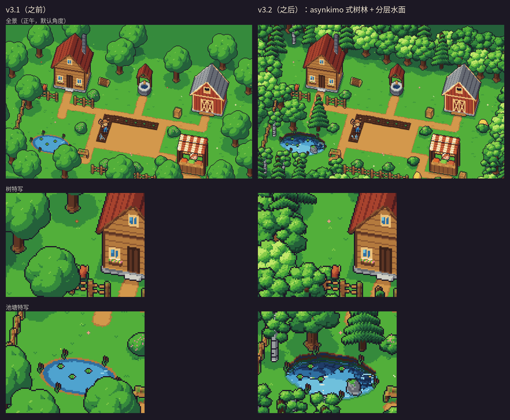

# 像素堆叠 · 放置农场 v3.2 · 风格 A

一个纯自动运行的放置农场小品，目前还没有玩法交互，只能手动转镜头。不需要构建，所有素材都在本目录里，离线也能运行。

v3 把整套美术按「风格 A」重做：参考 16-bit SNES/GBA 农场游戏（Stardew Valley、Fields of Mistria 那种精神）。另外借了 D 的两点：堆叠物体少细节、按面分级着色。

## 在线试玩
https://mouzhi.github.io/pixel-farm/ （`main` 分支即线上版本）


## 运行
- 直接双击 `index.html`，用 Chrome / Edge / Safari 打开就行。
- 也可以在本目录运行 `python3 -m http.server 8000`，然后打开 http://localhost:8000 。

URL 参数：
- `?speed=4`：时间流速倍数，默认是 1，白天大约 3 分钟。
- `?angle=0.22`：初始镜头角度，默认是 0.22，接近正面略带斜角。
- `?seed=123`：换一个随机农场布局。
- `?cursor=1`：显示一个假鼠标圈，录屏时用。
- `?nowind`：关掉风，调试用。

## 操作
- 镜头不会自动旋转。鼠标拖动，或手指在画面上左右滑动，都可以旋转镜头。
- 按 Q / E 或 ← / → 也能旋转，按 R 回到默认角度。
- 滚轮按整数倍缩放画面，像素始终保持方正。
- 镜头固定在农场中心，屏幕偏移每帧取整一次，所以不旋转时静止的东西逐像素不动，没有抖动。

## 每天的循环
1. 清理石头和树枝，拔草收集种子，把种子放进仓库。
2. 开垦土地，从仓库取种子播种。
3. 去井边打水、浇水。作物分 4 个阶段生长。
4. 收获后去市场，从摊位正面卖给老板，金币增加。
5. 回家睡觉（Zzz）。夜里会冒出新的杂草和杂物，第二天继续。

## 风格指南（风格 A）
### 调色板
- 固定 35 色（v3.2 为分层水面加了 3 色：最深水 `#16294a`、天光中间色 `#6fc0dc`、浅滩青 `#4c9c94`），写在 `assets/palette.js`，色板图在 `assets/palette.png`。
- 颜色按 ramp 分组，每组从暗到亮：
  - ink：2 色，全局最暗。
  - green：6 色，草地基色是 `#52af3a`。
  - wood：6 色，小路是 `#d3984c`。
  - roof：4 色，红屋顶。
  - stone：4 色。
  - water：4 色。
  - skin：2 色。
  - accent：4 色，奶白、麦黄、橙、粉。
- 所有体素、地面、水面、贴花和手绘小精灵都只用这套调色板。SpriteCook 生成的角色和作物量化到原来的 32 色。
- 白天画面约 98% 的像素正好落在色板上。剩下的是半透明的农夫身影，以及浏览器 1 级的取整误差。傍晚和夜里的色调、灯光是叠在上面的。

### 明暗（借鉴 D：按面分级，不做渐变）
- 体素只记一个"作者色"，着色只在它所在的 ramp 里往暗处走：
  - 顶面：作者色本身。
  - 斜面（屋顶、圆形物体上半）：作者色；朝向屏幕右侧时暗一级。
  - 侧面：暗一级；朝向屏幕右侧时暗两级。
- 光源固定在屏幕左上方。所以模型旋转时，每个物体按自己在屏幕上的朝向，在 16 个角度扇区里各用一套切片。
- 不加环境光遮蔽，不加噪点，不做自由渐变。
- 面的法线从体素周围的占用情况算出，所以任意坡度的屋顶都能用。圆的东西（石头、干草堆）直接用解析法线。

### 描边（选择性描边）
- 每个物体一条外描边，不是每层切片一条：
  - 堆叠物体在"按角度缓存"的那张图上描。
  - 树在"按姿态缓存"的那张图上描。
  - 小精灵在生成时描。
- 描边色取相邻像素所在 ramp 的最暗一级：树是深绿 `#173d2a`，木头是深棕 `#3b2219`，屋顶是 `#4a1c1e`。最暗一级本身再用 ink `#1c1626`。
- 地面、耕地不描边。

### 像素密度与比例
- 画布是 426×266 原生像素，按整数倍放大（1280×800 下是 3 倍）。
- 1 格 = 16 像素，经典 16-bit 图块尺寸。
- 体素 1:1 对应屏幕像素，墙面 1 像素一层。
- 农夫约 16×24：大头小身，3 头身左右的 Q 版。
- 房子 70×58，墙高 34，屋脊高约 68，再加烟囱。房子总高约是农夫的 3 倍，和样图 A_1 的比例接近。
- 树的冠幅约 50 像素，和房子差不多高。灌木约 20 像素。

### 少细节（借鉴 D）
- 堆叠物体只保留读得出形状的大块：
  - 墙板每 5 层一条缝。
  - 屋顶每 6 层一道瓦线。
  - 窗户是奶白框 + 一块玻璃 + 一处高光。
- 1 像素宽、会在旋转时断开闪烁的纹理一律不做。
- 草地纹理（草丛、小花、石子）是不旋转的 2D 贴花，只跟着位置平移，所以转镜头时地面不会"爬"。

### 树（v3.2，参考 @asynkimo 的森林）
参考：[traveling waves 森林帖](https://x.com/asynkimo/status/2121230694860890582)，以及 SpriteCook 的[树木风动教程](https://www.spritecook.ai/blog/pixel-art-trees-wind-animation)。
- 树冠由很多个"叶团"组成：橡树 14–19 团，桦树 8–11 团，灌木 6 团。
  - 每个叶团是一张小 2D 精灵，边缘是扇贝形。内部按抖动网格分成一个个"叶簇小格"，每格左上亮、右下暗，所以看得出一簇簇叶子，而不是噪点。
  - 叶团右下沿有一条最深色的分隔边，相邻叶团因此分得开。
  - 树冠上层的叶团最亮，只有顶部叶团才有最亮一级；中层暗一级，下层暗两级，所以整棵树是"左上受光、下面背光"。
- 每个叶团背后都有一个不动的深色"内层"。叶团被风吹起时，不会露出空洞。
- 树种和配色：
  - 普通橡树（绿）、亮橡树（偏黄绿）、深色橡树（后排用，显得有纵深）。
  - 分层松树：5–6 层枝叶，下沿是锯齿状针叶；树干随风弯曲，每层位移 = 倾斜 × 高度²。
  - 白桦（灰白树干带黑纹）、小橡树、灌木（部分带浆果）。
- 布局：农场四周两排交错的"林缘"。
  - 后排是大树和深色树，前排是高矮混合。
  - 靠近默认镜头的一侧只放矮树和灌木，不挡农场。
  - 林下地面更深（`#358a3c` → `#24603a`）。
  - 池塘后面也有几棵树，好让水里有倒影。
- 只有叶团的*位置*随镜头旋转，球从哪边看都一样，所以转镜头时树冠不闪。
- 风沿用他的行进波：
  - 6 股阵风加外围微风，阻尼弹簧控制倾斜。
  - 叶团每秒换 10 次姿态，只走整像素。各棵树在错开的帧上换姿态，不会集中在同一帧。
- 每棵树每个姿态的画面，直接在像素数组里拼好（树干堆叠 + 叶团 + 一圈描边），再整张写入，不用从画布回读。

### 水面（v3.2，参考 @asynkimo 的分层池塘）
参考：[Boring water 帖子串](https://x.com/asynkimo/status/2122402277441069409)，以及 SpriteCook 的[池塘教程](https://www.spritecook.ai/blog/pixel-art-pond-water-reflections-ripples)。
- 地面里的池塘只是一种平涂的标记色。每一帧在屏幕空间重新给水面着色，所以"远岸""近岸"会跟着镜头转。
- 每个水面像素只取一个色阶编号。各层之间互相覆盖色阶，最后才一次性换成调色板颜色，所以水面永远不会混色发糊。分 6 层：
  1. 离岸越远越深：深水核心，靠岸一圈浅一级。
  2. 近岸一半映着天空：离远岸越远越亮，分两档。
  3. 倒影：池塘后面的树（用当前被风吹动的姿态）和香蒲，上下翻转、压扁到 55%，只用 3 个暗色阶。离岸 3 行以后，每行按整像素左右错开。
  4. 浅滩和水波：近岸浅滩是青色，近岸地面变湿、暗一级，岸边有一圈"拍岸"短线。水中的长苔石头四周有泡沫。
  5. 后岸：岸边有一道泥土唇边。它在水里映成深色的 6 行，有微弱波纹，水线会慢慢"爬"上岸。
  6. 点缀：水滴涟漪（5 帧圆环）；每圈随机 20 个闪光点，每个闪光是一条会变长再断开的短横线；落叶会掉进水里漂一会儿再沉下去；睡莲叶上下浮动，下面有一行影子。
- 所有动画都在同一个 5 秒循环里，而且每种动画在一个循环里都转整数圈，所以循环处没有跳变。

## 长时间运行（v3.1 修复）
v3.0 在 Chrome 里挂久了，画面会只剩灯光、农夫和作物，地面、房子、树都消失了。

原因是每张体素切片各占一个 canvas，几分钟后就有约 1 万个 canvas、120MB 以上的像素内存，而且还在一直增长。GPU 内存紧张，或者标签页切到后台以后，Chrome 会回收这些 canvas 的 GPU 存储，它们就变成空白（context lost）。

v3.1 的修复：
- 每个模型的每个角度扇区，把所有切片合进一张图集。实测 canvas 稳定在约 4000 个，不再增长。
- 所有离屏 canvas 都改成 CPU 存储（`willReadFrequently`）。这类 canvas 不会被回收，往 CPU 主画布上画也不再需要从 GPU 回读。
- 按角度缓存的堆叠图，改成一个全局的"最近最少使用"缓存，像素上限约 64MB，最多 6000 张，超出就丢掉最久没用的。
- 加了一个看门狗：每 3 秒，以及标签页切回前台时，检查一次缓存。一旦发现缓存变空白，就从体素数据重建全部缓存，不用刷新页面。
- 事件记录只保留最近 300 条。

浸泡测试（`tools/soak.js`）：15 分钟、12 倍速，大约相当于模拟 40 天，并且定时旋转镜头。canvas 数量和内存一直是平的，没有报错。

## 技术要点
- 每个体素模型按 z 切成切片，逐层上移 1px，每层旋转相同角度，垂直压缩到 0.75。
- 大物体在每个角度都先 3 倍超采样堆叠，再用"多数颜色"缩回 1 倍。然后描边，按角度缓存。画面按 1.4° 一档旋转，空闲时预先算好附近的角度。
- 耕地是 2 层高的扁平堆叠，垄沟随之旋转，同样走这套缓存，所以不闪。
- 阴影先画成一张遮罩，再把遮罩下的地面换成同一 ramp 暗一级的颜色。阴影也留在色板内。
- 夜间光照按像素分档，再加 Bayer 抖动，只计算灯光覆盖的范围。
- 农夫被遮挡时，会显示半透明的身影。

## 素材（assets/）
- `palette.js`、`palette.png`：35 色调色板和色板图。
- `sprites.js`：精灵表，以 data URI 内嵌，所以 `file://` 也能跑。`chars.png` 和 `crops.png` 是同样内容的 PNG。
  - 农夫：
    - 正面、侧面、背面的基础图用 SpriteCook pixel-engine-image-v1 生成，16×24，提示词限定在本调色板里。每个方向挑了 3–4 个候选中最好的一个。
    - 动画用 pixel-engine-v1.5 生成，每段 4 帧，28×28：三个方向的走路、锄地、拔草、浇水。
  - 市场老板：基础图另做，再加 4 帧招手动画，卖菜时播放。
  - 成熟的胡萝卜、卷心菜、南瓜：16×16 公告板精灵。
  - 所有 SpriteCook 输出都由 `tools/build_sprites_A.py` 量化到 32 色。原始文件在 `assets/src/`，文件名以 `A` 开头。
- 程序化生成、可旋转的部分：
  - 房子、仓库、摊位、水井、栅栏、道具、石头和树枝、耕地、树：体素堆叠或叶团圆盘。
  - 草丛、小花、睡莲、香蒲、杂草、种子和幼苗：手绘的小 2D 精灵，用同一调色板。
- `hud_icons.png`：HUD 图标。

## 截图（shots/，不进 git）
`shots/` 由 `tools/shots.js` 等脚本生成，体积大，不进仓库（见 [EXCLUDED.md](EXCLUDED.md)）。README 配图放在 `docs/img/`。



- `style_A_vs_mock.png`：现在的游戏画面和目标样图 A_1 的并排对比。
- `compare_v2_vs_v3.png`：v2 和 v3 的对比。
- `trees_water_before_after.png`：v3.1 和 v3.2 的对比，包括全景、树特写和池塘特写。
- `trees_water_wind.gif`：10 秒的林缘风动和池塘动画。
- `rotation_style_A.gif`：转一整圈镜头，风照常吹。
- `00_morning.png` 到 `11_day2_morning.png`：一天里各个阶段的截图。
- `closeup_farmer.png`、`closeup_house.png`、`closeup_tree.png`、`closeup_market.png`、`closeup_sprite_sheet_x4.png`：特写。
- 较早版本的对比图（`rotation_before_vs_after.gif` 等）保留作参考。
- `preview.mp4` 和 `preview.gif`：从清晨到夜里的录屏，中间演示手动旋转镜头。

## 仓库结构和协作
```
index.html  game.js  .nojekyll    游戏本体（GitHub Pages 直接发布 main 的根目录）
assets/                          运行时素材：调色板、精灵表、HUD 图标
assets/src/                      SpriteCook 原图和早期模型（构建用，游戏不加载）
tools/                           测试、截图、构建脚本（见 tools/README.md）
docs/img/                        README 配图
.github/                         CI（语法检查和无头冒烟测试）、PR 模板
CONTRIBUTING.md                  分支、worktree、PR 检查清单、存档兼容、部署
EXCLUDED.md                      没有进仓库的大文件清单
```
分支、worktree 和 PR 流程见 [CONTRIBUTING.md](CONTRIBUTING.md)。
