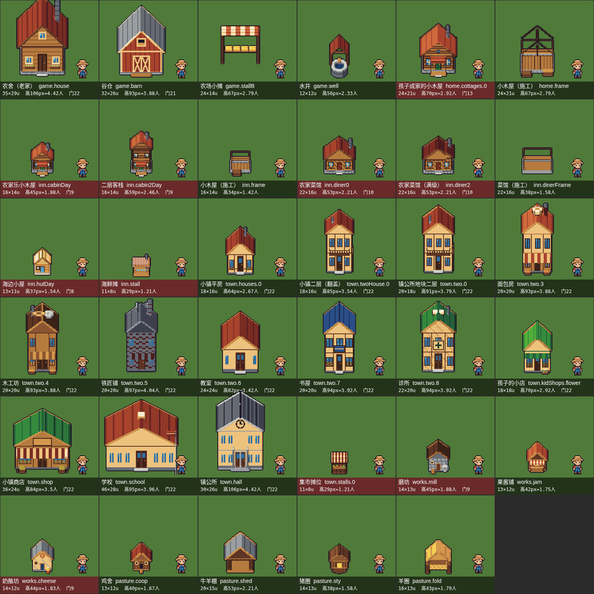
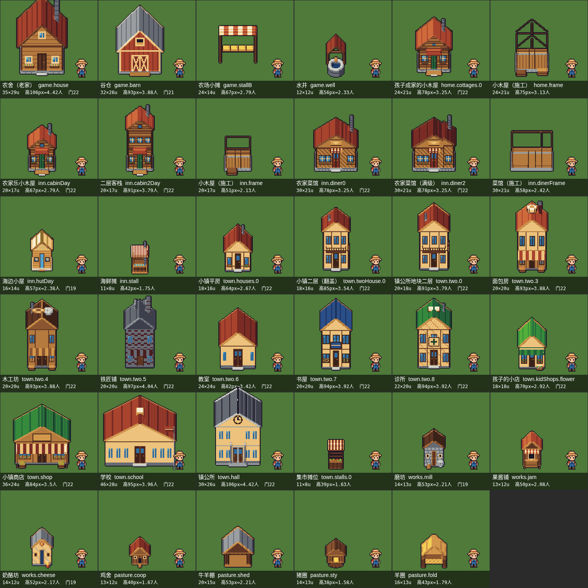

# 房子比例（v5.11.0.9）

玩家（用户）反馈：「房子你整体看一下，好多房子都偏小，修正修正」。v5.11.0 把小镇的房子按「门和大人一样高，平房约 2.7 人、二层约 3.7 人」放大了，
可农家乐的小木屋、二层客栈、菜馆、海边小屋、孩子成家的小木屋、加工坊和集市摊位还是老模型，摆在新房子旁边一下子显小。

## 怎么量的

`node tools/scale-audit.js [tag]`：在无头 Chrome 里用游戏自己的 `stackCanvas` 把每个建筑模型画出来（镜头角度 0，1 体素 = 1 屏幕像素），
旁边站一个大人（`idle_front`，含帽子 **24 px**），量出：

- **占地**：模型的宽 × 深（世界单位，2 体素 = 1 单位；含屋檐、门廊和台阶，比碰撞块大一圈）；
- **正面高**：从正面墙脚到屋顶 / 烟囱最高点的屏幕像素，也就是站在它跟前看到的高度，再除以 24 折成「几个人高」；
- **门高**：门洞的体素高（从模型代码里读出来，写在脚本的 `DOOR` 表里）。

输出 `scale_<tag>.json` 和一张对照图 `scale_<tag>_sheet.png`（每个建筑放大 2 倍，右边站着大人；不合规的标红）。CI 在 `scale` 组里跑，
有建筑不合规就失败。

## 比例规则

| 类别 | 正面高至少 | 门至少 | 其他 |
|---|---|---|---|
| 住房（平房） | 2.4 人（58 px） | 20 px | 小镇平房 2.67 人是基准 |
| 二层住房 | 3.2 人（77 px） | 20 px | 每层 24 体素 |
| 公共建筑（菜馆、商店、学校） | 2.2 人 | 20 px | 占地 ≥ 1.3 × 小镇平房（18 × 16） |
| 公共二层（镇公所、面包房…） | 3.0 人 | 20 px | 同上 |
| 海边小屋 | 2.0 人 | 18 px | 比住房小一号 |
| 作坊（磨坊、果酱铺、奶酪坊） | 1.7 人 | 17 px | 比住房小，门还是能让大人进 |
| 摊位 | 模型高 ≥ 28 px | – | 遮阳棚要高过摊主的帽子 |
| 牲口棚（鸡舍、牛羊棚、猪圈、羊圈） | 不管 | – | 按动物的个头，不按人 |

## 结果

| 建筑 | 类别 | 占地（世界单位）前 → 后 | 正面高（px / 人）前 → 后 | 门高 px 前 → 后 | 改了 |
|---|---|---|---|---|---|
| 农舍（老家） `game.house` | 二层 | 35×29 | 106 / 4.42 | 22 |  |
| 谷仓 `game.barn` | 谷仓 | 32×26 | 93 / 3.88 | 21 |  |
| 农场小摊 `game.stallB` | 摊位 | 24×14 | 67 / 2.79 | – |  |
| 水井 `game.well` | 小物 | 12×12 | 56 / 2.33 | – |  |
| 孩子成家的小木屋 `home.cottages.0` | 住房 | 24×21 | 70 / 2.92 → **78 / 3.25** | 13 → **22** | ✔ |
| 小木屋（施工） `home.frame` | 施工架 | 24×21 | 67 / 2.79 → **75 / 3.13** | – | ✔ |
| 农家乐小木屋 `inn.cabinDay` | 住房 | 16×14 → **20×17** | 45 / 1.88 → **67 / 2.79** | 9 → **22** | ✔ |
| 二层客栈 `inn.cabin2Day` | 二层 | 16×14 → **20×17** | 59 / 2.46 → **91 / 3.79** | 9 → **22** | ✔ |
| 小木屋（施工） `inn.frame` | 施工架 | 16×14 → **20×17** | 34 / 1.42 → **51 / 2.13** | – | ✔ |
| 农家菜馆 `inn.diner0` | 公共 | 22×16 → **30×21** | 53 / 2.21 → **78 / 3.25** | 10 → **22** | ✔ |
| 农家菜馆（满级） `inn.diner2` | 公共 | 22×16 → **30×21** | 53 / 2.21 → **78 / 3.25** | 10 → **22** | ✔ |
| 菜馆（施工） `inn.dinerFrame` | 施工架 | 22×16 → **30×21** | 38 / 1.58 → **58 / 2.42** | – | ✔ |
| 海边小屋 `inn.hutDay` | 小屋 | 13×11 → **16×14** | 37 / 1.54 → **57 / 2.38** | 8 → **19** | ✔ |
| 海鲜摊 `inn.stall` | 摊位 | 11×8 | 29 / 1.21 → **42 / 1.75** | – | ✔ |
| 小镇平房 `town.houses.0` | 住房 | 18×16 | 64 / 2.67 | 22 |  |
| 小镇二层（翻盖） `town.twoHouse.0` | 二层 | 18×16 | 85 / 3.54 | 22 |  |
| 镇公所地块二层 `town.two.0` | 二层 | 20×18 | 91 / 3.79 | 22 |  |
| 面包房 `town.two.3` | 公共二层 | 20×20 | 93 / 3.88 | 22 |  |
| 木工坊 `town.two.4` | 公共二层 | 20×20 | 93 / 3.88 | 22 |  |
| 铁匠铺 `town.two.5` | 公共二层 | 20×20 | 97 / 4.04 | 22 |  |
| 教室 `town.two.6` | 公共 | 24×24 | 82 / 3.42 | 22 |  |
| 书屋 `town.two.7` | 公共二层 | 20×20 | 94 / 3.92 | 22 |  |
| 诊所 `town.two.8` | 公共二层 | 22×20 | 94 / 3.92 | 22 |  |
| 孩子的小店 `town.kidShops.flower` | 住房 | 18×18 | 70 / 2.92 | 22 |  |
| 小镇商店 `town.shop` | 公共 | 36×24 | 84 / 3.5 | 22 |  |
| 学校 `town.school` | 公共 | 46×28 | 95 / 3.96 | 22 |  |
| 镇公所 `town.hall` | 公共二层 | 30×26 | 106 / 4.42 | 22 |  |
| 集市摊位 `town.stalls.0` | 摊位 | 11×8 | 29 / 1.21 → **39 / 1.63** | – | ✔ |
| 磨坊 `works.mill` | 作坊 | 14×13 | 45 / 1.88 → **53 / 2.21** | 9 → **19** | ✔ |
| 果酱铺 `works.jam` | 作坊 | 13×12 | 42 / 1.75 → **50 / 2.08** | – | ✔ |
| 奶酪坊 `works.cheese` | 作坊 | 14×12 | 44 / 1.83 → **52 / 2.17** | 9 → **19** | ✔ |
| 鸡舍 `pasture.coop` | 牲口棚 | 13×12 | 40 / 1.67 | – |  |
| 牛羊棚 `pasture.shed` | 牲口棚 | 20×15 | 53 / 2.21 | – |  |
| 猪圈 `pasture.sty` | 牲口棚 | 14×13 | 38 / 1.58 | – |  |
| 羊圈 `pasture.fold` | 牲口棚 | 16×13 | 43 / 1.79 | – |  |

## 改了什么

都是把体素模型本身按新尺寸重写（门、窗、木纹、花箱、门廊都是 1 体素的细线，和 v5.11.0 的小镇房子一个画法），没有拿旧图放大，所以不糊。

- **农家乐小木屋 / 二层客栈**：墙 16 × 11 单位（原来 12 × 8），每层 24 体素，门 22 体素高，门廊、门灯、山墙通风窗；二层客栈是同一个模型叠两层。
  农家乐区里的位置从 x 482 / 506 / 534 / 558 挪到 **476 / 500 / 540 / 564**（中间那条进小木屋的路 x 520 两边各留 11 单位），碰撞块 14 × 10 → **18 × 13**。
- **农家菜馆**：墙 26 × 14 单位（原来 18 × 9.5），墙高 26 体素，双开门 22 体素、门上小雨棚，山墙上挂招牌，厨房那一翼升级后高 3 体素；碰撞块 20 × 12 → **28 × 16**。
  门口桌子往南挪 3 单位，去菜馆的小路改到门前 y 116；「厨房升级」施工时的木架子搭在东翼上（原来是在菜馆东边另搭一个整栋大小的架子，会压到小路）。
- **海边小屋**：墙 12 × 9 单位（原来 9 × 7），墙高 24、门 19 体素；四间的位置（214 / 236 / 310 / 332, 228）不变，碰撞块 12 × 10 → 14 × 10，遮阳伞、海鲜摊、栈桥都不用动。
- **孩子成家的小木屋**：占地本来就够大（24 × 21），只把墙从 20 提到 28 体素、门从 13 提到 22，窗、花箱、门灯、门廊跟着抬高；位置、院子、碰撞都不变。
- **磨坊 / 果酱铺 / 奶酪坊**：占地不变（工坊院的三个槽位、玩家挪过的位置都不动），墙高 15 → 23 / 13 → 21 / 14 → 22，门 9 → 19。
- **集市摊位、海鲜摊**：占地不变，柱子和遮阳棚抬到 25–27 体素（原来 16–17，比摊主还矮）；柜台、货架跟着抬。
- **农家乐路灯**：18 → 26 体素，比大人高。
- 夜里窗户的灯光、烟囱的烟跟着新的窗户和烟囱高度走。

没改的：农舍、谷仓、水井、农场小摊、小镇所有房子（v5.11.0 已经按这套比例做过）、鸡舍和各种牲口棚（按动物的个头）。

## 存档

不加字段，不改任何坐标存档：农家乐的小木屋、菜馆是按「第几间」放在固定槽位上的，换了槽位读档后自然站到新位置；加工坊、孩子的小木屋位置不变。
地图不扩大（农家乐区还是 456..584 × −40..200）。

## 测试

- `node tools/scale-audit.js` → `scale_after_sheet.png`：每个建筑合不合比例规则；
- `node tools/inn-test.js`：农家乐区新尺寸下小路、桌子、花盆 / 路灯 / 留言板这些固定槽位都不压在房子上，海边小屋不压遮阳伞和海鲜摊；
- `node tools/scale-shots.js` → `scale_after_*.png`：农家乐区白天 / 二层客栈 / 菜馆和桌子 / 夜里客人入住、小镇集市、家里的工坊院和孩子的小木屋、
  海边白天 / 夜里；每个场景检查房子不压小路、不互相重叠，每扇门（小木屋、菜馆、海边小屋、加工坊、孩子的小木屋）都有路走得到；最后量一下镜头转动时的渲染时间。
