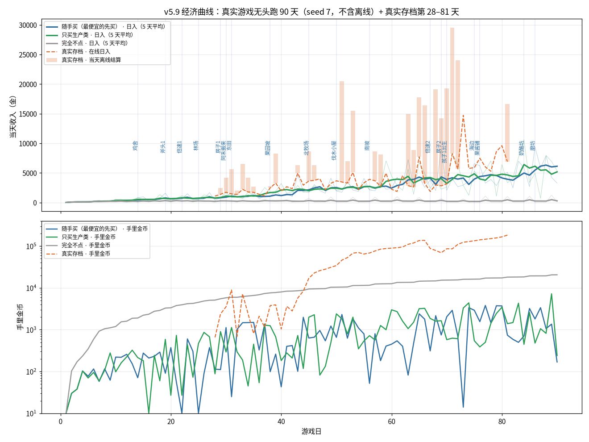

# 经济重新平衡（v5.9.x 现状测量 + 调整方案）

> 状态：**方案稿，只有文档和测量脚本，不改玩法代码**。基于 main（v5.9.0 + 小镇计划 #43）。所有数字都来自真实游戏逻辑的无头运行，脚本在 `tools/econ-curve.js` 和 `tools/econ-report.py`，任何人都能重跑。
> 原则不变：挂机观看为主，偶尔轻决策；不因关注、分享、打赏给任何奖励；离线保持 50% 和 3 天上限，另加「每 24 小时实时最多结算 3 天」（2026-11-18 决定，第 6.6 节）。



上图：上半部分是每天收入（粗线为 5 天平均，细线为当天），下半部分是手里的金币（对数轴）。蓝线下方的竖线标的是「随手买」玩家的主要解锁。橙色虚线和柱子是你的真实存档（第 28–81 天）：虚线是在线日入，柱子是当天离线结算拿到的钱。

## 0. 一句话结论

- **按游戏日算，在线收入的曲线是健康的**：前 10 天每天 100–500 金，第 30 天约 1 千，第 60 天约 2.5–4 千，第 90 天约 5–6 千。三种玩法（随手买、只买生产类、完全不点）跑出来的结果和你的真实存档在线部分对得上（第 41–71 天你的在线日入是 3.3–3.8 千，模拟是 2–4 千）。
- **金币堆起来有两个原因**：
  1. 离线结算在真实存档里占了**一半收入**（第 28–81 天 20.6 万对在线 20.9 万），而且结算时不推进游戏日，钱比按天解锁的内容（阿禾、孩子、上学、镇子）跑得快。
  2. 商店加上 16 块地**一共只值约 23 万金和 2,600 木材**。你第 71 天就全买完了，之后每天 7–9 千只进不出。
- **挂机半小时到底多少钱**（1× 一天约 5.2 分钟，半小时约 5.75 天）：第 3 天约 1.2 千，第 10 天约 2.9 千，第 30 天约 5.9 千，第 60 天约 2.4 万。开 4× 时，第 60 天半小时约 9.5 万。
- 倍速只是让同样的游戏日过得更快，**按游戏日算的经济不变**。真正让钱跑在内容前面的是离线结算和后期没东西买。（后来发现倍速会把整个游戏压缩到几个小时，**v5.10.2 已去掉倍速**，见第 8 节。）
- 方案的思路是**不砍收入，往每个阶段加花钱的地方**：
  - 前期（第 1–30 天）：院子、小路、动物照护、阿禾的小摊，约 1.1 万金的小花销，每样都很温和。
  - 中期：给木材和树苗找去处，加工坊回报提一点。
  - 后期：在小镇计划里加一个**可以无限次的「镇上建设捐献」**，保证钱永远有去处。

## 1. 怎么测的

- `node tools/econ-curve.js 90 <玩法> 7`：用 Chrome 无头打开真实的 `index.html?manual&seed=7`。从全新农场开始，每 20 实时秒（1× 下 1 个游戏小时）检查一次要不要买东西，一直跑到第 90 天。
  - `game.js` 只在这次运行里插了几行计数（文件本身不改），把每次卖货按作物、水果、动物产品、鱼、加工品、镇上小店、成家小院、木材和惊喜拆开记。
  - 每个玩法跑完约 6–8 分钟。
- 三种玩法：
  - **随手买（casual）**：每个游戏小时买「现在买得起的最便宜的一样」，包括商店物品和新地块（地块模块按你存档里的选择）。装饰要手里有 5 倍价钱才买。木材不够时每天点 3 棵树，树苗种在固定位置。
  - **只买生产类（growth）**：和随手买一样，但不买装饰和猫狗，相当于成长最快的上限。
  - **完全不点（idle）**：一样东西都不买，农夫和家人自己干活。
- 挂机半小时：随手买玩家玩到第 X 天（3、10、30、60）后不再点任何东西，接着跑 24 天（`AFK_FROM=X`），再按 1×、2×、4× 换算成半小时里过了几天。
- 局限：
  - 模拟**不含离线结算**（另算）。
  - 只用了一个种子（7）。每天的收入因为南瓜、西瓜成批收获而跳动很大，看 5 天平均更准。
  - 「买最便宜的」比真人更散，房子二档和孩子来得比你晚：模拟里孩子第 65–70 天出生，你是第 48 天。

## 2. 每天的收入和解锁（随手买，主表）

| 天 | 累计收入 | 当天收入 | 近 5 天日均 | 手里金币 | 木材 | 这段时间解锁 / 买下 |
|---:|---:|---:|---:|---:|---:|---|
| 1 | 6 | 6 | 6 | 6 | 0/100 | — |
| 2 | 140 | 134 | 70 | 30 | 0/100 | 扩田1 |
| 3 | 278 | 138 | 93 | 38 | 0/100 | 水壶1 |
| 4 | 393 | 115 | 98 | 103 | 0/100 | — |
| 5 | 512 | 119 | 102 | 77 | 0/100 | 猫+ |
| 6 | 780 | 268 | 155 | 115 | 0/100 | 扩田2 |
| 7 | 1,063 | 283 | 185 | 58 | 0/100 | 狗+、猫+ |
| 8 | 1,346 | 283 | 214 | 116 | 0/100 | 鞋1 |
| 9 | 1,532 | 186 | 228 | 62 | 0/100 | 狗+ |
| 10 | 2,041 | 509 | 306 | 221 | 0/100 | 扩田3 |
| 15 | 4,642 | 962 | 520 | 276 | 0/100 | 锄头1、好感满、猫+、篮子1、花盆+、鸡舍、鸡+ |
| 20 | 7,794 | 282 | 630 | 373 | 48/100 | 鸡+、狗+、花盆+、钓竿1、斧头1 |
| 25 | 11,379 | 534 | 717 | 0 | 4/100 | 篱笆、水壶2、倍速1、鞋2、草莓、林场 |
| 30 | 15,881 | 1,085 | 900 | 1,124 | 95/200 | 猪圈、稻草人+、猪+、房子1、阿禾搬来 |
| 35 | 21,763 | 1,656 | 1,176 | 1,495 | 155/200 | 稻草人+、篮子2、东田、长椅+ |
| 40 | 27,585 | 1,112 | 1,164 | 43 | 159/200 | 长椅+、斧头2、果园坡、蜂箱+、羊圈、草地、羊+ |
| 45 | 38,302 | 1,657 | 2,143 | 632 | 159/200 | 羊+、石盆+、钓竿2、水壶3、北牧场 |
| 50 | 50,945 | 1,939 | 2,529 | 656 | 172/200 | 牛棚、牛+、路灯+、屋西空地、伐木小屋 |
| 55 | 64,206 | 4,070 | 2,652 | 792 | 185/200 | 林间空地、蜂箱+、鞋3、路灯+、西瓜 |
| 60 | 76,326 | 2,372 | 2,424 | 450 | 157/200 | 南坡、路灯+、北坡西、二鸡舍、鸡+、二猪圈 |
| 65 | 97,750 | 4,295 | 4,285 | 2,398 | 165/200 | 猪+、二羊圈、羊+、路灯+、串灯+、二牛棚、牛+ |
| 70 | 117,147 | 2,055 | 3,879 | 2,040 | 93/400 | 锄头2、串灯+、倍速2、房子2、石灯+、东南滩、孩子1出生 |
| 75 | 136,895 | 6,559 | 3,950 | 2,918 | 345/400 | 北坡东、西南河湾、水车、西河湾、海边、石灯+、海竿 |
| 80 | 157,622 | 4,496 | 4,145 | 3,710 | 400/400 | 果酱铺、东坡、石灯+、南河湾、斧头3 |
| 85 | 180,672 | 2,671 | 4,610 | 3,217 | 344/400 | 水壶4、浇水器+、奶酪坊 |
| 90 | 211,274 | 3,272 | 6,120 | 169 | 400/400 | 磨坊、山道、高山牧场、上学、山顶、石桥、河对岸西、河对岸东 |

**能解锁多少东西**（全部商店和地块共约 23.0 万金。前一个数是随手买，括号里是只买生产类）：

| 第 N 天 | 买了几样 | 花了多少 | 占全部 |
|---:|---:|---:|---:|
| 5 | 3（3） | 260（270） | 0% |
| 10 | 9（8） | 1,420（1,570） | 1% |
| 20 | 32（21） | 6,490（6,710） | 3% |
| 30 | 44（30） | 13,280（14,150） | 6% |
| 40 | 61（42） | 24,780（28,250） | 11% |
| 50 | 76（53） | 45,030（45,850） | 20% |
| 60 | 98（75） | 67,890（72,830） | 29–32% |
| 70 | 122（86） | 101,510（104,930） | 44–46% |
| 80 | 135（108） | 135,310（143,030） | 59–62% |
| 90 | 160（117） | 187,810（195,230） | 82–85% |

**收入从哪来**（随手买）：

| 阶段 | 作物 | 果树 | 动物产品 | 鱼 | 加工品 | 卖多余木材 | 合计 |
|---|---:|---:|---:|---:|---:|---:|---:|
| 第 1–10 天 | 89% | — | — | 9% | — | — | 2.0 千 |
| 第 11–30 天 | 74% | 2% | 17% | 4% | — | 3% | 1.4 万 |
| 第 31–60 天 | 50% | 16% | 22% | 1% | 3% | 7% | 6.4 万 |
| 第 61–90 天 | 56% | 9% | 23% | 0% | 7% | 5% | 14.3 万 |

花钱的大头：第 61–90 天商店 7.4 万、地块 4.6 万、种子 1.1 万、干草 4.7 千。

只买生产类和完全不点的完整表格见附录。完全不点的玩家一直只有 12 格田，日入在 50 到 1,000 之间来回跳（平均约 250），钱从第 10 天的 1.2 千一路涨到第 90 天的 2.1 万，一样东西都没换来。

## 3. 实时时间和挂机半小时

- **1× 一个游戏日 = 313 实时秒（约 5.2 分钟）**：白天 6:00–20:00 每秒 3 游戏分钟，夜里农夫睡觉时快 6 倍。脚本测得平均 321 秒（每步 20 秒，有取整）。2× 约 2.6 分钟，4× 约 1.3 分钟。
- 你存档里「1× 约 10 分钟一天」是因为标签页切到后台时游戏不走（浏览器停了动画帧），切回来时按离线结算。
- **挂机半小时**（随手买玩家从第 X 天起不再点）：

| 从第 X 天开始挂 | 当时手里 | 当天日入 | 1×（约 5.75 天） | 2×（约 11.5 天） | 4×（约 23 天） | 切走或关掉 30 分钟（离线结算） |
|---:|---:|---:|---:|---:|---:|---:|
| 3 | 38 | 138 | **1,214** | 3,293 | 7,422 | 266 |
| 10 | 78 | 527 | **2,854** | 6,121 | 13,284 | 968 |
| 30 | 814 | 1,069 | **5,866** | 12,139 | 25,127 | 2,244 |
| 60 | 753 | 2,337 | **24,117** | 48,843 | 95,376 | 7,593 |

  （2× 在第 22 天左右买得起，4× 在第 65 天左右。所以第 3、10 天实际上只有 1×，第 30 天最多 2×。）
- **前期半小时挂机能把当前阶段的商店买空**：
  - 第 3 天挂半小时的 1.2 千，正好够开完三次田（440）、铜水壶（80）、布鞋（200）、钢锄头（250）、大篮子（300）。
  - 第 10 天的 2.9 千还能再加鸡舍和 4–5 只鸡。
  - 东西是有的，问题是一口气全买完，前期那几样「第一次」的乐趣被压成一瞬间。之后下一档要木材或阿禾搬来，钱就停在手里。
- **离线**：离开 30 分钟按 2.9 个游戏日 × 近 3 天日均结算（这个天数已经按 50% 折算过）。离开超过 31 分钟就到 3 天的上限，之后每次回来都重新结算。

## 4. 和你的真实存档对照（第 28–81 天，v4.7.1 → v5.8.1，只在本机读，没有提交）

| 阶段 | 在线日入 | 离线结算 | 离线占比 | 这段时间花掉 | 期末手里 |
|---|---:|---:|---:|---:|---:|
| 第 28–40 天 | 1,759 | 21,414 | 48% | 44,387 | 1,040 |
| 第 41–50 天 | 3,331 | 8,873 | 21% | 9,030 | 34,219 |
| 第 51–60 天 | 3,481 | 41,428 | 54% | 19,970 | 89,610 |
| 第 61–71 天 | 3,801 | 106,559 | 72% | 92,351 | 85,968 |
| 第 72–81 天 | 7,588 | 28,096 | 27% | 6,894 | 183,049 |

- 合计在线 20.9 万，离线 20.6 万。共结算 46 次，其中 13 次到了 3 天上限，单日最多一天拿到 2.1 万离线钱（第 71 天）。
- 第 66–71 天全部买完，之后只花干草和种子。木材 800/800 满仓，树苗 62 棵没处种，镇上小店 10 天只多赚 2,121。
- 模拟里的「随手买」不含离线，第 90 天才买到 82%。你多了一倍的离线收入，第 71 天就全买完了，两者对得上。

## 5. 曲线在哪断：五个主要问题

1. **后期没东西买（第 70 天以后的死区）**
   - 商店加地块总价约 23 万金和 2,600 木材。后期的东西（地块 2.2–6.5 千、加工坊 3.5–5 千、浇水器 800 一台）只相当于 0.5–1 天的收入。
   - 单价其实跟上了收入：前期一件 60–300 相当于当时 0.5–2 天收入，后期一件 2–6.5 千也只相当于 0.5–1 天。问题在于**数量有限**，最后一批被一口气买完，之后就是纯攒钱。
2. **离线结算让钱跑在按天解锁的内容前面**
   - 离线占你实际收入的 50%，而且一次一大笔（7–21 千）。
   - 阿禾搬来、孩子出生和长大、上学、镇门、婚礼都按游戏日走，离线钱不推进游戏日，所以钱早早到位，内容却还没开。
   - 倍速不会这样，它连游戏日一起加速。（v5.10.2 起没有倍速了。）
3. **前期挂机把一个阶段压成一瞬间，前期能花钱的小东西太少**
   - 第 1–20 天，500 金以下、前置简单的东西只有二十来样（扩田 3 次、铜水壶、布鞋、钢锄头、大篮子、鸡舍、6 只鸡、3 猫 3 狗、钢竿、斧头），加起来约 5 千。
   - 装饰（花盆 150、稻草人 250、长椅 300）在模拟里第 15 天就被买了，说明前期确实缺可以花的地方。可装饰本身没有功能，摆满院子后也就没了。
4. **木材和树苗只在前中期是资源，后期全浪费**
   - 前期木材上限 100、200，房子要 40、150、400 木材，这时是瓶颈。
   - 第 75 天以后模拟和你的存档都满仓：400/400、800/800，多出来的按 4 金一份卖，占收入 5–7%。
   - 树苗每砍一棵树送 1 棵，只能种在果园里，你堆了 62 棵。
5. **加工坊和镇上小店回报太低，没有存在感**
   - 三间加工坊共 1.3 万金加 300 木材。随手买玩家第 61–90 天从加工品只拿到 9.5 千（7%），全建好后每天约 300–950，要 15–40 天才回本。
   - 镇上小店 10 天多赚 2,121（v5.9.1 已经在改）。

次要问题：
- 完全不点的玩家会一直停在 12 格田，钱涨到 2 万也不会变（已定：加「家人帮忙添置」开关，见 6.7）。
- 第 1–10 天在线日入只有 100–300，挂机拿到的钱相对很多，正好说明前期要的是「能花的地方」，不是「更多的钱」。

## 6. 调整方案

### 6.1 原则

- **不砍在线收入、不动已有价格的大框架**：已经买过的东西不涨价，存档不受影响。离线只加一个 24 小时滚动上限（第 6.6 节），不降比例。
- 每个阶段都有「这一阶段的花钱处」，大约等于这一阶段 1–2 次半小时挂机的钱。这样挂机回来总有东西可买，又不会一次买空。
- 新加的花钱处以**温和的小功能加好看**为主，比如走路快一点、动物开心一点、日志里多一句话。不做负面机制，不做要盯着的东西。全部由家人自动摆放和执行，复用 `decor.js` 的「买了进仓库、家人摆出来」流程。
- 和「商店逐步显示」配合：建议显示**价格 ≤ max(1,000，近 3 天日均 × 10)** 的东西，也就是大约一次 1× 半小时挂机挣的钱。再加上已经买过的那几样的下一档，这样挂机回来不会出现「钱有了但商店空着」。

### 6.2 前期花钱处（第 1–30 天，合计约 1.1 万金）

新页签「院子」（或并进「装饰」）：

| 东西 | 价格 | 何时出现 | 效果（都很小） |
|---|---|---|---|
| 石子小路 | 每段 40 金，最多 20 段（800） | 第 1 天 | 家人从门口往田、鸡舍、集市方向一段段铺；走在路上 +5% |
| 信箱 | 120 | 第 1 天 | 早上偶尔有一封信：阿禾的小纸条、镇上的消息（以后接镇子小报），纯文字 |
| 晾衣绳 | 150 | 第 1 天 | 晴天家人晾衣服，下雨收 |
| 门前花坛 | 每个 200，最多 4 个（800） | 第 3 天 | 好看；有蜂箱以后蜜蜂会来，多一瓶蜂蜜的概率 +2% |
| 菜园小栅栏 | 每段 30 金 + 1 木材，最多 24 段（720 + 24 木） | 买斧头后 | 围起来的田夜里长杂物的机会减半 |
| 窗花和窗帘 | 180 | 第 5 天 | 屋子换样子，晚上窗户透暖光 |
| 门口灯笼 | 260 | 第 5 天 | 不用水车也亮的油灯，只照门口一小圈 |
| 屋顶换色 | 300（3 种颜色任选，以后换色 100） | 第 8 天 | 纯好看，同时也是后期的小花销 |
| 石板路 | 每段 150 金 + 2 木材，最多 20 段（3,000 + 40 木） | 房子一档后 | 把石子路升成石板；走在路上一共 +10% |

阿禾的小摊（在她搬来之前的第 2–30 天正好是窗口，以后她爸爸接着用）：

| 东西 | 价格 | 效果 |
|---|---|---|
| 遮阳棚 | 300 | 集市收购价 +2%，好感 +5（一次） |
| 新秤 | 200 | 集市收购价 +2% |
| 木招牌 | 400 + 10 木材 | 集市收购价 +2%，镇上来的客人偶尔在摊前停一下 |
| 花瓶 | 120 | 好感 +3（一次），摊子上多一束花 |

动物照护（鸡舍等前置盖好后出现）：

| 东西 | 价格 | 效果 |
|---|---|---|
| 鸡舍稻草垫 | 200 | 鸡每晚心情 +3 |
| 猫窝 | 每只 150（最多 3 只，450） | 猫晚上回窝睡；猫心情不掉到 60 以下 |
| 狗屋 | 每只 250（最多 3 只，750） | 狗晚上回狗屋，白天门口趴着 |
| 刷子 | 300 | 家人每天给一只动物梳毛，心情 +2 |
| 盐砖 | 猪圈、羊圈、牛棚各 400（1,200） | 那一棚每晚心情 +2 |

前期合计：
- 院子约 7.4 千金和 64 木材，阿禾小摊 1,020 金，动物照护 2,900 金，一共约 1.13 万金。
- 对照：随手买玩家前 30 天一共挣 1.6 万，第 10 天挂半小时 2.9 千。前期大约多出四成可以花钱的地方，又不至于把成长卡住，因为都是一两百一件，可以慢慢买。
- 小摊的三件价格加成合计 +6%，对第 1–30 天的收入约多 900，不改变曲线。

### 6.3 中期（第 20–60 天）：木材、树苗和加工坊

| 改动 | 现在 | 改成 | 理由 |
|---|---|---|---|
| 行道树 | 无 | 每棵 1 棵树苗 + 20 金，沿大路和地块边种，最多 40 棵 | 树苗的去处；路边慢慢变成林荫道 |
| 集市收树苗 | 不收 | 树苗超过 20 棵时家人自动卖多余的，每棵 8 金 | 不再堆着（与 v5.9.1「猫猫满 20 改送别的」配合） |
| 面粉 / 果酱 / 奶酪价格 | 60 / 80 / 130 | **70 / 95 / 150** | 加工坊回本从 15–40 天缩到约 10–25 天（估算） |
| 加工坊进料 / 出货上限 | 8 / 6（奶酪 6 / 4） | **12 / 9（奶酪 9 / 6）** | 夜里不再因为满了停工 |
| 堆肥（可选，默认关） | 无 | 每格每次 5 金，跟种子一起买；4 天以上的作物少长 1 天 | 和田地数一起涨的持续花销；是投资而不是纯消耗，南瓜每格每天从 15 升到约 18 |

### 6.4 后期（第 60 天以后）：接上小镇计划，再加一个永远有用的出口

- 小镇计划里的建设：镇子部分约 30 万，农家乐和度假村约 45 万，开店每家 1.5 万。这些放在农场商店买完之后正合适，模拟里是第 70–90 天，你的存档是第 71 天。按日入 6–9 千、外加离线算，大约能用 60–90 个游戏日。
- **新加：镇上建设捐献**（v5.10.0 镇公所的告示板上）：
  - 每次 5,000 金，或者 100 木材，没有次数上限。
  - 每捐一次，镇上自动多一件街景（花坛、长椅、路灯、旗子、喷泉边的小雕塑，轮着来），繁荣度进度 +2%。
  - 捐满一段后告示板换下一句话，不给金币回报，免得变成理财。
  - 作用是保证 23 万的商店和 75 万的小镇项目都建完以后，钱和木材**永远有去处**。真实存档那种 18 万闲钱，可以变成满街的东西。
- 已有的「送给镇上」（多余的装饰搬到镇里）照计划做。

### 6.5 数值微调（精确值）

| 项 | 现在 | 建议 | 说明 |
|---|---|---|---|
| 面粉 / 果酱 / 奶酪 | 60 / 80 / 130 | 70 / 95 / 150 | 见 6.3 |
| 加工坊上限 | 8 / 6；奶酪 6 / 4 | 12 / 9；奶酪 9 / 6 | 见 6.3 |
| 多余木材卖价 | 4 | 不变 | 由捐献和木工坊消化，卖价不动 |
| 4× 倍速 | 3,000 | **v5.10.2 去掉** | 倍速不改变按天算的经济，但让整个游戏缩成几个小时（第 8 节） |
| 已有商店价格 | — | 不变 | 不让已经买过的人吃亏，也遵守「价格不因离线上调」的决定 |
| 后期新东西的定价 | — | 按「出现时日入 × 2–6 天」定 | 小镇计划第 4 节的价格本来就是这个思路（8 千 – 4 万） |

### 6.6 已定（2026-11-18）：离线每 24 小时最多结算 3 天

**规则**：
- 50% 的比例和单次 3 天的上限都不变。
- 另外，**任意连续 24 个实时小时里，离线结算加起来最多 3 个游戏日**。
- 窗口是滚动的：每次结算都记下时间和天数，满 24 小时后自动从窗口里移出。
- 木材（`offlineWood`）和补记下雨（`WX.advanceDays`）都用封顶以后的天数。

**效果**：
- 只关一次、离开不超过一天的人不受影响。比如晚上关掉、早上回来，还是拿 3 天。
- 一天里反复关开、切标签页的人，24 小时最多也只拿 3 天。
- 你存档第 70 天那样一天结算两次 7,667 的情况，以后只会有一次。
- **对你这份存档影响很大**：我按真实日志把 46 次结算逐条套上 24 小时窗口重算了一遍，第 28–81 天的离线收入会从 **20.6 万降到约 1.3 万**，46 次里有 44 次被截。原因是你这 82 个游戏日是在大约 42 个实时小时里玩完的（2026-11-17 早上到 11-18 晚上）。这段时间里窗口最多只能放出约 6 天的离线收益，可原来一共结算了约 60 天。
- 在线部分完全不变。按这个结果，你的存档到第 81 天大约是在线 20.9 万加离线 1.3 万，商店会在第 80 天以后才买完，和第 2 节「随手买」模拟的节奏（第 90 天买到 82%）基本一致。
- 对每天固定玩一两次的普通玩家，影响很小：一天最多本来也就关开几次。

**纯函数**：放在 `sim.js`，Node 里可以直接测。`offlineSettle(awaySec, dayEarn, win, now)` 返回值在原来的基础上增加：
- `asked`：按离开时长算出来的天数，单次最多 3 天。
- `used`：24 小时窗口里已经用掉的天数。
- `days`：这次实际给的天数，等于 min(asked, 3 − used)。
- `limited`：是否被 24 小时上限截了。
- `nextFullAt`：什么时候窗口重新满 3 天。

**存档（只追加，不升版本，仍是 v15）**：
- 新增 `offline: { win: [{ at: 毫秒时间戳, days: 0.00 }] }`，最多保留 12 条，超过 24 小时的条目在读档和结算时清掉。
- `save.js` 的 `validate` 里：
  - 缺这个字段或格式不对，就当成 `{ win: [] }`。
  - 每条的 `days` 夹在 0..3 之间。
  - `at` 必须是有限数。
- 旧存档读进来时窗口是空的，所以第一次回来照常给。

**防回拨时钟**：
- 如果 `now < savedAt`，也就是时钟往回拨过：这次不结算，只在日志里写一行「时钟好像往回调过，这次不算离线收益」。窗口保持原样，`savedAt` 照常更新为现在。现在 `awaySec` 为负时已经不结算，这里只是把日志补上。
- 窗口里时间在未来的条目（`at > now`），**按 `at = now` 处理，不删**。这样「先把时钟往前拨、领完再拨回来」的循环里，拨回来以后窗口依然是满的，要再等 24 个真实小时才能领下一份。
- 只是电脑时间一度设错的正常玩家，最多损失一个 24 小时窗口，不会被永久卡住。
- 单次 `awaySec` 照旧最多只算 3 天，所以时钟往前拨得再远也只拿 3 天。

**欢迎回来弹窗**（v5.9.1 起离开不到 10 分钟只写日志，不弹框；这里只改文字）：
- 正常：「离开了 2 小时 5 分，按在线 50% 的速度折合 3 天（已到 3 天上限）」，下面一行照旧写「最近日均 … → 获得 … 金」。
- 被 24 小时上限截了：第一行改成「离开了 40 分钟，折合 3 天；过去 24 小时已经结算过 2 天，这次按 1 天算」。下面加一行小字「每 24 小时最多结算 3 天离线收益，明天 07:40 以后再满」，时间用玩家本地时间显示，后面不加日期。
- 窗口已经用完（这次 0 天）：不弹框，只在日志里写「离开了 35 分钟；过去 24 小时的 3 天离线收益已经领过，明天 07:40 以后再算」。
- 商店里不加任何新提示，免得玩家觉得要去盯着它。

**测试**：
- `save-test.js`：
  - 窗口累加。
  - 第 24 小时整点移出。
  - 封顶以后木材也按封顶天数算。
  - 未来时间戳夹到现在。
  - 时钟回拨不结算。
  - 坏字段回退成空窗口。
- `save-smoke.js`：连续两次「隐藏 40 分钟 → 回来」，第二次只拿 0 天，并且只在日志里写，不弹框。

### 6.7 已定（2026-11-18）：「家人帮忙添置」开关，默认关

**给谁用**：完全不点的玩家。现在这种玩家 90 天停在 12 格田，手里攒着 2 万。打开开关后，家人会慢慢把最基础的生产类东西添齐。打开的人仍然可以随时自己买任何东西。

**会买什么（只有这些，按顺序）**：

| 顺序 | 东西 | 价格 | 备注 |
|---:|---|---|---|
| 1–3 | 家门口的田 3 档 | 60 / 130 / 250 | 12 → 24 格 |
| 4 | 铜水壶 | 80 | |
| 5 | 布鞋 | 200 | |
| 6 | 钢锄头 | 250 | |
| 7 | 大篮子 | 300 | |
| 8 | 鸡舍 | 300 | |
| 9–14 | 第 1–6 只鸡 | 100–340 | 只填满第一个鸡舍，第二鸡舍要地块，不碰 |
| 15 | 银水壶 | 600 | |
| 16 | 皮靴 | 800 | |
| 17 | 草莓种子 | 800 | |
| 18 | 手推车 | 1,200 | |

- 合计约 6,210 金，不要木材。
- **不买**：
  - 装饰、猫狗。（倍速 v5.10.2 已去掉。）
  - 区域、地块、房子和其他要木材的建筑。
  - 加工坊、浇水器、蜂箱、镇门、新房子、捐献。
  - 鱼食、金鱼、捕虫网。
- 这些都是带个人口味或者分量大的决定，留给玩家自己点。
- 列表写死在 `sim.js` 的 `AUTO_BUY`，以后要加东西改这一处。
- 已经买过的跳过。`offer().ok` 不成立的（锁着、前置没买、商店逐步显示里还藏着的）也跳过，这样不会替玩家「跳级」。

**花钱的规矩（留够种子钱）**：
- 只有手里的钱 ≥ **价格 × 3**，并且买完以后还剩 **max(300, 近 3 天日均 × 2)**，才会买。
- 种子的买法本来就只在手里一半以上时才买贵的种子。这个留底能保证添置以后菜照样种得好，不会把农场打回胡萝卜。
- **每个游戏日最多买 1 样**，按列表顺序找第一样满足条件的。

**什么时候买、谁去买**：
- 每天第一次去集市卖完东西以后，当场结算。商店和集市是同一个摊子，有人在场才说得通。
- 阿禾搬来以前是农夫去，搬来以后谁先到集市就由谁买。孩子不买，和现在「孩子不在集市买东西」的规矩一致。
- 离线结算期间不买，等回来后的第一个集市时间。

**日志和提示**：
- 日志写一行：「阿禾帮家里添置了大篮子（300 金）。不想让家人代买，可以在商店顶上关掉『家人帮忙添置』。」
- 后半句只在第一次出现，以后只写前半句。
- 买的时候在集市摊子上冒一个「-300」，和自己买时一样。
- 游玩记录（playlog）里这次购买记 `who: 'auto'`，方便以后看有多少是家人代买的。
- 成就和里程碑照常算，不另外区分。

**开关放在哪**：
- 商店面板标题栏右侧，一个小开关「家人帮忙添置」，悬停或长按显示说明：「打开后，钱多的时候家人每天最多替你买一样基础的东西（扩田、工具、鸡）。装饰、地块、建筑不会买。」
- 小红书分支用同一个开关，不另做设置页。
- 关掉立即生效，已经买的不退。

**存档（只追加，不升版本）**：
- `settings` 增加 `autoBuy: false`。
- `save.js` 的 `validate` 现在会把 `settings` 重建成只有 `speed`，要改成同时保留布尔值 `autoBuy`，缺了就当 `false`。
- 旧存档读进来是关着的。

**验收**：
- `econ-curve.js` 加一个玩法 `idle-auto`：不点，但开关打开。目标是第 30 天前买完第 1–14 项，第 60 天前买完全部 18 项。日入稳定在随手买第 25–30 天的水平（约 700–1,000），手里的钱不再无限攒。
- `save-test.js`：
  - 列表顺序。
  - 3 倍价钱和留底两个条件。
  - 每天只买一样。
  - 锁着的跳过。
  - 关掉以后不买。
  - 旧存档读入后 `autoBuy` 为 `false`。
- `save-smoke.js`：开关切换以后刷新，状态还在。新开局打开开关，跑 5 天，日志里有「帮家里添置了」。

## 7. 实施分步（每步都能单独验收）

| 版本 | 内容 | 验收 |
|---|---|---|
| **v5.10.1**（原计划 v5.9.2，排到镇公所 v5.10.0 之后）离线 24 小时上限 + 家人帮忙添置 | 6.6 和 6.7：两个纯函数放在 `sim.js`；存档只追加 `offline.win` 和 `settings.autoBuy`；欢迎回来弹窗改文字；商店顶上加开关 | 6.6 和 6.7 各自的测试全过；第 59 天、第 82 天存档读入无报错，窗口为空、开关为关；`econ-curve.js` 的 `idle-auto` 达到 6.7 的目标；随手买和只买生产类两条曲线不变 |
| **下一次经济更新**（原 v5.9.3，版本号到时顺排）院子小花销 | 6.2 的院子 9 样、阿禾小摊 4 样、动物照护 5 样。全部走 `decor.js` 的买了进仓库、家人摆出来流程，存档只追加 | 新开局第 1 天能看到石子小路、信箱、晾衣绳；随手买 90 天重跑，第 1–30 天多花约 1 万，日入曲线变化不超过 ±10%；家人帮忙添置不会去买这些 |
| **再下一次经济更新**（原 v5.9.4）木材、树苗、加工坊 | 行道树、集市收树苗、加工品价格和上限，可选堆肥 | 真实存档读入后树苗按钮不再挂着 31；加工品收入占比从约 7% 升到 10–12% |
| **v5.10.0 之后** 镇公所里加上「镇上建设捐献」 | 镇公所已在 v5.10.0 上线，捐献跟着后面的经济更新一起做 | 第 82 天存档读入后，告示板上至少有 30 万可花；捐 10 次能看到 10 件新街景 |
| v5.10.2 起 | 照小镇计划的顺序（小镇计划里 v5.10.1 以后的版本号都顺延一位） | 每一版都重跑 `econ-curve.js`（随手买、只买生产类、完全不点），把第 30、60、90 天的日入、手里金币和买了几成写进 PR |

测量脚本的用法（每次改数值都重跑，约 8 分钟）：

```bash
npm --prefix tools ci
node tools/econ-curve.js 90 casual 7 & node tools/econ-curve.js 90 growth 7 & node tools/econ-curve.js 90 idle 7 & wait
for x in 3 10 30 60; do AFK_FROM=$x node tools/econ-curve.js $((x+24)) casual 7 & done; wait
python3 tools/econ-report.py [导出的存档和日志.txt]   # 表格写到 $PF_SHOTS/econ_report.md，图写到 docs/img/econ_curve.png
```

## 8. 已定（2026-11-19）：v5.10.2 去掉 2× / 4× 倍速，短暂离开不占离线额度

**起因：一位新玩家一个晚上就「打穿」了。** 他的存档（只在本机读，没有提交）：2026-11-18 19:32 到 11-19 01:40（太平洋时间），一共 6.1 小时，玩到第 73 天。第 6 天买 2×，第 17 天买 4×（3,000 金），之后 57 个游戏日全开 4×，一天约 80 秒，这 57 天只用了 2 小时 50 分钟。按游戏日算他的在线收入和「随手买」模拟差不多（第 30 天累计 1.65 万对 1.59 万，第 73 天 18.5 万对 12.7 万），离线 42 次一共 4 万，只占 18%，没有发现漏洞。生产类的东西全买完了，剩下的是装饰、8 块地、第二座新房子和镇上的房子，卡在木材（15/800）。

解锁全按游戏日走，倍速让游戏日变便宜，所以整个游戏被压缩成几个小时。v5.10.1 的离线上限会把他的离线收入从 39,859 砍到 222，但在线部分不受影响，他只会晚十来分钟打穿。

**决定：**
- 去掉 2× / 4× 倍速，只留一种速度；农夫睡觉时夜里快进 6 倍照旧。不改建造时间。
- 买过倍速的存档，第一次读档退回买倍速的钱（2× 600，4× 再加 3,000），追加 `settings.speedRefund`，只退一次。
- 离开不到 5 分钟、或者这次不到 100 金的离线结算照常给钱，但不算进 24 小时 3 天的额度。这位玩家第 1–6 天切标签页 6 次（每次 0–80 金）就用掉了整个 24 小时的额度；按新规则这 6 次都不占额度。

**一种速度下的实时时长**（`node tools/econ-curve.js 90 casual 7`，开着页面、不算离线）：

| 第 N 天 | 开着页面的实时时长 | 累计收入（v5.10.2） | 累计收入（v5.10.1 时的同一模拟） |
|---:|---:|---:|---:|
| 30 | 约 2.7 小时 | 15,953 | 15,881 |
| 60 | 约 5.3 小时 | 88,026 | 76,326 |
| 90 | 约 8.0 小时 | 228,745 | 211,274 |

每个游戏日平均约 321 秒（脚本 20 秒一步，有取整；理论值 313 秒）。第 60 天累计多了约 15%，因为「随手买」玩家不再花 3,600 买倍速，这笔钱早早变成了田和动物。按游戏日算的经济基本不变。

要注意：页面一直开着的话，第 90 天也只要约 8 小时。这位朋友如果全程 1×，到第 73 天大约要 6.5 小时的页面时间，加上中途休息，估计 8–9 小时，比原来的 6.1 小时长一半左右，但还是一天之内能玩完。要让内容撑过好几天，得靠后面的小镇内容（约 75 万金）和木材这些门槛，或者以后再考虑按实时计的建造时间（这次没有改）。

## 附录 A：只买生产类（growth）

| 天 | 累计收入 | 当天收入 | 近 5 天日均 | 手里金币 | 木材 | 这段时间解锁 / 买下 |
|---:|---:|---:|---:|---:|---:|---|
| 1 | 6 | 6 | 6 | 6 | 0/100 | — |
| 2 | 140 | 134 | 70 | 30 | 0/100 | 扩田1 |
| 3 | 278 | 138 | 93 | 38 | 0/100 | 水壶1 |
| 4 | 393 | 115 | 98 | 103 | 0/100 | — |
| 5 | 515 | 122 | 103 | 70 | 0/100 | 扩田2 |
| 6 | 815 | 300 | 162 | 95 | 0/100 | 鞋1 |
| 7 | 1,104 | 289 | 193 | 59 | 0/100 | 扩田3 |
| 8 | 1,427 | 323 | 230 | 107 | 0/100 | 锄头1 |
| 9 | 1,623 | 196 | 246 | 278 | 0/100 | — |
| 10 | 2,143 | 520 | 326 | 98 | 0/100 | 好感满、篮子1、鸡舍 |
| 15 | 4,743 | 517 | 520 | 182 | 24/100 | 鸡+、钓竿1、斧头1 |
| 20 | 7,871 | 276 | 626 | 27 | 4/100 | 水壶2、篱笆、倍速1、鞋2、草莓 |
| 25 | 11,503 | 461 | 726 | 468 | 44/100 | 林场、猪圈、猪+ |
| 30 | 16,944 | 1,654 | 1,088 | 293 | 164/200 | 房子1、阿禾搬来、篮子2、东田、斧头2 |
| 35 | 22,370 | 1,290 | 1,085 | 451 | 154/200 | 果园坡、蜂箱+、羊圈、草地 |
| 40 | 32,863 | 3,197 | 2,099 | 183 | 154/200 | 羊+、钓竿2、水壶3、北牧场、牛棚 |
| 45 | 42,743 | 1,952 | 1,976 | 1,989 | 154/200 | 牛+、屋西空地 |
| 50 | 54,769 | 1,979 | 2,405 | 2,390 | 152/200 | 伐木小屋、林间空地、蜂箱+、鞋3 |
| 55 | 68,204 | 3,293 | 2,687 | 539 | 146/200 | 西瓜、南坡、北坡西、二鸡舍、鸡+、二猪圈 |
| 60 | 87,228 | 4,474 | 3,805 | 2,993 | 150/200 | 猪+、二羊圈、羊+、二牛棚、牛+ |
| 65 | 105,901 | 6,728 | 3,735 | 3,183 | 108/400 | 锄头2、倍速2、房子2、东南滩、孩子1出生、北坡东 |
| 70 | 121,953 | 2,600 | 3,210 | 578 | 256/400 | 西南河湾、水车、西河湾、海边、海竿、果酱铺 |
| 75 | 146,186 | 5,325 | 4,847 | 544 | 342/400 | 东坡、南河湾、斧头3、水壶4、浇水器+ |
| 80 | 170,104 | 6,401 | 4,784 | 3,446 | 318/400 | 浇水器+、奶酪坊、磨坊 |
| 85 | 199,138 | 3,380 | 5,807 | 2,588 | 400/400 | 上学、山道、高山牧场、山顶、石桥、河对岸西、河对岸东 |
| 90 | 224,998 | 5,363 | 5,172 | 241 | 66/800 | 东大道、房子3、孩子2出生、镇门 |

## 附录 B：完全不点（idle）

| 天 | 累计收入 | 当天收入 | 近 5 天日均 | 手里金币 | 木材 | 这段时间解锁 / 买下 |
|---:|---:|---:|---:|---:|---:|---|
| 1 | 6 | 6 | 6 | 6 | 0/100 | — |
| 2 | 153 | 147 | 76 | 103 | 0/100 | — |
| 3 | 306 | 153 | 102 | 171 | 0/100 | — |
| 4 | 370 | 64 | 92 | 235 | 0/100 | — |
| 5 | 481 | 111 | 96 | 346 | 0/100 | — |
| 6 | 728 | 247 | 144 | 593 | 0/100 | — |
| 7 | 1,108 | 380 | 191 | 923 | 0/100 | — |
| 8 | 1,240 | 132 | 187 | 1,055 | 0/100 | — |
| 9 | 1,372 | 132 | 200 | 1,112 | 0/100 | — |
| 10 | 1,452 | 80 | 194 | 1,192 | 0/100 | — |
| 15 | 2,709 | 397 | 251 | 2,224 | 0/100 | 好感满 |
| 20 | 3,880 | 51 | 234 | 3,345 | 0/100 | — |
| 25 | 5,235 | 294 | 271 | 4,525 | 0/100 | — |
| 30 | 6,564 | 306 | 266 | 5,804 | 0/100 | — |
| 35 | 7,605 | 184 | 208 | 6,595 | 0/100 | — |
| 40 | 9,015 | 239 | 282 | 8,005 | 0/100 | — |
| 45 | 10,605 | 740 | 318 | 9,420 | 0/100 | — |
| 50 | 11,784 | 45 | 236 | 10,424 | 0/100 | — |
| 55 | 12,903 | 52 | 224 | 11,493 | 0/100 | — |
| 60 | 14,094 | 54 | 238 | 12,609 | 0/100 | — |
| 65 | 16,099 | 852 | 401 | 14,464 | 0/100 | — |
| 70 | 17,090 | 79 | 198 | 15,380 | 0/100 | — |
| 75 | 17,991 | 74 | 180 | 16,206 | 0/100 | — |
| 80 | 19,292 | 44 | 260 | 17,332 | 0/100 | — |
| 85 | 21,546 | 1,058 | 451 | 19,361 | 0/100 | — |
| 90 | 22,945 | 82 | 280 | 20,610 | 0/100 | — |
