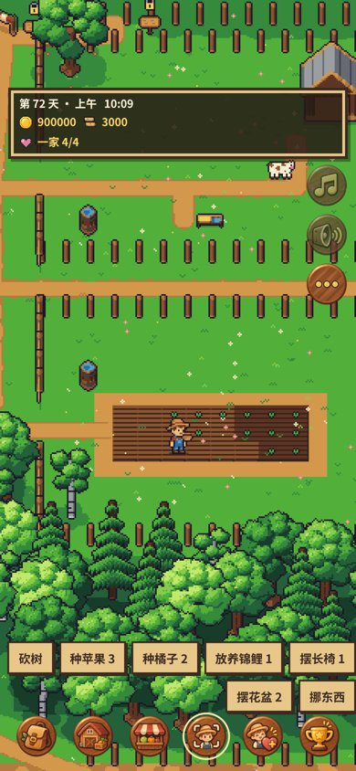
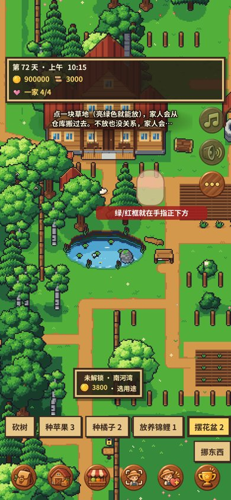
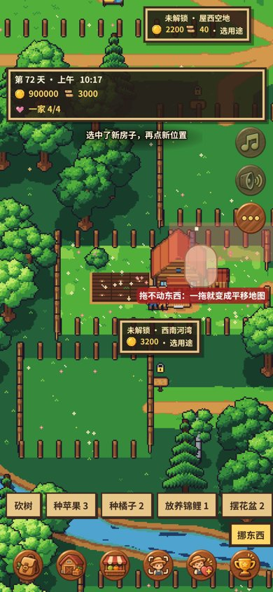
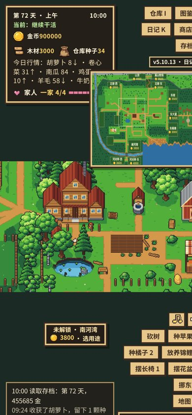
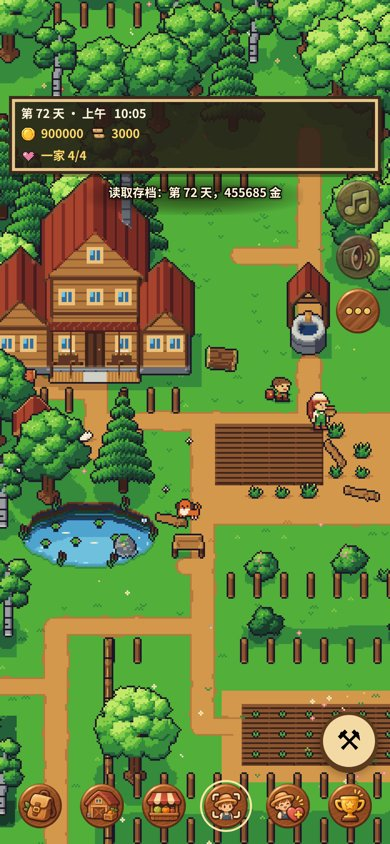
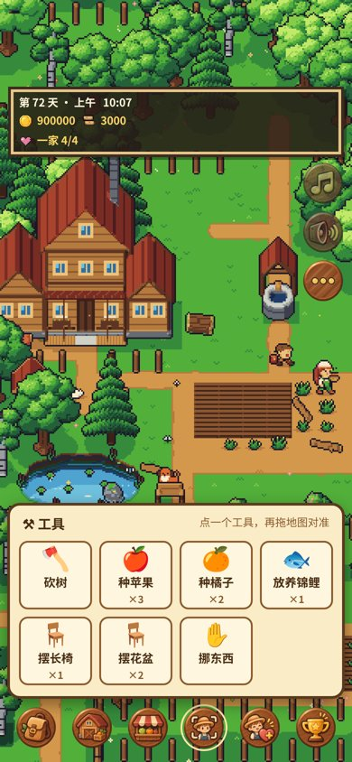
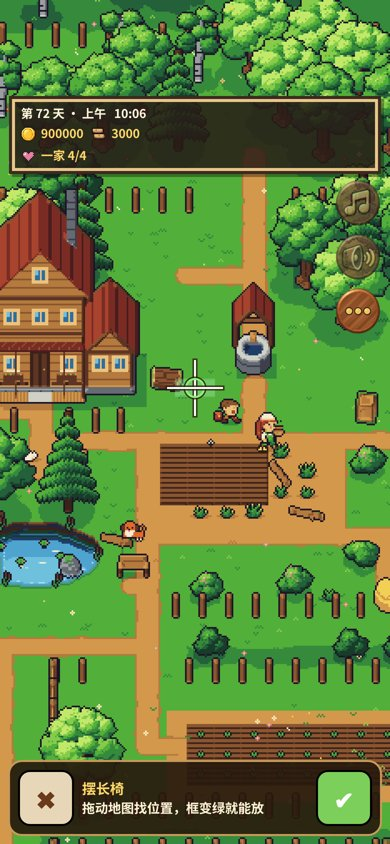
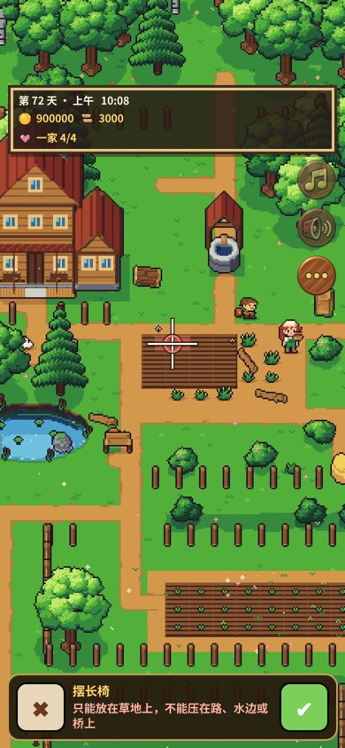
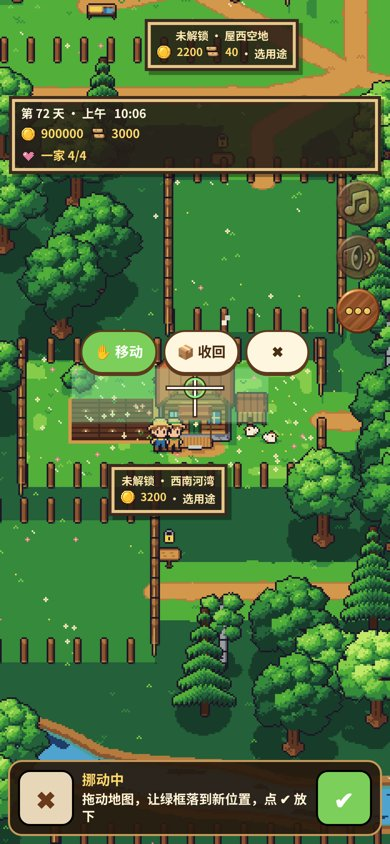

# 手机触屏操作优化计划（砍树 / 种树 / 放养 / 摆装饰 / 挪东西）

> 状态：**方案 + 粗糙原型**，分支 `feat/mobile-touch`，不合并。原型是 `touch.js`（一个独立文件，不改 game.js），截图脚本 `tools/touch-mock-shots.js`，体检脚本 `tools/touch-audit.js`。
> 起因（用户）：「咱们网页版有很多右下角 砍树/放东西/移动东西的交互，这个交互在手机上就不好操作了，看看怎么优化」

## 0. 体检：现在在手机上是什么样

在 390×844 @3x、`hasTouch/isMobile` 的手机视口里逐个点过（`node tools/touch-audit.js web|xhs`，用 CDP 发真触摸事件；存档用 `save-v15-day72-cottage.json`，给了斧头、树苗、锦鲤、长椅和花盆）。xhs 用的是 `port/xhs-1.2.0`（v5.10.12）打出来的包，web 是 main v5.10.13。

| 现在 | 截图 |
|---|---|
| xhs：工具按钮挤在底栏上方，两行 7 个 |  |
| xhs：摆花盆，绿/红框只在手指按住时出现，就在手指下面 |  |
| xhs：挪东西选中后想拖过去，结果是在平移地图 |  |
| web 在手机上：页面比屏幕宽，地图只剩中间一条，小地图压在上面，日志掉出屏幕 |  |

### 地图上的点选交互清单

| 交互 | 入口 | 现在怎么操作 | 手机上的问题 |
|---|---|---|---|
| 砍树 `chop` | #tools「砍树」 | 进模式后点野树，标记斧头；再点同一棵取消 | 点下去就生效，没有预览；手指盖住树和斧头标记；命中框 32 帧缓冲像素宽（xhs 上约 53px），想「确认一下」再点一次反而把标记取消了（实测偏 22px 点，提示「取消了砍树」） |
| 种苹果/种橘子 `plant` | #tools「种X n」 | 点空草地 | 预览（绿/红点）只在 pointermove 时更新，手机上手指没按下就没有预览；点错只有一条提示 |
| 放养锦鲤 `release` | #tools「放养锦鲤 n」 | 进模式后点池塘（web v5.10.13 金鱼已改成买了自动放，锦鲤还要点） | 池塘常在屏幕外（xhs 1.2.0 已经会把镜头移回池塘）；提示原来只写在 title 里 |
| 摆装饰 `decor` | #tools「摆X n」，**每种装饰一个按钮** | 点草地，亮绿就能放 | 框只在按住时出现、在手指正下方；按钮数量随装饰种类增长 |
| 挪东西 `move` | #tools「挪东西」 | 点一下选中，再点新位置；工坊会画出所有工坊院 | 只能两次点，不能拖：一拖就是平移地图；小装饰选取半径 6 世界单位（xhs 上约 20px 半径）；取消只能再点同一个东西或 Esc |
| 浇水器 `sprinkler` | #tools | 选一个再点新位置 | 同挪东西 |
| 撤销 | 「指令 n ✕」「要搬的 n ✕」 | 一下全清 | 没有确认，误触就全没了 |
| 地块改建、修路、地块购买 | 木牌标签 → 商店/地块面板 | 面板里点按钮 | 不是地图点选，手机上基本可用（不在本计划范围） |
| 平移 | 单指拖 | 5px 阈值区分点按和拖动 | 手指点按常常晃 6–10px，实测晃 6px 的点按被当成拖动，什么都没发生，也没提示 |
| 旋转 | 右键拖 / Shift+拖 / Q E ← → | | web 触屏完全转不了；xhs 有双指旋转（mobile.js） |
| 缩放 | 滚轮 | | web 触屏不能缩放；xhs 有双指捏合 |
| 悬停提示 | 按钮 title、hover 预览 | | 手机没有悬停：提示看不到（xhs 用 toast 补了，但长句被截成「…家人会…」） |
| 快捷键 | Esc 退出模式、M 地图、K 日记、R 回家、WASD | | 手机都没有；退出模式没有可见按钮 |

### 实测数字（xhs 1.2.0，390×844）

- 1 世界单位 ≈ 3.33 CSS px；工具按钮 36px 高；7 个工具按钮占两行、78px 高，正压在地图下沿。
- 进入模式前 `hover = null`：不按下就没有任何预览；按住时才有绿/红框，位置在手指正下方。
- **跟随农夫时地图会自己漂**：进入砍树模式 1.5 秒内，房子在屏幕上移动了 110px。瞄准的时候目标在走，点下去就点歪了。现在只有拖动地图才关跟随。
- 挪东西：选中后单指拖动 → 地图平移，东西不跟手，选中状态还在，屏幕上看不出下一步该干嘛。
- web 手机版：小地图 x 184..414、日志 y 777..910，超出 390×844；画布是中间 266px 高的一条。

### 痛点排名

1. **点下去就生效，事先看不到会放在哪**，而且手指正好盖住目标（种树、摆装饰、挪东西、砍树都是）。
2. **跟随镜头在瞄准时漂移**（xhs 默认跟随）——点不准的头号原因之一。
3. **挪东西不能拖、拖了反而平移地图**，取消方式看不见。
4. **工具按钮一排排堆在底部**：每种装饰一个按钮，越玩越多；激活状态不明显；没有可见的「退出」；提示在 title 里。
5. **5px 点按阈值太严**，手指晃一下点按就丢了，还没有任何反馈。
6. 小东西选不中（小装饰、浇水器、蜂箱选取半径约 20px）。
7. web 触屏没法旋转、缩放；放东西的朝向和遮挡跟镜头角度有关。
8. 一键清空没有确认。
9. （web）手机布局本身是坏的，地图只剩一条，先要有手机布局才谈得上触屏工具。

## 1. 统一的「工具模式」方案（推荐）

一句话：**选工具 → 底部操作条 + 屏幕中间固定准星 → 拖地图对准 → ✔ 确认**。所有工具用同一套。

| ⚒ 收起后 | ⚒ 打开 | 摆长椅：准星下是空草地 | 准星在路上：✔ 后提示原因 | 挪东西：选中后浮出按钮 |
|---|---|---|---|---|
|  |  |  |  |  |

### 1.1 ⚒ 工具箱（取代 #tools 一排按钮）
- 手机上 #tools 整排收起，换成右下角一个 58px 的 ⚒ 圆按钮（xhs 放在底栏上方右侧，避开右上角系统按钮和右侧 ♪ / ••• 竖排）。有新工具可用时角标提示。
- 点开是一个工具面板：4 列大图标格子（76px 高），图标 + 名字 + 剩余数量（×3）。装饰合并成一个「摆装饰」格子，点进去再选哪件（解决按钮随装饰种类增长的问题）；原型里还没合并。
- 「撤销全部指令」「撤销要搬的」放在面板底部，点了先确认（「撤销 5 个砍树/种树指令？」）。
- 面板只是重新排版：每个格子触发 ui.js 里原来的按钮，逻辑不复制（原型就是这么做的）。

### 1.2 底部操作条
- 进入任何工具模式，底部图标栏让位，换成一条操作条：左 ✖（退出 / 取消选中），中间两行字（工具名 + 现在该做什么，或刚才为什么不行），右 ✔（确认）。按钮 56×56。
- 提示不再靠 title / toast：原来的 `pf:say` 失败原因（「只能放在草地上…」）直接显示在操作条里，红色，2.4 秒后回到操作提示。
- 连续操作：砍树、种树确认后留在模式里（还有树苗就继续），摆装饰用完自动退出——跟现在一样。

### 1.3 准星 + 预览
- 准星固定在屏幕中间偏上（46% 高度）：拇指在下半屏拖地图，准星永远不被手指挡住，也不压 HUD。
- 每帧把准星位置当作「悬停」点交给游戏（现有的 `hoverAt`），所以现有的绿/红框、斧头标记、种树点、工坊院轮廓都直接出现在准星下；准星中心圈同步变绿/变红。
- **进入工具模式时关掉跟随镜头**，退出后恢复（解决漂移）。
- 吸附：摆放用 `placeOk` 返回的吸附坐标画预览（已有），正式版再加一个「幽灵」半透明物件图，比现在的细框更好认。
- 点地图的快捷方式：工具模式里**轻点地图某处 = 把那一点平移到准星下**（预览随之出现），不直接下单；再按 ✔ 才算。这样「点哪放哪」的直觉还在，但永远有预览、永远能反悔。砍树例外：命中框够大（53px），轻点野树直接切换标记，和现在一样快。
- 单指拖 = 平移、双指 = 缩放/旋转（xhs 已有），工具模式下手势不变，没有冲突。

### 1.4 选中物件 → 浮动小按钮
- 挪东西模式里，准星对准一个东西按 ✔（或直接轻点它）= 选中；它头顶浮出「✋ 移动」「📦 收回」「✖」三个 44px 胶囊按钮。
- 「移动」：东西跟着准星走（幽灵 + 绿/红），拖地图找位置，✔ 放下。家人照旧会走过去搬。
- 「收回」：放回仓库（新功能，需要一个 `orderThing('store', …)`；原型里只是占位提示）。
- **长按**（480ms，期间没移动）地图上的可挪物件：不用先开工具箱，直接进入挪东西并选中它，轻震一下。
- 选取半径放大：手机上按 CSS px 算，至少 22px 半径（约 44pt 目标），小装饰、浇水器、蜂箱都按这个下限。

### 1.5 点按阈值和反馈
- 点按/拖动阈值手机上改成 10 CSS px（鼠标仍是 5）；工具模式里多数操作走 ✔，阈值的影响本来就小了。
- 触感：先探测 `xhs.miniTool.vibrateShort` / `navigator.vibrate`，有就轻震（选中、确认、出错），没有就跳过。小红书 API 里有没有震动没查到官方文档，**不依赖它**。

### 1.6 和 xhs 外壳怎么接
- 代码放在网页版（新文件 `touch.js` + game.js 里几个小钩子），xhs 打包时自动带上（打包脚本从 index.html 读脚本清单）。
- 启用条件：`PFPlatform.mobile`（xhs）或 `(pointer: coarse)`（手机浏览器）或 `?touch`。电脑上什么都不变。
- xhs 外壳要配合的：工具模式时隐藏 `#xhs-bar` 和 `#xhs-toast`（操作条取代它们）；`wireToolHints` 里的 toast 改成写进操作条；放养锦鲤时把池塘移到准星下（现在是移到 45% 屏幕中间，改成准星位置即可）；⚒ 按钮放在 `--xhs-bottom-clear + --xhs-bar-h` 上方。奖杯/图鉴、没有存档按钮这些约定都不动。
- game.js 正式版要加的钩子（原型用合成 PointerEvent 代替）：`aimAt(clientX, clientY)`（= hoverAt）、`commitAt(clientX, clientY)`（= clickAt，返回结果而不是只 say）、`setFollow` 的模式联动、`movableAt` 的最小屏幕半径、`TAP_SLOP`。

## 2. 两种别的做法

### 方案 B：直接拖着放（手指上方的幽灵）
按住地图 → 幽灵出现在手指上方约 60px → 拖动调整 → 松手放下（或松手后按 ✔）。挪东西就是按住物件直接拖走。
- 好处：一个动作完成，最像「拿起来放下」，挪东西特别顺手。
- 坏处：工具模式里单指拖不能再平移地图（要改成双指平移或拖到边缘自动卷动），和 xhs 现有的单指平移/双指缩放旋转冲突最大；屏幕顶部 HUD、底部栏附近放不了东西；松手即下单容易误放；砍树这种「点目标」的工具用不上，等于两套交互。

### 方案 C：点一下出预览，再确认（不加准星）
工具模式里轻点 → 在点的位置留下幽灵预览（手指拿开后才看得清），可以再点别处换位置或拖幽灵微调，✔ 确认。
- 好处：改动最小（预览改成「点了才落、落了不消失」+ 操作条），直觉上就是现在的点哪放哪。
- 坏处：第一次点的时候还是看不到、盖住目标，总要点两三次；拖幽灵和拖地图要靠「按在幽灵上」区分，小东西又难按中。

### 推荐
**方案 1（准星 + 操作条）为主，吸收 C 的「轻点 = 把那点移到准星下」作为快捷方式，挪东西加长按选中**。理由：手指永远不挡目标、确认前永远有预览、单指平移/双指缩放旋转一个都不用改，砍树/种树/放养/摆装饰/挪东西/浇水器共用一套代码。B 的拖动手感好，但跟现有手势冲突太大，留到以后单独给「挪东西」试。

## 3. 工作量（估）

| 阶段 | 内容 | 估计 |
|---|---|---|
| 1 | game.js 钩子（aimAt / commitAt / 跟随联动 / TAP_SLOP / 最小选取半径）+ `touch.js` 正式版：⚒ 工具箱（装饰合并成一格）、操作条、准星预览、轻点=对准、撤销确认、触感探测；xhs 外壳接入；手机截图组 + 单测 | 1.5–2 天 |
| 2 | 挪东西：浮动按钮、长按选中、幽灵跟准星、「收回仓库」新指令（存档只追加字段，仍是 v15） | 1 天 |
| 3（可选） | 网页版手机布局：手机浏览器打开时借用 xhs 的手机外壳布局（全屏画布、底栏、HUD 收拢），否则网页版在手机上地图只剩一条 | 1–2 天 |

CI：新增 `shots (touch)` 小组（xhs 包 + `?touch` 网页各几张），控制在 25 分钟内。

## 4. 和在做的分支的冲突风险

- **PR #61（v5.11.0 小镇扩建）**：game.js 输入区（`setMode / hoverAt / clickAt / pointer*`）它没碰，ui.js 的 `tools()` 也没碰。冲突点只有 index.html：脚本 `?v=` 版本号整体改了、`#ui … {pointer-events:auto}` 那一长行加了 `#mmJump`。新增 `touch.js` 那一行和这行 CSS 会有小冲突，手工合一下即可。**建议等 #61 合并后再从 main 拉分支做正式版**。地图变大以后平移更多，小地图下面的跳转按钮（家/农家乐/小镇/海边）正好配合准星找位置。
- **feat/event-countdown**：改了 HUD（日期下面的倒计时）和 index.html 里小地图尺寸。准星放在 46% 高度、操作条在底部，不重叠；同样只有 index.html 的文本冲突。
- **platform/xhs / port/xhs-1.2.0**：mobile.js 的 `wireToolHints`（toast 提示、池塘居中）和 mobile.css 的 `#tools` 定位要改成配合 ⚒ 和操作条。正在送审准备的 xhs 1.2.0 **不要**带这套改动，放到下一版（和小镇扩建一起）。

## 5. 原型说明（不合并）
- `touch.js`：上面说的工具箱、操作条、准星、浮动按钮、长按，全部通过 ui.js 原有按钮和合成指针事件驱动，game.js 一行没改。`index.html` 末尾加了一行引用（只在触屏 / `?touch` / xhs 下生效）。
- 已知粗糙处：装饰没合并成一格；幽灵图没做（只有原来的细框 + 准星变色）；「收回」只是占位；准星下的合成 pointermove 在手指按住时暂停，正式版改成直接调钩子。
- 截图：`node tools/touch-mock-shots.js`（需要先在 port/xhs-1.2.0 上 `bash platforms/xhs/pack.sh`，`PF_XHS_DIST` 指向 dist）。
