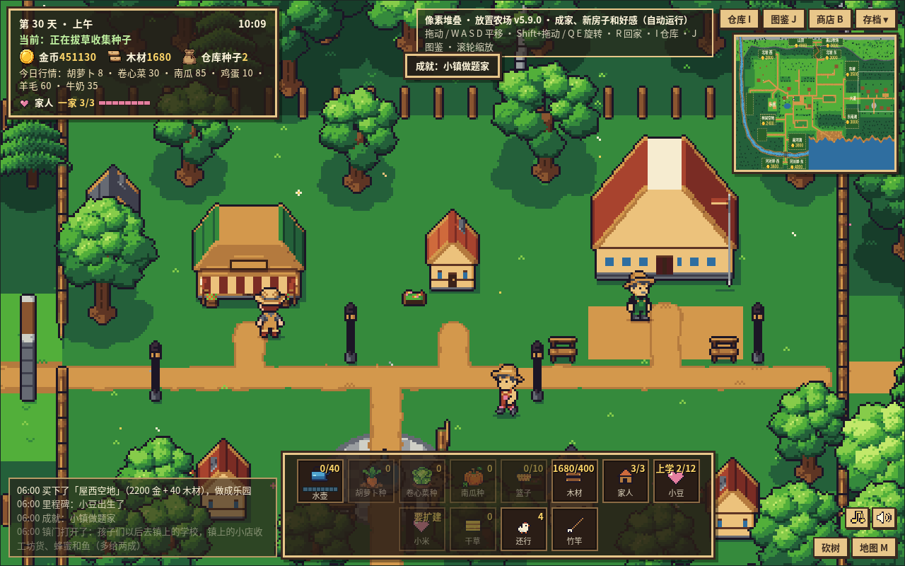
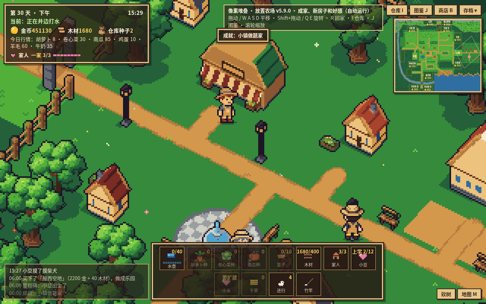
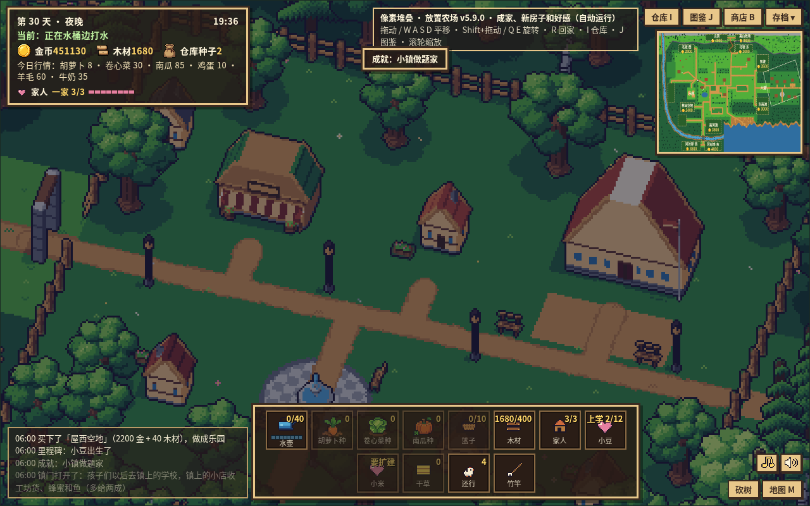

# 小镇充实计划（v5.9.x 打磨 + v5.10.x 起的小镇扩建）

> 状态：**规划稿，不含玩法代码**。基于 main（v5.9.0，第 11 阶段已合入）和玩家真实存档（第 82 天）。价格、天数都是初稿，可以改。
> 原则不变：挂机观看为主、偶尔轻决策、不需要微操；不因关注 / 分享 / 打赏给任何奖励；不扩地图（镇子仍在 x 448..632、y −16..150 这块里）。





## 0. 存档观察（真实存档，第 82 天，v5.8.1 → v5.9.0 迁移正常）

存档只在本机分析，**没有提交进仓库**。用 v5.9.0 读入：自动迁到存档 v15，没有报错、控制台干净；新房子 0 座（`cottage` 没买），数据都对得上。

| 项目 | 数据 | 说明 |
|---|---|---|
| 进度 | 第 82 天；22 次会话，累计约 25 小时实时；1× 下约 10 分钟一天 | 第 38–46 天开过一次 4×，之后一直 1× |
| 金币 | 现有 183,049；累计赚 429,613 | 最近 7 天日入 5.3k–9.6k（在线），离线 1–2 万 / 次 |
| 收入结构（第 72–81 天，约 10.4 万） | 在线部分作物约 83%、动物约 14%、果树 2–3%、鱼不到 1%；离线约 2.8 万；镇上小店多赚的合计只有 **2,121** | 加工坊的果酱 / 奶酪在 `crops` 以外几乎看不到存在感 |
| 买东西 | 第 66–71 天集中买完：16 块地全部选好模块、三间加工坊、派对区，第 71 天一次买了 41 件装饰（18 盏灯 + 10 盆花 + 6 条长椅…）和镇子 | **第 72 天起只花了干草（约 160/天）和种子（几百到 2,600/天），没买过任何东西**，金币 8.4 万 → 18.3 万只涨不花 |
| 木材 | 800 / 800 满仓 | 木材没有去处 |
| 树苗 | 苹果苗 31、橘子苗 31 堆在仓库，按钮「种苹果 31 / 种橘子 31」一直挂着 | 猫猫惊喜送的种子 / 树苗累积，没有地方种 |
| 惊喜 | 171 次（约 3 次 / 天，最多 9 次 / 天）；双黄蛋 58、猫送种子 34、金蛋 29、发光 26 | 双黄蛋占三分之一，日志刷屏感明显 |
| 闲置 | 第 54–62 天家人每天「休息」250–400 分钟；外扩以后降到 50–100 | 外扩前的空档期太长，现在节奏正常 |
| 离线 | 3 天上限 × 50%：离开 10.3 小时和离开 0.6 小时拿到的一样（8,941） | 睡一觉回来没有额外惊喜，属设计取舍，见第 1 节 |
| 小孩 | 小豆（kid0）第 48 天出生，上学功能上线时已是少年，从没上过学；小米上了 11 天 | 合理，不用补 |
| 帧率 | 日志平均 135 fps，第 63–65、80 天掉到 75–100；最低值总是 10（多半是切回标签页那一帧） | 见第 1 节「夜里灯多就卡」 |

**结论**：现在的瓶颈不是缺地，而是**钱和木材没有去处、镇子只是个摆设**。小镇扩建正好当作中后期的金币 + 木材出口，第 4 节的价格按「日入 8k、手里 15–20 万、木材常年满仓」来定。

## 1. 当前版本的打磨（建议先出 v5.9.1，不加新内容）

按影响排序，每条都能单独验收：

1. **夜里灯多就卡（性能）**：`lighting()` 每帧在 CPU 上逐像素填光照，灯越多越慢。真实存档主屋前有 18 盏灯，无头浏览器里同一画面中午渲染一帧 5.5 ms、晚上 88 ms（光照占 83 ms），镇上只有 2–4 ms。小红书真机会更明显。
   改法：光照层按「镜头位置 + 角度 + 灯的集合」缓存，只有变化时重算；屏幕外的灯不算；或者先半分辨率算再放大。验收：同一存档夜里一帧 < 15 ms（无头）。
2. **镇子夜里是死的**：镇上 5 盏路灯不进光照，窗户不亮，18 点以后一个人都没有。改法：镇上路灯和有人在家的窗户接入光照（在第 1 条的缓存之后做），林老师 / 阿松傍晚在广场坐到 20:30。
3. **工具栏挡画面**：东西一多，底部工具栏在 1280×800 下变成 4 列 × 5 行，正好挡在屏幕中间（真实存档截图里几乎盖住了半个镇子）。改法：单行，数量为 0 的格子收起来，多余的折进「更多」；镜头居中时把目标点往上抬。
4. **「欢迎回来」弹窗太勤**：离开 1 分钟也弹一个要点「好的」的框。改法：离开 < 10 分钟只在日志里写一行，不弹框。
5. **惊喜刷屏**：同一天同一种惊喜合并成一行（「今天母鸡下了 3 个双黄蛋」），双黄蛋的概率减半；种子 / 树苗满 20 以后猫猫改送别的（花、鱼食、装饰小物）。
6. **树苗堆着没处种**：「种苹果 31」一直挂着，说明可种的位置没了。改法：没位置时按钮变灰并说明原因；或者镇上的新功能区（第 3 节「集市」）可以收树苗。
7. **装饰扎堆在主屋前**：一次买 18 盏灯全挤在院子里。改法：灯优先沿着路摆，每块地最多几盏；第 3 节的「镇公所」上线后，多余的装饰可以「送给镇上」，摆到镇里的街上（买过的东西不浪费，镇子也变热闹）。
8. **镇上小店太弱**：10 天只多赚 2,121 金（同期总收入约 10.4 万）。改法：起送数从 3 降到 2，加上鸡蛋、羊毛、牛奶、松露和水果；真正的提升放到第 3 节的订单和集市日。
9. **木材满仓**：800/800 之后砍的木头全浪费。第 4 节的每一步都要木材，顺便把木材上限和木工坊挂钩。
10. **仓库卫生**：v5.9.0 把一个指向本机路径的 `tools/node_modules` 符号链接提交进了 main，别的工作树切分支会冲突。打磨版里删掉它（`.gitignore` 里本来就有 `node_modules/`）。
11. 离线上限（可选，待定）：现在离开 40 分钟和离开一晚上一样。可以把上限从「3 个游戏日」改成「8 个实时小时内按比例递减」，让睡一觉回来有一点期待。这条改经济，放到开放问题里。

## 2. 小镇本身：更多、更大的房子，更密的布局

**现状**：镇子 23×21 格里只有学校、小店、5 座一层小民居（12×10 世界单位，比学校小三圈）、一个喷泉和 5 盏灯。大半是草地和树，邻居 4 个，傍晚以后全回屋。

**布局（不扩地图）**：把镇子分成「主街北侧 / 主街南侧 / 广场一圈 / 东头学校区」四片，每片留出固定地块（L1–L12），新建筑只落在地块上，寻路和遮挡都按地块预先算好：

```
 y≈0   [L1 镇公所] [小店] [L2] [林老师家] [L3]   [学校 + 操场扩建 L4]
 y=66  ═══════════════ 主街 ═══════════════════════════════
 y≈90  [L5] [L6 面包房]  (广场 + 集市摊位 L7)  [L8] [L9 诊所]
 y≈120 [周婶家] [L10 木工坊] [L11]  [阿松家] [小桃家] [L12 图书馆]
```

- **房子更大、样式更多**：新做 3 种体素房，都比现在的民居大一圈，有二层：
  - 木构二层，带阳台和晾衣绳；
  - 砖石房，带阁楼窗和烟囱；
  - 「下店上住」的街边铺子，一楼是橱窗，二楼住人。
  
  现有 5 座民居随繁荣度（见第 3 节）逐步翻盖成二层：先搭脚手架，第二天变新房，和第 11 阶段搭新房子的表现一致。
- **更密**：主街两侧房子之间只留 1 格的巷子；南边的树减半，换成院子、篱笆和菜园。
- **街景小物**（都是小精灵或复用体素，不加大图）：水井、邮筒、花坛、晾衣绳、货箱、手推车、告示板、遮阳伞、猫在屋顶、炊烟。第 1 节第 7 条「送给镇上」的装饰也摆在这里。
- **镇民和作息**：邻居从 4 人加到 10 人左右，每新开一个功能区来一位店主。一天分早市、上课、午饭、下午、傍晚广场、关灯六段；集市日和节日另有一套。晚上 20:30 前广场一直有人。同屏人数控制在 12 人以内，远处的人简化绘制。

## 3. 新功能区（每个都带一点轻玩法）

**核心机制：镇子繁荣度 1–5**。镇公所门口有一块告示板，列出 2–3 个「建设项目」。玩家只需点一下选哪个先建（轻决策），镇民和家人就会自己去搭，需要一段时间。每建成一个项目，繁荣度就往上走，解锁下一批项目和镇子外观的变化（房子翻盖、路面铺石板、节日）。不用玩家盯着，也没有失败。

| 功能区 | 谁在那 | 加的玩法（全部自动结算） |
|---|---|---|
| **镇公所 + 告示板** | 新邻居 · 镇长 | 建设项目、繁荣度、「送给镇上」的装饰；每周一张镇子小报（日志里一段话，写这周镇上发生了什么） |
| **集市广场（扩建现有广场）** | 周婶 + 流动摊贩 | 每 7 天一个「集市日」：家里的生鲜和加工品在集市上多卖 15–25%，大人一早推车去，傍晚回来；摊位越来越多，镇外有人来逛；可以收余下的树苗和鱼 |
| **面包房 / 小饭馆**（小桃的店） | 小桃 | 订单板：每天给出 2 个订单（例如「6 份面粉 + 4 个鸡蛋」），玩家点一个接下，或者开「自动接最划算的」。按单交货多付 50%，再加好感，交货由家人跑腿。不接也没有惩罚 |
| **木工坊**（阿松） | 阿松 | 用木材做家具 / 装饰 / 镇上的长椅，木材上限 +400；是镇上各项目需要木材的来源 |
| **铁匠铺** | 新邻居 · 铁匠 | 一次性升级，钱的大出口：浇水器范围、加工坊提速、斧头三级、鱼竿三级、手推车（集市日多带货） |
| **学校扩建** | 林老师 | 操场和第二间教室；每 14 天一次运动会（孩子们赛跑，家人去看，派对区同款的热闹）；上学日的好感翻倍 |
| **图书馆 / 书屋** | 新邻居 | 孩子放学顺路看书（上学日 +1）；图鉴里没收集到的条目给出提示；加工坊配方（例如「苹果派」需要面粉和苹果）给面包房订单用 |
| **诊所 / 兽医** | 新邻居 · 医生 | 动物、猫狗心情的下限更高；生病这类负面机制**不做**，只做「每月体检，开心值 +」这种正向事件 |
| 码头 | — | **不选**：镇子这块没有水，硬加要扩图；鱼统一去集市 |

**节日（自动发生，用来看热闹）**：集市日每 7 天一次；运动会每 14 天一次；丰收节每 28 天一次（镇上摆长桌，家里所有人去，当天收入按集市日结算）；灯会要铁匠铺和木工坊都建好，在丰收节晚上举办，路灯和串灯全亮，所以要等第 1 节第 1 条的性能问题修完。

## 4. 分步顺序（每步都能单独验收、看得见变化）

价格依据：在线日入约 8k，手里 15–20 万，木材常年满仓。目标是这一轮在 30–40 个游戏日（1× 下约 5–7 个实时小时）里，把现在攒着的钱和后面的收入都有个去处。每一步都只追加存档字段，读旧档会补默认值。

| 版本 | 内容 | 价格 / 解锁 | 看得见的变化 |
|---|---|---|---|
| **v5.9.1** 打磨 | 第 1 节第 1–10 条 | 免费 | 夜里不卡、镇上有灯、工具栏变窄、日志不刷屏 |
| **v5.10.0** 镇公所 + 第一批房子 | 告示板、繁荣度 1→2；3 座新的二层房（项目各 8,000 金 + 120 木材）；新来 3 位邻居；街景小物第一批；「送给镇上」 | 镇子已买 | 搭脚手架 → 新房；街上人变多 |
| **v5.10.1** 集市广场 + 集市日 | 广场扩大、6 个摊位、每 7 天一次集市日 | 30,000 金 + 200 木材；繁荣度 2 | 集市日一早大人推车出门，广场挤满人 |
| **v5.10.2** 面包房 + 订单板 | 小桃的店，每天 2 个订单（可选自动接） | 25,000 金 + 150 木材；繁荣度 2 | 家人送货的身影、订单完成的日志 |
| **v5.10.3** 木工坊 + 铁匠铺 | 木材上限 +400；铁匠铺 5 项一次性升级（每项 8k–25k） | 木工坊 20,000 金 + 300 木材；铁匠铺 35,000 金 + 100 木材；繁荣度 3 | 烟囱冒烟、打铁火光，工坊门口堆着木料 |
| **v5.10.4** 学校扩建 + 图书馆 | 操场、运动会、书屋 | 学校 40,000 金 + 200 木材；书屋 25,000 金 + 150 木材；繁荣度 3→4 | 运动会、孩子们在操场上跑 |
| **v5.10.5** 诊所 + 老房翻盖 | 诊所；原有 5 座民居翻成二层（每座 12,000 金 + 150 木材，可分批） | 诊所 30,000 金；繁荣度 4→5 | 整条街换成二层房，路面铺石板 |
| **v5.10.6** 丰收节 + 灯会 | 每 28 天一次丰收节，晚上办灯会 | 繁荣度 5 | 全镇亮灯，一家人吃长桌宴 |

合计约 30 万金 + 2,000 多木材。每一步上线前都要：单元测试（纯规则放在 `town.js` 及其拆分文件里）、无头截图和检查脚本（在 `town-shots.js` 的基础上加）、真实存档读入不报错；夜景先要过第 1 节第 1 条的帧数验收。小红书包里，每个功能区的美术都放进后续分包。

## 5. 开放问题（需要你拍板）

1. **订单和集市日要不要玩家点一下？** 一种是「每天在告示板上点一个订单 / 集市日选带哪类货」（轻决策），另一种是全自动、只看热闹。我倾向于默认自动，留一个可选的「我来挑」。
2. **优先做哪 3 个功能区？** 我建议的顺序是：集市 → 面包房 → 木工坊 / 铁匠铺；学校扩建、图书馆、诊所放在后面。要不要调？
3. **离线上限改不改？** 现在离开 40 分钟和离开一晚上收益一样；要不要改成按实时小时递减（例如最多 8 小时），让过夜回来有点期待？这条会抬高经济，改的话第 4 节的价格要上调约两成。
