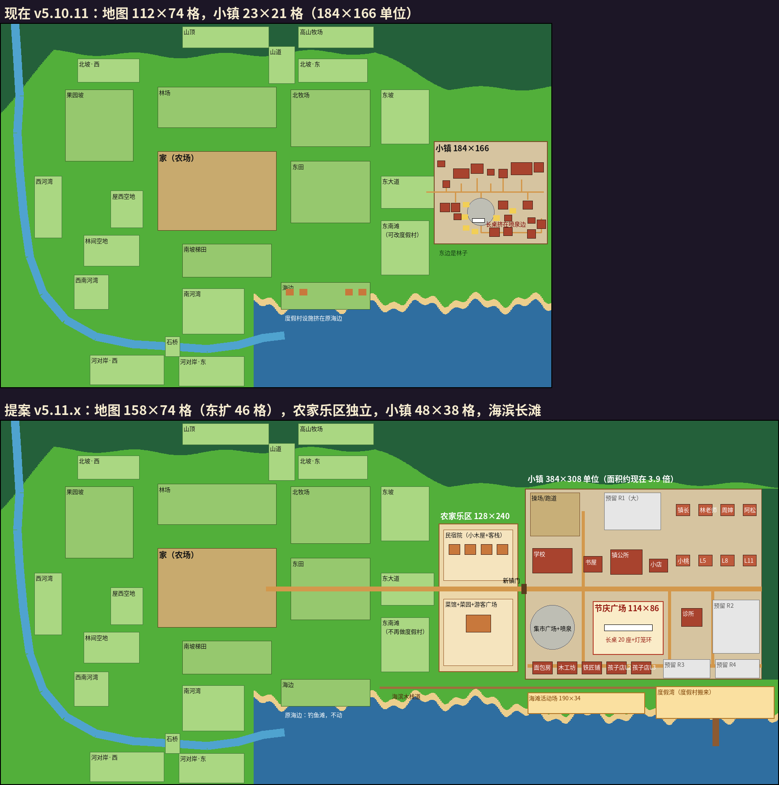
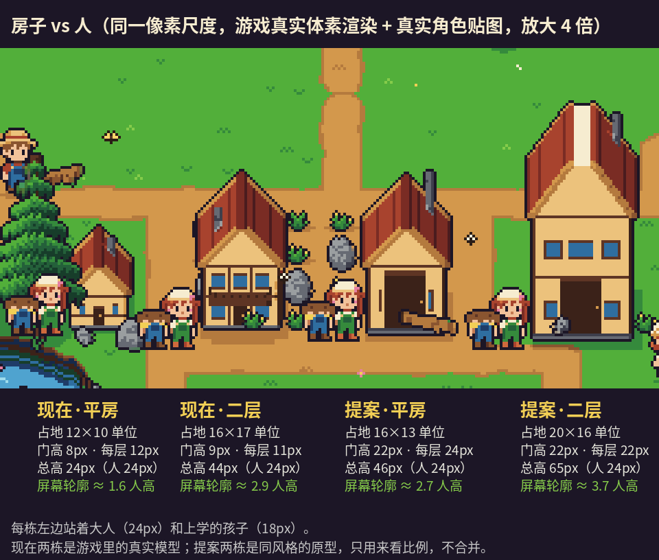

# 小镇放大方案（v5.11.x）

> 状态：**已定稿**（2026-11-19 用户拍板，见第 6 节）。v5.11.0（第一阶段：地图、小镇新布局、房子加高、节庆广场、小地图跳转）已做完，见 README「v5.11.0 小镇放大」；v5.11.1 农家乐区也做完了（版本号用 v5.11.0.5，见 README「v5.11.0.5 农家乐区」；和下面 5 节的差别：没有单独的「买农家乐区」，开了镇门就能盖，第一间小木屋就是开张；老民宿的地块不清空设施而是保留旧 mod「空院子」并免费改建一次），v5.11.2 海湾还没做。基于 main `9b49292`（v5.10.11 丰收节已合并）。
> 起因：玩家（用户）反馈「小镇整张图偏小，房子只有 1.5 人高；想整体放大、房子做大、多留区域方便以后加功能；农家乐应该单独一块地，不要占掉已有地块；海边要办活动太小」。

两张图都可以重新生成：俯视图由 `map.json` 导出现在的真实坐标（world.js / plots.js / town.js / hall.js / careers.js / market.js / festival.js / inn.js）后画出；房子图是在游戏里真实渲染的（用游戏自己的 `buildModel` / `gableY` 和角色贴图），提案的两栋房子只是同风格的原型，不合并。

---

## 1. 现在的尺寸（实测）

单位约定：1 格（tile）= 8 世界单位；屏幕上 1 世界单位 = 2 像素（`RS = 2`）；体素模型 1 体素 = 1 屏幕像素；镜头纵向压缩 `K = 0.75`。

| 项目 | 数值 | 出处 |
|---|---|---|
| 整张地图 | x −256..640，y −208..384 → **896 × 592 单位 = 112 × 74 格** | `world.js WORLD` |
| 家（农场） | 192 × 128 单位 = 24 × 16 格 | `world.js HOME` |
| 小镇范围 | x 448..632，y −16..150 → **184 × 166 单位 ≈ 23 × 21 格**（约 3.05 万平方单位） | `town.js RECT` |
| 小镇里的建筑 | 18 栋（5 栋老房、3 块镇公所地块、2 间孩子小店、小店、学校、镇公所、面包房、木工坊、铁匠铺、书屋、诊所），占地合计 3,612 平方单位，**占小镇面积 11.8%**；再加上集市广场（半径 22）和 6 个摊位，主街两侧基本没有空地了 | town/hall/careers/... |
| 丰收节长桌 | 在 (520,112)，紧贴喷泉广场（半径 15，有集市时 22）南边，只有 **8 个座位**，和集市摊位挤在一起，看不清 | `festival.js TABLE/SEATS` |
| 大人角色 | 帧 28×28，实际不透明部分 **24 px 高**（含帽子）；上学的孩子去掉 6 行 → **18 px** | `assets/sprites.js`，`game.js cut` |
| 老平房（h1–h5 原样） | 占地 12 × 10 单位，模型 24×20×24 体素：**门高 8 px（只有大人的 1/3）**，墙高 12 px，屋顶连烟囱 24 px；屏幕轮廓（屋顶高 + 进深×0.75）≈ 39 px ≈ **1.6 个人**，正是「1.5 人高」的来源 | `town-art.js house` |
| 现在的二层（翻盖后 / 镇公所地块） | 占地 16 × 17 单位，模型 32×34×44：**门高 9 px，每层只有 11 px**，轮廓 ≈ 69 px ≈ 2.9 人 | `town-art.js twoStorey` |
| 海边（钓鱼滩） | 围起来的沙滩 144 × 44 单位（18 × 5.5 格），外面一条 152 × 40 的水域；度假村 4 间小屋、8 把伞、海鲜摊、游客栈桥、观景台**全挤在这一块里** | `world.js coast`，`inn.js resortLayout` |
| 东南滩 | 78 × 88 单位地块；想要度假村必须把它**改建成「度假村」**，原来的农田 / 花甸 / 工坊就没了（地块本身一点不用，只当开关） | `plots.js eshore`，`inn.js RESORT_PLOT` |
| 民宿 | 必须占掉 5 块地之一（林间空地 / 南河湾 / 河对岸·西 / 河对岸·东 / 东坡），改建成「民宿院」，等于**拿掉一块农田或牧场** | `inn.js INN_PLOTS` |
| 北边界 | 镇子东边山崖线已经平在 y ≈ −105（`ridgeY` 在 x>470 封顶），所以小镇往北最多到 y ≈ −96 | `plots.js ridgeY` |
| 走路 | 7 单位 / 游戏分钟（`WALK = 7`，1× 时 1 秒 = 3 游戏分钟）。农场 → 学校门 ≈ 466 单位 ≈ **67 游戏分钟**；农场 → 丰收节长桌 ≈ 416 单位 ≈ **59 游戏分钟** | `game.js`，`town.js schoolRoute` |
| 屏幕能看到多少 | 网页 426×266 帧缓冲 ≈ 213 × 177 单位；小红书竖屏 240×426 ≈ **120 × 284 单位**。现在整个小镇在网页上差不多一屏，竖屏要横着拖两屏 | `game.js W/H`，`platforms/xhs/README.md` |
| 地面画布 | 世界 + 28 单位边 → 1904 × 1296 px ≈ 2.47 M 像素（RGBA 约 9.9 MB），`ground()` 每次重建跑约 2.5M 次 | `game.js GM`，`expansion.js` |

结论：房子显小的主要原因不是占地，而是**门和每层太矮**（门只有人的 1/3）；地图显小是因为 18 栋房子 + 集市 + 节日都挤在 23×21 格里，而且东边已经没有地方再加东西。

## 2. 新布局

总原则（沿用 v5.5 / v5.8 的老规矩）：**x < 448 的一切坐标不动**（家、7 个区域、16 块外圈地块、河、桥、山道、钓鱼海边）。玩家存档里所有带坐标的东西（树、装饰、喷头、院子杂物、工坊、成家孩子的小家）都在这一侧，所以完全不用搬。只有 x ≥ 448 的东边整条重画；那边的东西在存档里都是**按 id / 数量 / 序号**记的，不记坐标（见第 3 节）。

### 2.1 地图

| | 现在 | 提案 |
|---|---|---|
| 世界范围 | x −256..640 | x −256..**1008**（东扩 46 格），y 不变 |
| 总大小 | 112 × 74 格 | **158 × 74 格**（面积 ×1.41） |
| 东边 448..1008 | 小镇 + 一圈林子 | **农家乐区**（456..584）+ **新镇门**（x≈596）+ **小镇**（596..980）+ 东侧林边 |
| 海岸 | x>155 一条，岸线 y≈250 | x<540 不变；x>540 岸线往南平滑推 22 单位，留出 **50 单位深的沙滩带**，从 x 360 一直连到 1008 |

### 2.2 房子尺寸（见房子比例图）

目标：**门和大人一样高**，平房约 2.5 人、二层约 3.5 人（屏幕轮廓）。占地只放大 1.2–1.35 倍，主要加高。

| | 占地（单位） | 门高 | 每层 | 总高 | 轮廓 |
|---|---|---|---|---|---|
| 老平房 现在 | 12 × 10 | 8 px | 12 px | 24 px | 1.6 人 |
| **平房 提案** | **16 × 13** | **22 px** | 24 px | 46 px | **≈2.7 人** |
| 二层 现在 | 16 × 17 | 9 px | 11 px | 44 px | 2.9 人 |
| **二层 提案** | **20 × 16** | **22 px** | 22 px | 65 px | **≈3.7 人** |
| 学校 / 镇公所 / 诊所 / 作坊等公共建筑 | 统一 ×1.4 占地，层高同上（22–24 px） | | | | |

二层轮廓 3.7 人比「2.5–3 人」略高；如果要压到约 3 人，把屋顶坡度从 0.75 降到 0.5、每层 20 px 即可（见「待定 2」）。

### 2.3 小镇内部（x 596..980，y −96..212，384 × 308 单位 ≈ 48 × 38 格，面积约现在的 **3.9 倍**）

一条 8 单位宽的主街（y = 66，和东大道是一条直线）把镇子分成南北两半，南边再加一条工坊街（y = 190），两条南北小街（x = 690 / 830）。

| 片区 | 位置 | 内容 |
|---|---|---|
| 学校区（西北，紧挨镇门） | 604..720 × −90..56 | 学校（64×40）、书屋、操场 + 跑道（运动会）。放在门口是为了让孩子上学少走路 |
| 镇中心（北） | 724..820 × −90..56 | 镇公所、小店；**预留 R1（大，92×60）** |
| 民居（东北） | 840..980 × −76..30 | 两排 × 4 块：5 栋老房 + L5 / L8 / L11，每块 28×24 |
| 集市广场（西南） | 圆心 (640,128)，半径 36（现在 22） | 喷泉 + 6 个摊位 + 以后集市日扩到 10 个 |
| **节庆广场（南中）** | **706..820 × 86..172（114 × 86）** | **丰收节长桌独占**：桌长 78 单位、两边 **20 个座位**（现在 8 个），四周一圈灯笼柱，北侧小舞台；平时空着当散步广场，不跟集市共用 |
| 诊所（东） | (866,112) | 门口留出石阶和长椅 |
| 工坊街（南） | y = 190 一排 | 面包房、木工坊、铁匠铺、孩子小店 L2 / L3 |
| **预留地块** | R1 724..816 × −90..−30；R2 900..976 × 84..170；R3 820..896 × 180..210；R4 904..976 × 180..210 | 先立「待开发」木牌，不带玩法。以后的新功能（例如邮局、戏台、车站、温泉）直接落在这里，不用再挪别人 |

### 2.4 农家乐区（独立，不再占老地块）

位置 456..584 × −40..200（128 × 240，比林间空地大 5 倍），东大道从中间穿过去，游客一进镇门前就路过。
- 北半边「民宿院」：4 间小木屋一排 + 二层客栈升级位，每间门口两盆花一盏灯（固定槽位）。
- 南半边：农家菜馆（加厨房位）、菜园、游客小广场（以后可放烧烤 / 采摘活动）。
- 买法：在「农家乐」页直接买「农家乐区」，**不再要求把某块地改建成民宿院**；价格、繁荣度 3 的门槛照旧。

### 2.5 海边

- 原来的海边（200..344）**只留钓鱼**：码头、海竿全不动。
- 沿 y ≈ 226 修一条海滨木栈道，从东南滩脚下（x 360）一直到 1008。
- **海滩活动场** 600..790 × 234..268（190 × 34，钓鱼滩的 1.3 倍长），就在小镇南门外：篝火、沙滩排球网、海滩节舞台、放烟花的位置。以后加「海滩节」（建议每 28 天，和丰收节错开 14 天）就在这里办。
- **度假湾** 808..1000 × 224..276：度假村整体搬来。小屋位 4 → 6，伞位 8 → 12，海鲜摊、游客栈桥（伸进海里 40 单位）、日落观景台都有固定槽位。
- 东南滩不再有「度假村」这个选项，只做农田 / 花甸 / 工坊。

### 2.6 走路时间（7 单位 / 游戏分钟）

| 路线 | 现在 | 提案 | 处理 |
|---|---|---|---|
| 农场 → 学校门 | ≈466 单位，67 分钟 | ≈514 单位，**73 分钟（+6）** | 学校放在镇门口，基本不变 |
| 农场 → 丰收节长桌 | ≈416，59 分钟 | ≈674，96 分钟 | 「石板主街 / 东大道走得快 1.3 倍」（沿用 `yardWalk` 那种倍率）→ 约 77 分钟；节日出发时间提前 20 分钟 |
| 农场 → 民宿（经营民宿的孩子） | 林间空地 ≈200，29 分钟 | 农家乐区门口 ≈300，**43 分钟** | 可以接受；排班开始时间提前 15 分钟 |
| 小镇 → 度假湾（游客、海鲜摊的人） | 镇门 → 老海边 ≈330 | 镇南门 → 度假湾 ≈150 | 反而更近 |
| 寻路网格 | 224 × 148 格 | 316 × 148 格（+42%） | A* 缓存 256 条不变；回归测试量路径长度 |

### 2.7 镜头和小地图

- `clampCam` 用的是 `WORLD`，扩图后自动能拖到东边；要加的是**小地图快捷跳转**：在小地图下面加「家 / 农家乐 / 小镇 / 海滩」4 个按钮（竖屏尤其需要）。
- 小地图比例 0.5 → 画布宽 448 → 632 px；网页右上角放不下，改成**按容器宽度缩放**（竖屏也一样）。
- 不加缩小档（不加速、不改像素比例）；放大档（滚轮 0..3）照旧。

## 3. 存档迁移（saveVersion 继续 15，只追加字段）

### 3.1 先确认存档里有什么坐标

用 4 份存档查过（`tools/fixtures/save-v10-day59-manor.json`、`save-v15-day72-cottage.json`、`/workspace/pf-saves/day81-save-and-log.txt`、`/workspace/pf-saves/friend/pixel-farm-save.json`）：

| 存档里的东西 | 记法 | 扩图后 |
|---|---|---|
| 树、装饰、喷头、院子杂物、工坊、成家孩子的小家（`home.houses[].x/y`） | 坐标，全部在 x < 448（两份真实存档里 x ≥ 448 的树都是 0 棵） | 不动 |
| 镇公所项目、小店地块、面包房 / 木工坊 / 铁匠铺 / 学校 / 书屋 / 诊所 | `town.hall.built` 里的 id，`town.lots` 里的 id | 按 id 落到新坐标 |
| 送给镇上的装饰 | `town.hall.gifts` 按序号排槽位（`slots.js TOWN`） | 新槽位表**每一组的数量都不能比现在少**，否则读档校验会丢礼物；测试里加断言 |
| 民宿 | `inn.cabins / inn2 / diner / guests[].room` 都是数量和序号 | 按序号落到农家乐区的槽位 |
| 度假村 | `inn.resort.huts / parasols / stall / pier / deck` 数量 | 按序号落到度假湾槽位（6 / 12 个位，只会多不会少） |
| 丰收节 | `festival` 里只记天数 | 不受影响 |
| 人当时站的位置 | 读档时如果在 x ≥ 448，挪到最近的门口 / 镇门 | 一次性修正 |

结论：**不需要改写任何坐标**，迁移只是「换一张布局表」加两件事（民宿、度假村搬家），新增字段：
- `town.layout: 2`（像 `settings.decorLayout` 一样，标记已经换过新布局，提示只弹一次）
- `plots[id].free: 1`（这块地可以免费改建一次）
- `inn.where: 'agri'`、`inn.moved: 天数`

注意 `plots.js validPlots` 会把不认识的 mod 改成第一个选项：民宿院 / 度假村从地块选项里拿掉以后，**旧存档里的 `inn` / `resort` 要放进一张「旧 mod」表**，否则读档时会被悄悄改成「农田」。`validPlots` 也要保留新的 `free` 字段。

### 3.2 已经把老地块改成民宿院的玩家

1. 小木屋、客栈、菜馆、厨房、住着的客人按数量 / 序号原样搬到农家乐区，星级、留言簿、收入全保留；正在施工的（`inn.job`）在新位置接着盖完。
2. 原来那块地（林间空地等）还给玩家，显示「空院子（可以免费改建一次）」，`free: 1`。点开选农田 / 果园 / 花甸……**不收改建费**。在玩家选之前，这块地什么也不产出，家人也不会去干活。
3. 弹一次说明：「民宿搬到镇门口的农家乐区了，原来那块地还给你，可以免费改成别的」。

### 3.3 东南滩已经是「度假村」的玩家

1. 度假村的所有设施按序号搬到度假湾，住着的客人保留房号。
2. 东南滩标成 `free: 1`，可以免费改成农田 / 花甸 / 工坊；同时**补偿当初改建的钱：750 金 + 10 木材**（东南滩 3,000 金 × 25% + 10 木，就是改成度假村那一步的价钱；不管当初是不是买地时直接选的度假村，都给，免得查不清）。
3. 「度假湾」对这些玩家直接开放，不再收钱。

### 3.4 4 份存档逐个过一遍

| 存档 | 情况 | 迁移结果 |
|---|---|---|
| fixture v10 第 59 天庄园 | 还没开地块、没开镇子 | 只换地图，没有可迁移的东西 |
| fixture v15 第 72 天小家 | 林间空地是花甸，成家孩子的小家在林间空地 (−68,160)，镇子没开 | 不动 |
| 用户的第 81 天存档（v14） | 16 块地全买了，东南滩是农田，镇子开了，没有民宿 / 度假村 | 镇子按新布局；地块全不变 |
| 朋友的存档（v15） | 东南滩是工坊，磨坊 + 果酱铺在东南滩，镇子开了 | 东南滩不动，工坊照常运转；镇子按新布局 |

现有存档里没有民宿和度假村，所以搬民宿 / 度假村的那一版（v5.11.1 / v5.11.2；v5.11.0 两者都不动，所以这一版还没做）要新做一份 `tools/fixtures/save-v15-inn-resort.json`（民宿院在林间空地 + 东南滩是度假村 + 2 间海边小屋 + 住着客人），专门测 3.2 / 3.3。真实存档不进仓库。

## 4. 性能和手机屏幕

| 风险 | 估算 | 对策 / 验收 |
|---|---|---|
| 地面画布变大 | (1264+56)×2 = 2640 × 1296 ≈ 3.42 M 像素（+38%，约 13.7 MB）；`ground()` 每次重建 +38% | 只按脏矩形重建（已有）；新增东边区域走快速分支。验收：全量重建时间 ≤ v5.10.11 的 1.45 倍 |
| `expansion.js` 的分桶网格写死了 x ≤ 532（`BX0 = −300, BW = 52`） | 超出部分退回慢路径 | 改成按 `WORLD` 算 `BW`（52 → 84） |
| 更高的体素模型 | 平房体素 1.15 万 → 3.8 万，每个新角度建一次切片约 3.3 倍；镇上大楼约 25 栋 | 叠片缓存 `STK_BUDGET` 16 M 像素够用（每栋每角度约 5 千像素）；空闲时预热大楼的循环（`w*d*h ≥ 8000`）会多处理一些楼，要分帧做。验收：`tools/fps.js` 在小镇里空闲 / 旋转帧率 ≥ v5.10.11 的 90%；`night-bench.js`（灯更多）同样 ≥ 90% |
| 高房子挡人 | 二层 65 px，后面的街和人会被挡住 | 人在楼后时楼半透明（只对小镇大楼），或保证主要动线在楼前；截图检查 4 个镜头角度 |
| 网页 426×266 | 一屏 ≈ 213 × 177 单位，小镇要拖 2 × 2 屏 | 小地图快捷跳转 |
| 小红书竖屏 240×426 | 一屏 ≈ 120 × 284 单位，小镇要横拖约 3 屏 | 快捷跳转按钮放在底栏上方；竖屏截图验收：镇门、节庆广场、度假湾各一张，无 UI 重叠 |

## 5. 分阶段

每一版都照之前的规矩：单独分支、早开草稿 PR、存档只追加、4 份存档 + 所有 fixture 读得出来、不加速、「家人帮忙添置」不买镇上 / 民宿 / 度假村 / 铁匠铺的东西、装饰用固定槽位、版本号和缓存参数、文档、CI 分组里加测试、经济曲线和上一版比、`v511x_` 截图、中文总结。

### v5.11.0　地图放大 + 小镇新布局 + 房子加高 + 节庆广场
- `WORLD.x1` 640 → 1008；东边林子和山崖延长；海岸线东段往南推。
- 小镇新坐标（`town.js`、`hall.js`、`careers.js`、`market.js`、`festival.js`、`school.js`、`library.js`、`clinic.js`、`bakery.js`、`woodshop.js`、`smithy.js`、`slots.js TOWN`），新镇门 x ≈ 596；东大道接到新镇门。东大道还没修到的玩家看到的镇门也在新位置。
- 所有镇上建筑按 2.2 节加高；预留地块立牌子。
- 丰收节长桌搬到节庆广场，20 个座位，灯笼环。
- 石板主街 / 东大道走路 ×1.3；小地图缩放 + 4 个跳转按钮；分桶网格跟着 `WORLD`。
- 迁移：`town.layout = 2`、读档时挪人。
- **验收**：4 份存档 + 全部 fixture 读档后金币、木材、`hall.built`、礼物数、`lots`、孩子上学天数完全相同；农场 → 学校 ≤ 80 游戏分钟（测试量）；丰收节一家人 18:00 前全部入座；`fps.js` / `night-bench.js` ≥ v5.10.11 的 90%；地面全量重建 ≤ 1.45 倍；经济曲线第 30 / 60 / 90 天和 v5.10.11 相差 ≤ 3%；截图：小镇全景 4 个角度、节庆广场白天 + 夜里、房子和人同框、竖屏 3 张。

### v5.11.1　农家乐独立成区
- 新的「农家乐区」，在「农家乐」页直接买；地块选项去掉「民宿院」，旧值进「旧 mod」表。
- 老民宿整体搬家；老地块 `free: 1`，免费改建一次；说明弹窗。
- 新 fixture `save-v15-inn-resort.json`。
- **验收**：老民宿玩家读档后小木屋数、客栈、菜馆等级、星级、留言、住着的客人全部一样，原地块显示可免费改建且改建花 0 金；新玩家买农家乐不占任何地块；游客从东大道进来、在农家乐区入住、第二天早上离开；经济曲线相差 ≤ 3%；截图：农家乐区满配白天 / 夜里、空院子改建界面。

### v5.11.2　海滨长滩 + 度假湾 + 海滩活动
- 海滨木栈道、海滩活动场、度假湾；度假村搬到度假湾（小屋 6、伞 12）；东南滩去掉度假村选项，补偿 750 金 + 10 木，`free: 1`。
- 海滩活动先做一个：「海滩节」每 28 天，和丰收节错开 14 天；白天沙滩排球、堆沙堡比赛，晚上篝火。
- **验收**：老度假村玩家设施数、客人房号保留，补偿只发一次（重复读档不重复发）；钓鱼滩的码头和钓鱼完全不变；海滩节当天一家人和游客都到场、不和丰收节同一天；夕阳光照在新海岸上没有硬边；`fps.js` 在海边 ≥ 90%；竖屏截图。

## 6. 用户的决定（2026-11-19）

1. **小镇整体往东搬**，镇门口空出来给农家乐区（按第 2 节推荐布局）。
2. **房子尺寸按方案**：门和大人一样高，平房约 2.7 人，二层约 3.7 人。
3. **度假湾**：新玩家 **8,000 金 + 繁荣度 3** 才能开（v5.11.2 做），代替原来「把东南滩改成度假村」那一步；已经有度假村的老玩家免费。
